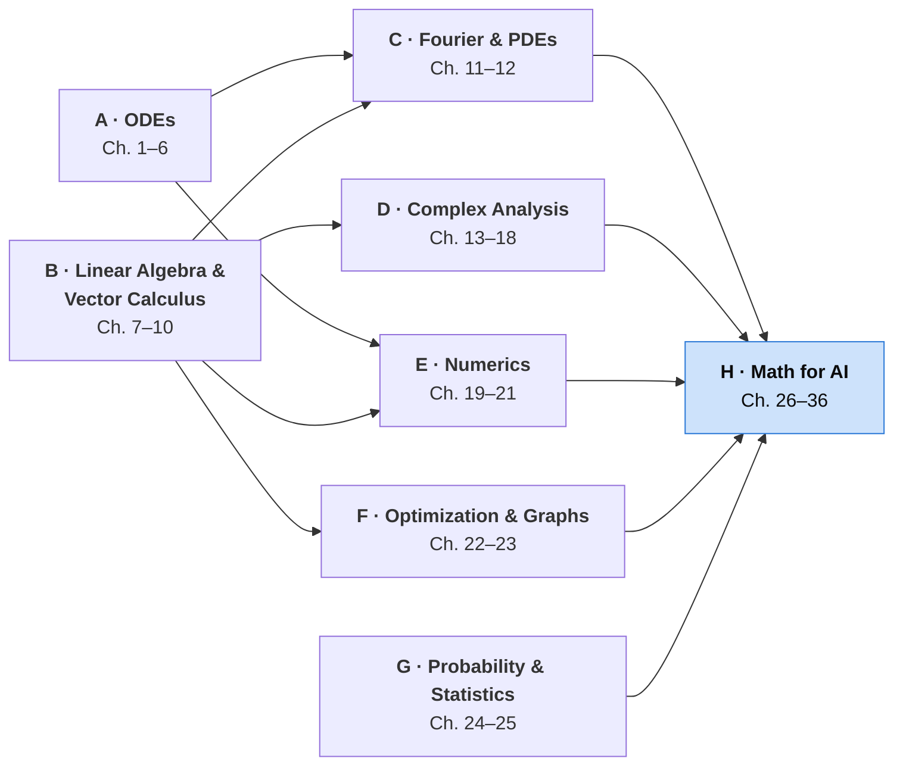
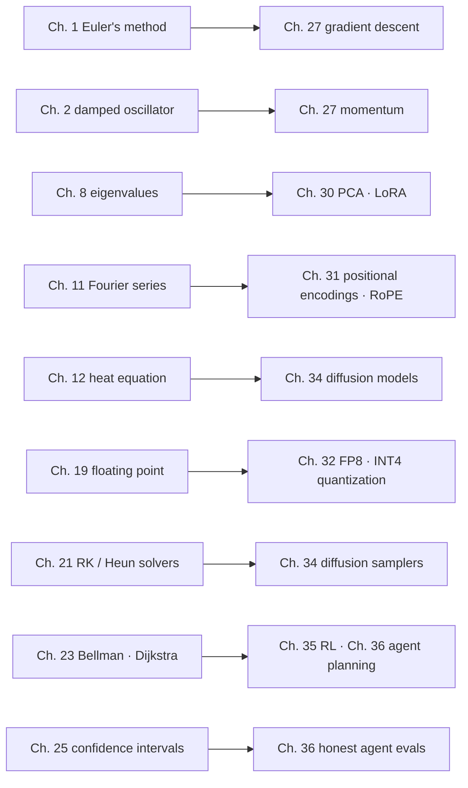

# Advanced Engineering Mathematics: A Visual Knowledge Base

> *Engineering and AI share one toolkit. These 36 one-page chapters take you from first-order ODEs to quantized transformers and agent workflows.*

This repository is a **one-page-per-chapter companion** organised around the table of contents of Erwin Kreyszig's *Advanced Engineering Mathematics* (10th ed.). Every topic in the book's 25 chapters is summarised in its own words, with figures, flowcharts and AI connections. An additional **Part H** extends the book into the mathematics behind modern AI: autodiff, optimisation, information theory, quantization, efficient inference, diffusion models, reinforcement learning and agentic workflows.

Each chapter aims to **build intuition, not replace the book.** For proofs, worked examples and exercises, open Kreyszig at the section numbers listed in each chapter's ✅ checklist.

---

## 🗺️ The map



### Bridges: where classic engineering math reappears in AI



---

## 📚 Chapters

### Part A · Ordinary Differential Equations

| # | Chapter | In one line |
|---|---|---|
| 1 | [First-Order ODEs](chapters/part-a-odes/01-first-order-odes.md) | Slope fields, separable/exact/linear ODEs; the logistic curve and the sigmoid are the same function |
| 2 | [Second-Order Linear ODEs](chapters/part-a-odes/02-second-order-linear-odes.md) | Springs, RLC circuits, resonance; momentum optimisers behave like damped springs |
| 3 | [Higher-Order Linear ODEs](chapters/part-a-odes/03-higher-order-linear-odes.md) | Characteristic roots determine whether solutions grow, decay or oscillate |
| 4 | [Systems of ODEs · Phase Plane](chapters/part-a-odes/04-systems-phase-plane.md) | Trace and determinant classify a system's fate; links to state-space models and GAN dynamics |
| 5 | [Series Solutions · Special Functions](chapters/part-a-odes/05-series-solutions-special-functions.md) | Legendre and Bessel functions: drums, antennas, spherical harmonics |
| 6 | [Laplace Transforms](chapters/part-a-odes/06-laplace-transforms.md) | Turns calculus into algebra; steps, impulses, convolution |

### Part B · Linear Algebra · Vector Calculus

| # | Chapter | In one line |
|---|---|---|
| 7 | [Matrices, Vectors, Determinants, Linear Systems](chapters/part-b-linear-algebra-vector-calculus/07-linear-algebra-matrices-systems.md) | Rank decides the fate of Ax = b; the language of every neural layer |
| 8 | [Matrix Eigenvalue Problems](chapters/part-b-linear-algebra-vector-calculus/08-eigenvalue-problems.md) | Directions a matrix only stretches: PageRank, PCA, Hessians |
| 9 | [Vector Differential Calculus: Grad, Div, Curl](chapters/part-b-linear-algebra-vector-calculus/09-vector-differential-calculus.md) | ∇ gives slope, outflow and swirl; backprop computes ∇L |
| 10 | [Vector Integral Calculus: Integral Theorems](chapters/part-b-linear-algebra-vector-calculus/10-vector-integral-calculus.md) | Green, Gauss and Stokes are one theorem: what is inside equals what crosses the boundary |

### Part C · Fourier Analysis · Partial Differential Equations

| # | Chapter | In one line |
|---|---|---|
| 11 | [Fourier Analysis](chapters/part-c-fourier-pdes/11-fourier-analysis.md) | Every signal is a sum of sines; FFT, JPEG, positional encodings |
| 12 | [Partial Differential Equations](chapters/part-c-fourier-pdes/12-partial-differential-equations.md) | Waves, heat and potentials; the heat equation reappears inside diffusion models |

### Part D · Complex Analysis

| # | Chapter | In one line |
|---|---|---|
| 13 | [Complex Numbers & Functions](chapters/part-d-complex-analysis/13-complex-numbers-functions.md) | Multiplication is rotation; Cauchy–Riemann; RoPE |
| 14 | [Complex Integration](chapters/part-d-complex-analysis/14-complex-integration.md) | Boundary values determine every value inside (Cauchy's formula) |
| 15 | [Power Series · Taylor Series](chapters/part-d-complex-analysis/15-power-series-taylor-series.md) | The radius of convergence is the distance to the nearest pole |
| 16 | [Laurent Series · Residue Integration](chapters/part-d-complex-analysis/16-laurent-series-residue-integration.md) | Hard real integrals evaluated by summing residues |
| 17 | [Conformal Mapping](chapters/part-d-complex-analysis/17-conformal-mapping.md) | Angle-preserving maps; Joukowski airfoils; Smith charts |
| 18 | [Complex Analysis & Potential Theory](chapters/part-d-complex-analysis/18-complex-analysis-potential-theory.md) | Electrostatics, heat and flow from one complex potential |

### Part E · Numeric Analysis

| # | Chapter | In one line |
|---|---|---|
| 19 | [Numerics in General](chapters/part-e-numerics/19-numerics-in-general.md) | Floating point, Newton's method, splines, quadrature; stable softmax |
| 20 | [Numeric Linear Algebra](chapters/part-e-numerics/20-numeric-linear-algebra.md) | LU, iteration, condition numbers, least squares, power method |
| 21 | [Numerics for ODEs & PDEs](chapters/part-e-numerics/21-numerics-odes-pdes.md) | Order, stability, stiffness; diffusion samplers are ODE solvers |

### Part F · Optimization · Graphs

| # | Chapter | In one line |
|---|---|---|
| 22 | [Unconstrained Optimization · Linear Programming](chapters/part-f-optimization-graphs/22-optimization-linear-programming.md) | Steepest descent zig-zags; the LP optimum is at a vertex |
| 23 | [Graphs · Combinatorial Optimization](chapters/part-f-optimization-graphs/23-graphs-combinatorial-optimization.md) | Dijkstra, spanning trees, max-flow; Bellman's principle |

### Part G · Probability · Statistics

| # | Chapter | In one line |
|---|---|---|
| 24 | [Data Analysis · Probability Theory](chapters/part-g-probability-statistics/24-data-analysis-probability.md) | Bayes, distributions, the CLT; weight initialisation follows from variance rules |
| 25 | [Mathematical Statistics](chapters/part-g-probability-statistics/25-mathematical-statistics.md) | Estimation, confidence intervals, tests, regression; error bars for benchmarks |

### Part H · Mathematics for AI, Agents & Efficient Models *(beyond Kreyszig)*

| # | Chapter | In one line |
|---|---|---|
| 26 | [Matrix Calculus, Tensors & Autodiff](chapters/part-h-math-for-ai/26-matrix-calculus-autodiff.md) | Jacobians, forward vs reverse mode; backprop is the chain rule on a graph |
| 27 | [Optimization for ML](chapters/part-h-math-for-ai/27-optimization-for-ml.md) | Convexity, SGD → Adam, Lagrange/KKT, schedules, calculus of variations |
| 28 | [Information Theory](chapters/part-h-math-for-ai/28-information-theory.md) | Entropy, cross-entropy, KL, perplexity; prediction is compression |
| 29 | [Bayesian Inference, Sampling & Monte Carlo](chapters/part-h-math-for-ai/29-bayesian-inference-sampling.md) | Priors as regularisers, MCMC, variational inference, error ∝ 1/√N |
| 30 | [Low-Rank Methods: SVD, PCA, Embeddings, LoRA](chapters/part-h-math-for-ai/30-low-rank-svd-pca.md) | Rotate, stretch, rotate; keep the biggest stretches |
| 31 | [Neural Networks & Transformers](chapters/part-h-math-for-ai/31-neural-networks-transformers.md) | Attention, √d scaling, RoPE, parameter/FLOP counting, scaling laws, decoding |
| 32 | [Number Formats & Quantization](chapters/part-h-math-for-ai/32-number-formats-quantization.md) | FP8/FP4/INT4, scales and zero-points, outliers, GPTQ/AWQ/SmoothQuant, QAT |
| 33 | [Model Compression & Efficient Inference](chapters/part-h-math-for-ai/33-efficient-inference.md) | Roofline, KV cache, FlashAttention, pruning, distillation, speculative decoding |
| 34 | [Stochastic Processes & Diffusion Models](chapters/part-h-math-for-ai/34-stochastic-processes-diffusion.md) | Brownian motion, Itô, Fokker–Planck; diffusion models reverse the heat equation |
| 35 | [Reinforcement Learning](chapters/part-h-math-for-ai/35-reinforcement-learning.md) | Bellman equations, policy gradients, bandits, RLHF/DPO/GRPO |
| 36 | [Agentic Workflows](chapters/part-h-math-for-ai/36-agentic-workflows.md) | Reliability as pⁿ, voting, verify-and-retry, search, latency tails, honest evals |

### Appendix

| | | |
|---|---|---|
| A3 | [Formula Sheet](chapters/appendix/A3-auxiliary-formulas.md) | Special functions, series, and grad/div/curl/∇² in cylindrical and spherical coordinates |

---

## 🧭 Reading paths

Pick a destination and follow the arrows. Each path takes about 1–2 hours.

| Goal | Path |
|---|---|
| **Understand transformers end to end** | 7 → 8 → 9 → 26 → 28 → 31 → 13 (RoPE) |
| **Quantization & efficient inference** | 19 → 20 → 7 → 30 → 32 → 33 |
| **Diffusion & generative models** | 1 → 12 → 21 → 24 → 29 → 34 |
| **Agents, planning & RL** | 23 → 24 → 25 → 28 → 35 → 36 |
| **Training dynamics & optimizers** | 1 → 2 → 4 → 22 → 26 → 27 |
| **Classic engineering core** | 1 → 2 → 6 → 7 → 9 → 10 → 11 → 12 → 19 → 21 |
| **Signals & systems** | 2 → 6 → 11 → 13 → 16 |

---

## 🧩 Anatomy of a chapter

Every page follows the same layout, so you always know where to look:

| Section | What you get |
|---|---|
| **Hook** | the one idea to remember |
| 🧭 **Big picture** | why the topic exists, in two or three paragraphs |
| 📈 **Figures** | plots generated from code, with light and dark variants that match your GitHub theme |
| 🗺️ **Concept map / flowchart** | how the ideas connect, or which method to use when |
| 🔑 **Core ideas** | section-by-section summary with the key formulas |
| 💡 **Aha! moments** | surprising connections, many of them to AI |
| 🤖 **Where it shows up** | engineering and AI applications side by side |
| ⚠️ **Pitfalls** | the mistakes everyone makes |
| 🧪 **Try it** | a short, runnable Python snippet |
| ✅ **Book coverage** | checklist of the Kreyszig sections covered |

---

## 🛠️ Regenerating the figures

All 39 figures (78 SVGs, light and dark) are generated from code in [`scripts/figures/`](scripts/figures/):

```bash
pip install -r requirements.txt
```

```bash
python scripts/figures/build_all.py            # everything (~2 min)
```

```bash
python scripts/figures/build_all.py ch32 ch33  # just some chapters
```

Colours follow one fixed, colour-blind-checked categorical palette (`scripts/figures/style.py`). Each figure is drawn twice, and the Markdown serves the right version with `<picture>` and `prefers-color-scheme`.

---

## 📖 About the source

- The structure follows Kreyszig, *Advanced Engineering Mathematics*, **10th edition** (Wiley, 2011), which is the latest edition. The 9th edition has essentially the same structure.
- The summaries, figures and examples here are original. For depth, rigour and exercises, use the book.
- Part H covers material outside Kreyszig, the mathematics behind modern AI systems. Where it cites specific results (Chinchilla scaling constants, GPTQ, DPO, pass@k and others), the paper is named in the text.
