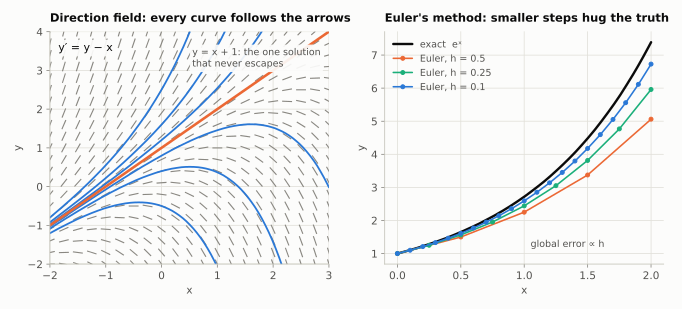
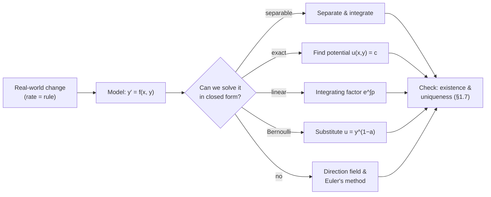
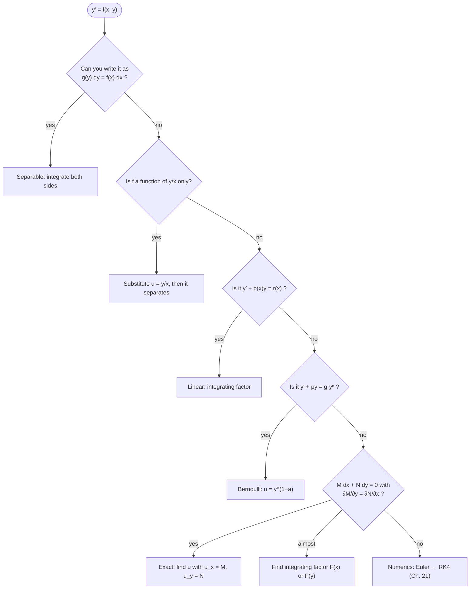

# 1 · First-Order ODEs

> *An ODE is a rule that gives the slope at every point. Solving it means finding the curves that follow that rule everywhere.*

**Part A · Ordinary Differential Equations** · Kreyszig §1.1–1.7 · ⏱ ~10 min · Prereqs: derivatives and integrals
[← Index](../../README.md) · [Next: Second-Order Linear ODEs →](02-second-order-linear-odes.md)

---

## 🧭 The big picture

Most laws of nature say **how things change**, not what they are. Some examples: cooling coffee, a draining tank, a growing population, the charge on a capacitor. A first-order ODE

```math
y' = f(x, y)
```

turns each of these into one line of mathematics. The whole chapter rests on one picture: at every point $(x, y)$ you draw a short line with slope $f(x,y)$, and every solution is a curve that follows those lines.

<p align="center">
  <picture>
    <source media="(prefers-color-scheme: dark)" srcset="../../assets/figures/ch01-direction-field-euler-dark.svg">
    
  </picture>
</p>

## 🗺️ Concept map



## 🔑 Core ideas, section by section

| § | Idea | The one formula to remember |
|---|---|---|
| 1.1 | **Basic concepts & modeling**: order, general vs particular solution, initial value problem (IVP) | $y' = ky \Rightarrow y = y_0 e^{kx}$ (growth or decay) |
| 1.2 | **Direction fields & Euler's method**: the geometry of $y' = f$, and the first numerical method | $y_{n+1} = y_n + h\,f(x_n, y_n)$ |
| 1.3 | **Separable ODEs**: put every $y$ on one side and every $x$ on the other | $\int g(y)\,dy = \int f(x)\,dx + c$ |
| 1.4 | **Exact ODEs & integrating factors**: $M\,dx + N\,dy = 0$ is the differential of some $u$ | exact $\iff \partial M/\partial y = \partial N/\partial x$ |
| 1.5 | **Linear ODEs, Bernoulli, population dynamics** | $y = e^{-h}\left(\int e^{h} r\,dx + c\right),\ h = \int p\,dx$ |
| 1.6 | **Orthogonal trajectories**: curves that cross a family at right angles | replace $y' = f$ by $y' = -1/f$ |
| 1.7 | **Existence & uniqueness (Picard–Lindelöf)** | $f$ and $\partial f/\partial y$ continuous $\Rightarrow$ exactly one solution |

### The three equations you will meet everywhere

**Linear first-order ODE.** Multiply by the integrating factor $e^{\int p\,dx}$ and the left side becomes one derivative:

```math
y' + p(x)\,y = r(x) \quad\Longrightarrow\quad \left(e^{\int p\,dx}\, y\right)' = e^{\int p\,dx}\, r(x)
```

**Bernoulli equation.** $y' + p y = g y^{a}$ turns linear after the substitution $u = y^{1-a}$.

**Logistic (Verhulst) equation.** Growth that saturates at a carrying capacity:

```math
y' = Ay - By^2 \quad\Longrightarrow\quad y(t) = \frac{A/B}{1 + c\,e^{-At}}
```

### Which method should I use?



## 🧩 Classic models

| Model | ODE | Behaviour |
|---|---|---|
| Radioactive decay, drug clearance | $y' = -ky$ | half-life $t_{1/2} = \ln 2 / k$ |
| Newton's law of cooling | $T' = -k\,(T - T_{\text{room}})$ | exponential approach to room temperature |
| Torricelli's law (draining tank) | $h' = -c\sqrt{h}$ | empties in **finite** time |
| Mixing tank | $y' = (\text{in}) - (\text{out})$ | settles to an equilibrium concentration |
| RL circuit | $L I' + R I = E(t)$ | time constant $L/R$ |
| Logistic population | $y' = Ay - By^2$ | S-curve that settles at $A/B$ |

## 💡 Aha! moments

- **The logistic curve is the sigmoid.** $\sigma(t) = 1/(1+e^{-t})$ solves $\sigma' = \sigma(1-\sigma)$. Logistic regression and the old neural-network activation function are a population model from 1838.
- **Euler's method *is* gradient descent.** Gradient descent $\theta_{k+1} = \theta_k - \eta\nabla L(\theta_k)$ is one Euler step of the *gradient flow* ODE $\theta' = -\nabla L(\theta)$, with the learning rate $\eta$ as the step size $h$.
- **A ResNet layer is an Euler step too.** $x_{l+1} = x_l + f(x_l)$ discretises $x' = f(x)$. That observation led to *Neural ODEs* (2018).
- **Uniqueness explains why the solution curves never cross.** If two of them met, the IVP starting at the meeting point would have two solutions, and §1.7 rules that out.

## 🤖 Where it shows up

| Engineering | AI / computing |
|---|---|
| RC/RL circuits, heat loss, chemical kinetics, pharmacokinetics | Gradient flow, Neural ODEs, learning-rate warm-up as a damped system |
| Population and epidemic models (SIR starts here) | Exponential moving averages: $m_t = \beta m_{t-1} + (1-\beta) g_t$ is a discrete $m' = -k(m-g)$ |

## ⚠️ Pitfalls

- When you divide by $y$ to separate variables, you can silently lose the solution $y \equiv 0$.
- Uniqueness can fail. $y' = \sqrt{y}$ with $y(0) = 0$ has the solution $y = 0$ and also $y = x^2/4$, because $\partial f/\partial y$ blows up at $y=0$.
- Euler's method is only **first-order** accurate: halving $h$ only halves the error. Use RK4 when accuracy matters (Ch. 21).

## 🧪 Try it

```python
import numpy as np
f = lambda x, y: y - x                # the ODE y' = y - x
x, y, h = 0.0, 1.5, 0.1               # y(0) = 1.5
for _ in range(20):                   # Euler's method to x = 2
    y, x = y + h * f(x, y), x + h
exact = 2 + 1 + 0.5 * np.exp(2)       # y = x + 1 + 0.5 e^x
print(f"Euler: {y:.4f}  exact: {exact:.4f}")
```

## ✅ Book coverage

- [x] 1.1 Basic Concepts. Modeling
- [x] 1.2 Geometric Meaning of y′ = f(x, y). Direction Fields, Euler's Method
- [x] 1.3 Separable ODEs. Modeling
- [x] 1.4 Exact ODEs. Integrating Factors
- [x] 1.5 Linear ODEs. Bernoulli Equation. Population Dynamics
- [x] 1.6 Orthogonal Trajectories
- [x] 1.7 Existence and Uniqueness of Solutions for Initial Value Problems

---
[← Index](../../README.md) · [Next: Second-Order Linear ODEs →](02-second-order-linear-odes.md)
