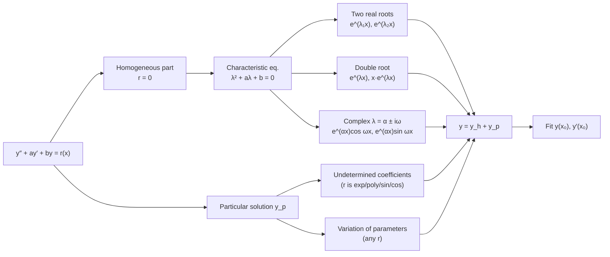
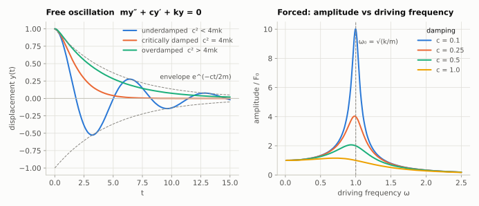

# 2 · Second-Order Linear ODEs

> *Springs, swings, circuits and suspension bridges all obey one equation. Learn it once and you can read every one of them.*

**Part A · Ordinary Differential Equations** · Kreyszig §2.1–2.10 · ⏱ ~12 min · Prereqs: [Ch. 1](01-first-order-odes.md), complex numbers ($e^{i\theta}$)
[← First-Order ODEs](01-first-order-odes.md) · [Index](../../README.md) · [Next: Higher-Order Linear ODEs →](03-higher-order-linear-odes.md)

---

## 🧭 The big picture

Newton's law $F = ma$ involves acceleration, a **second** derivative. So does almost everything that oscillates. The workhorse of this chapter is

```math
y'' + p(x)\,y' + q(x)\,y = r(x)
```

and the whole theory rests on one fact: **linear ⟹ superposition**. Solutions of the homogeneous equation ($r = 0$) form a 2-dimensional vector space. Find two independent ones and you have them all. Then

```math
\boxed{\;y = \underbrace{c_1 y_1 + c_2 y_2}_{y_h:\ \text{homogeneous}} + \underbrace{y_p}_{\text{any one particular solution}}\;}
```

## 🗺️ Concept map



## 🔑 Core ideas, section by section

| § | Idea | Key formula |
|---|---|---|
| 2.1 | **Homogeneous linear ODEs**: superposition, basis, reduction of order | $y_2 = y_1 \int \frac{e^{-\int p\,dx}}{y_1^2}\,dx$ |
| 2.2 | **Constant coefficients**: try $y = e^{\lambda x}$ | $\lambda^2 + a\lambda + b = 0$ |
| 2.3 | **Differential operators**: $D = d/dx$, so the ODE is $P(D)\,y = 0$ | $(D - \lambda_1)(D - \lambda_2)\,y = 0$ |
| 2.4 | **Free oscillations** of a mass–spring system | $my'' + cy' + ky = 0,\ \ \omega_0 = \sqrt{k/m}$ |
| 2.5 | **Euler–Cauchy equation**: try $y = x^m$ | $m^2 + (a-1)m + b = 0$ |
| 2.6 | **Existence, uniqueness, Wronskian** | $W = y_1 y_2' - y_2 y_1' \neq 0 \iff$ independent |
| 2.7 | **Nonhomogeneous ODEs**: undetermined coefficients | $r = k e^{\gamma x} \Rightarrow y_p = C e^{\gamma x}$, etc. |
| 2.8 | **Forced oscillations, resonance, beats** | amplitude peaks near $\omega \approx \omega_0$ |
| 2.9 | **Electric circuits (RLC)** | $LI'' + RI' + I/C = E'(t)$ |
| 2.10 | **Variation of parameters** | $y_p = -y_1\int \frac{y_2 r}{W}dx + y_2 \int \frac{y_1 r}{W}dx$ |

### The three cases of $\lambda^2 + a\lambda + b = 0$

| Discriminant $a^2 - 4b$ | Roots | Basis of solutions | Physical meaning |
|---|---|---|---|
| $> 0$ | real $\lambda_1 \ne \lambda_2$ | $e^{\lambda_1 x},\ e^{\lambda_2 x}$ | **overdamped**: slow creep back to rest |
| $= 0$ | double $\lambda = -a/2$ | $e^{\lambda x},\ x e^{\lambda x}$ | **critically damped**: fastest return with no overshoot |
| $< 0$ | $-a/2 \pm i\omega$ | $e^{-ax/2}\cos\omega x,\ e^{-ax/2}\sin\omega x$ | **underdamped**: rings, and the ringing decays |

<p align="center">
  <picture>
    <source media="(prefers-color-scheme: dark)" srcset="../../assets/figures/ch02-damping-resonance-dark.svg">
    
  </picture>
</p>

### Undetermined coefficients: a guessing table

| If $r(x)$ contains… | …guess $y_p$ = |
|---|---|
| $k e^{\gamma x}$ | $C e^{\gamma x}$ |
| $k x^n$ | $K_n x^n + \dots + K_1 x + K_0$ |
| $k\cos\omega x$ or $k\sin\omega x$ | $K\cos\omega x + M\sin\omega x$ |
| $k e^{\alpha x}\cos\omega x$ | $e^{\alpha x}(K\cos\omega x + M\sin\omega x)$ |

**Modification rule:** if your guess already solves the homogeneous ODE, multiply it by $x$, or by $x^2$ for a double root. **Sum rule:** if $r$ is a sum of such terms, add the guesses.

### One equation, two worlds

| Mechanical | $m\,y'' + c\,y' + k\,y = F(t)$ | Electrical (RLC) | $L\,I'' + R\,I' + \tfrac{1}{C}I = E'(t)$ |
|---|---|---|---|
| mass $m$ | inertia | inductance $L$ | inertia of current |
| damping $c$ | friction | resistance $R$ | dissipation |
| spring $k$ | stiffness | $1/C$ (inverse capacitance) | stores energy |
| force $F(t)$ | driver | $E'(t)$ | driver |

## 💡 Aha! moments

- **Euler's formula makes oscillation automatic.** Complex roots $\alpha \pm i\omega$ give $e^{(\alpha + i\omega)x} = e^{\alpha x}(\cos\omega x + i\sin\omega x)$, which is growth or decay multiplied by rotation.
- **Resonance with no damping grows without bound.** If $c = 0$ and you drive at exactly $\omega_0$, then $y_p = \frac{F_0}{2m\omega_0}\, t\sin\omega_0 t$, and the factor $t$ grows forever. Driving *near* $\omega_0$ instead gives **beats**.
- **Momentum in deep learning is a damped spring.** Heavy-ball momentum discretises $\theta'' + \gamma\theta' + \nabla L(\theta) = 0$. Too little friction (momentum near 1) gives overshoot and ringing. Too much gives a slow crawl. *Critical damping* is the sweet spot, and that is the intuition behind tuning $\beta$.
- **Myth check:** the 1940 Tacoma Narrows collapse is often blamed on simple resonance. Engineers attribute it to *aeroelastic flutter*, a self-excited oscillation, which is a richer phenomenon than this chapter's model.

## 🤖 Where it shows up

| Engineering | AI / computing |
|---|---|
| Car suspensions, building seismic isolators, MEMS accelerometers | Momentum / Nesterov optimisers as damped oscillators |
| RLC filters, radio tuning (resonance selects a station) | PID controllers for robots and autoscalers (critical damping = fastest settling) |
| Shock absorbers designed near critical damping | Second-order learning-rate warm-up and EMA dynamics |

## ⚠️ Pitfalls

- Forgetting the **modification rule** gives you $0 = r(x)$ and a contradiction.
- Apply initial conditions to the **full** solution $y_h + y_p$, not to $y_h$ alone.
- $W = 0$ at one point means $W \equiv 0$ on the interval (Abel's formula), and the two functions are dependent.

## 🧪 Try it

```python
import numpy as np
m, c, k = 1.0, 0.4, 1.0
disc = c**2 - 4*m*k
kind = "over" if disc > 0 else "critically " if disc == 0 else "under"
lam = np.roots([m, c, k])
print(f"{kind}damped, roots = {lam}")      # complex pair → rings while decaying
```

## ✅ Book coverage

- [x] 2.1 Homogeneous Linear ODEs of Second Order
- [x] 2.2 Homogeneous Linear ODEs with Constant Coefficients
- [x] 2.3 Differential Operators
- [x] 2.4 Modeling of Free Oscillations of a Mass–Spring System
- [x] 2.5 Euler–Cauchy Equations
- [x] 2.6 Existence and Uniqueness of Solutions. Wronskian
- [x] 2.7 Nonhomogeneous ODEs
- [x] 2.8 Modeling: Forced Oscillations. Resonance
- [x] 2.9 Modeling: Electric Circuits
- [x] 2.10 Solution by Variation of Parameters

---
[← First-Order ODEs](01-first-order-odes.md) · [Index](../../README.md) · [Next: Higher-Order Linear ODEs →](03-higher-order-linear-odes.md)
