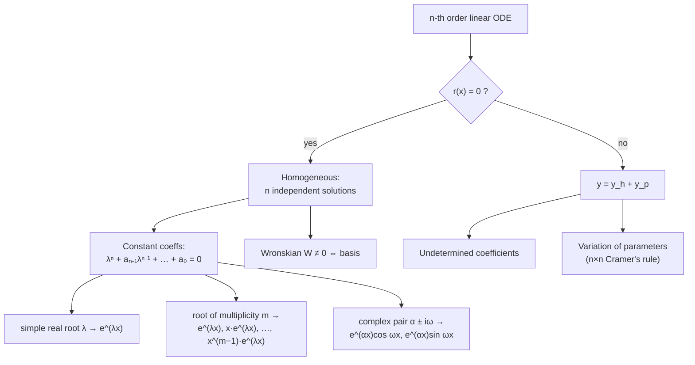
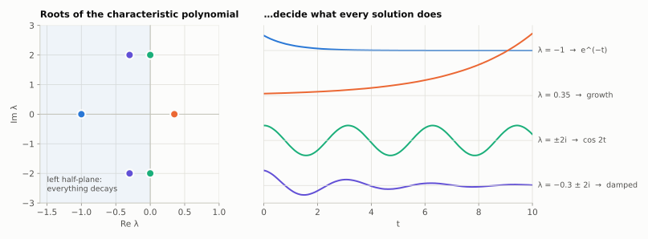

# 3 · Higher-Order Linear ODEs

> *Find the roots of a polynomial and you know how every solution behaves.*

**Part A · Ordinary Differential Equations** · Kreyszig §3.1–3.3 · ⏱ ~7 min · Prereqs: [Ch. 2](02-second-order-linear-odes.md)
[← Second-Order Linear ODEs](02-second-order-linear-odes.md) · [Index](../../README.md) · [Next: Systems & Phase Plane →](04-systems-phase-plane.md)

---

## 🧭 The big picture

Chapter 2 extends from order 2 to any order $n$ almost word for word:

```math
y^{(n)} + p_{n-1}(x)\,y^{(n-1)} + \cdots + p_1(x)\,y' + p_0(x)\,y = r(x)
```

- The homogeneous solutions form an **$n$-dimensional** vector space, so you need $n$ independent solutions.
- Independence is tested with the $n \times n$ **Wronskian** determinant.
- With constant coefficients, everything reduces to the **roots of a degree-$n$ polynomial**.

## 🗺️ Concept map



## 🔑 Core ideas, section by section

| § | Idea | Key formula |
|---|---|---|
| 3.1 | **Homogeneous linear ODEs**: superposition, basis of $n$ solutions, Wronskian | $W = \det\big[y_j^{(i)}\big]_{i=0..n-1}$ |
| 3.2 | **Constant coefficients**: characteristic polynomial, multiple and complex roots | $y = e^{\lambda x}$ with $P(\lambda) = 0$ |
| 3.3 | **Nonhomogeneous**: undetermined coefficients and variation of parameters | $y_p = \sum_k y_k \int \frac{W_k\, r}{W}\,dx$ |

### Reading the roots

<p align="center">
  <picture>
    <source media="(prefers-color-scheme: dark)" srcset="../../assets/figures/ch03-roots-to-behaviour-dark.svg">
    
  </picture>
</p>

| Where is the root $\lambda$? | What the mode $e^{\lambda x}$ does |
|---|---|
| Real, negative | decays monotonically |
| Real, positive | grows exponentially (**unstable**) |
| Purely imaginary $\pm i\omega$ | oscillates forever at frequency $\omega$ |
| Complex, $\operatorname{Re}\lambda < 0$ | oscillates while decaying |
| Repeated (multiplicity $m$) | multiplied by $1, x, \ldots, x^{m-1}$ (resonance-like) |

**Rule of thumb:** a system is stable when **every root lies in the left half-plane**. This one rule underlies control theory, filter design and numerical stability.

### Flagship application: the elastic beam

The Euler–Bernoulli beam is a **fourth-order** ODE:

```math
EI\, y''''(x) = f(x)
```

Here $y$ is the deflection, $E$ is Young's modulus, $I$ is the area moment of inertia and $f$ is the load per unit length. A clamped end gives $y = y' = 0$, a free end gives $y'' = y''' = 0$, and a simply supported end gives $y = y'' = 0$. Bridges, aircraft wings and MEMS cantilevers are all designed with this equation.

## 💡 Aha! moments

- **Linear algebra in disguise.** The solutions form a vector space and the Wronskian is a determinant. A higher-order ODE is equivalent to a first-order **system** $\mathbf{y}' = A\mathbf{y}$ ([Ch. 4](04-systems-phase-plane.md)), and the characteristic polynomial of the ODE is exactly $\det(A - \lambda I)$ for that system's matrix.
- **Roots are "poles".** In signal processing and control, these same roots appear as poles of a transfer function ([Ch. 6](06-laplace-transforms.md)). Engineers talk about "moving poles left" to make a system settle faster.
- **Linear recurrences behave the same way.** $a_{n+2} = a_{n+1} + a_n$ (Fibonacci) is solved by $a_n = r^n$ with $r^2 = r + 1$. The golden ratio is a characteristic root.

## 🤖 Where it shows up

| Engineering | AI / computing |
|---|---|
| Beam deflection, vibration of shafts, multi-mass systems | Stability of linear recurrences, IIR filters and RNN linearisations |
| Higher-order filters (Butterworth, Chebyshev) | Linear state-space layers (S4/Mamba family) are built from the same modes $e^{\lambda t}$ |

## ⚠️ Pitfalls

- A repeated root of multiplicity $m$ needs **$m$** solutions ($x^k e^{\lambda x}$), not one.
- Complex roots come in **conjugate pairs** when the coefficients are real. Use the real pair $e^{\alpha x}\cos\omega x$ and $e^{\alpha x}\sin\omega x$.
- Polynomial root-finding is ill-conditioned for high degree ([Ch. 20](../part-e-numerics/20-numeric-linear-algebra.md)). Use eigenvalue solvers numerically, not closed forms.

## 🧪 Try it

```python
import numpy as np
# y'''' + 2y'' + y = 0  →  (λ² + 1)² = 0  → double roots ±i
print(np.roots([1, 0, 2, 0, 1]))
# basis: cos x, sin x, x·cos x, x·sin x   (the x-factors grow → resonance!)
```

## ✅ Book coverage

- [x] 3.1 Homogeneous Linear ODEs
- [x] 3.2 Homogeneous Linear ODEs with Constant Coefficients
- [x] 3.3 Nonhomogeneous Linear ODEs

---
[← Second-Order Linear ODEs](02-second-order-linear-odes.md) · [Index](../../README.md) · [Next: Systems & Phase Plane →](04-systems-phase-plane.md)
