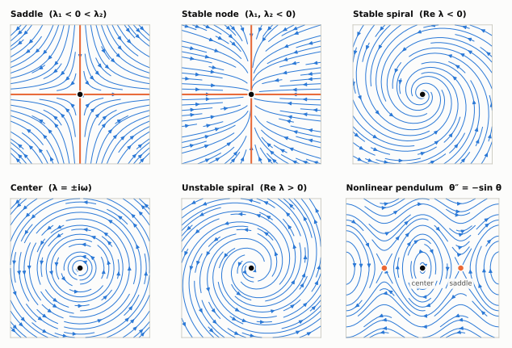
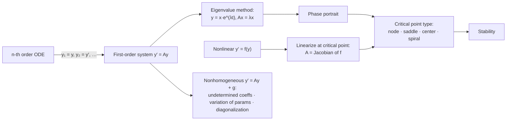
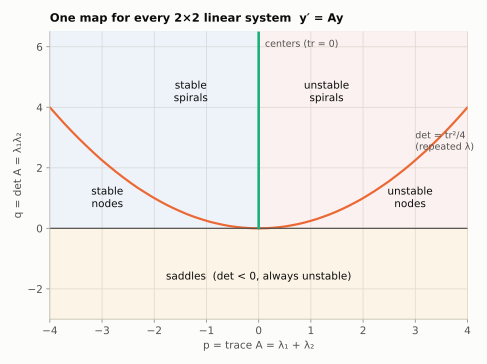

# 4 · Systems of ODEs · Phase Plane · Qualitative Methods

> *You can know how a system behaves without solving it. Two numbers, the trace and the determinant, tell you its fate.*

**Part A · Ordinary Differential Equations** · Kreyszig §4.0–4.6 · ⏱ ~12 min · Prereqs: [Ch. 2](02-second-order-linear-odes.md), eigenvalues ([Ch. 8](../part-b-linear-algebra-vector-calculus/08-eigenvalue-problems.md))
[← Higher-Order Linear ODEs](03-higher-order-linear-odes.md) · [Index](../../README.md) · [Next: Series Solutions & Special Functions →](05-series-solutions-special-functions.md)

---

## 🧭 The big picture

Real systems have several interacting parts: predator and prey, two coupled tanks, the currents in a network, the neurons in a layer. Stack the unknowns into a vector and the ODE becomes

```math
\mathbf{y}' = A\,\mathbf{y} \qquad\text{(linear)}\qquad\text{or}\qquad \mathbf{y}' = \mathbf{f}(\mathbf{y}) \qquad\text{(nonlinear)}
```

The key idea is to stop plotting $y(t)$ and plot **trajectories in the phase plane** $(y_1, y_2)$. The picture shows every solution at once.

<p align="center">
  <picture>
    <source media="(prefers-color-scheme: dark)" srcset="../../assets/figures/ch04-phase-portraits-dark.svg">
    
  </picture>
</p>

## 🗺️ Concept map



## 🔑 Core ideas, section by section

| § | Idea | Key formula |
|---|---|---|
| 4.0 | **Reference: matrices & vectors**: eigenvalues, eigenvectors | $\det(A - \lambda I) = 0$ |
| 4.1 | **Systems as models**: mixing tanks, electrical networks, conversion of an $n$th-order ODE | $y_1 = y,\ y_2 = y',\ \dots$ |
| 4.2 | **Basic theory**: superposition, basis, Wronskian of a system | $\mathbf{y} = c_1\mathbf{y}^{(1)} + \dots + c_n\mathbf{y}^{(n)}$ |
| 4.3 | **Constant coefficients & the phase plane** | $\mathbf{y} = \sum c_k \mathbf{x}^{(k)} e^{\lambda_k t}$ |
| 4.4 | **Critical points & stability criteria** | classify by $p = \operatorname{tr}A$, $q = \det A$, $\Delta = p^2 - 4q$ |
| 4.5 | **Nonlinear systems**: linearization, pendulum, Lotka–Volterra | $A = \partial \mathbf{f}/\partial \mathbf{y}$ at the critical point |
| 4.6 | **Nonhomogeneous linear systems** | $\mathbf{y}_p$ by undetermined coefficients / variation of parameters |

### The trace–determinant map

Every 2×2 system $\mathbf{y}' = A\mathbf{y}$ is located by $p = \lambda_1 + \lambda_2 = \operatorname{tr}A$ and $q = \lambda_1\lambda_2 = \det A$:

<p align="center">
  <picture>
    <source media="(prefers-color-scheme: dark)" srcset="../../assets/figures/ch04-trace-determinant-dark.svg">
    
  </picture>
</p>

| Condition | Critical point | Stable? |
|---|---|---|
| $q < 0$ | **saddle** | never |
| $q > 0,\ \Delta \ge 0$ | **node** | if $p < 0$ |
| $q > 0,\ \Delta < 0,\ p \ne 0$ | **spiral** (focus) | if $p < 0$ |
| $q > 0,\ p = 0$ | **center** | stable, but not attractive |

**Stable and attractive** (asymptotically stable) $\iff p < 0$ and $q > 0$.

### Nonlinear systems: zoom in until it looks linear

Near a critical point $\mathbf{y}_0$ where $\mathbf{f}(\mathbf{y}_0) = \mathbf{0}$, replace $\mathbf{f}$ by its **Jacobian**:

```math
\mathbf{y}' \approx J(\mathbf{y}_0)\,(\mathbf{y} - \mathbf{y}_0), \qquad J_{ij} = \frac{\partial f_i}{\partial y_j}
```

The linearization predicts the local picture correctly for saddles, nodes and spirals. Centers are the delicate case, because nonlinear terms can tip them either way.

| Classic nonlinear model | Equations | Story |
|---|---|---|
| Pendulum | $\theta'' = -\tfrac{g}{L}\sin\theta$ | centers at $0, \pm 2\pi$ (swinging), saddles at $\pm\pi$ (balanced upside-down) |
| Lotka–Volterra | $y_1' = a y_1 - b y_1 y_2,\ \ y_2' = -k y_2 + l y_1 y_2$ | prey and predators cycle forever around a center |
| Van der Pol | $y'' - \mu(1 - y^2)y' + y = 0$ | a **limit cycle**: every orbit is attracted to one loop |

## 💡 Aha! moments

- **GAN training can orbit forever.** Simultaneous gradient descent–ascent on the bilinear game $\min_x\max_y xy$ gives $x' = -y,\ y' = x$. That system is a **center**, so the players circle the equilibrium and never reach it. Methods such as extragradient and optimism add a little "damping" that turns the center into a stable spiral.
- **State-space models are this chapter.** S4 and Mamba-style sequence layers are built on $\mathbf{h}' = A\mathbf{h} + B u$ and $y = C\mathbf{h}$. Training keeps $A$'s eigenvalues in the left half-plane, which is the stability criterion above.
- **Linear RNNs explode or vanish according to the same rule.** Eigenvalues of the recurrent matrix outside or inside the unit circle are the discrete-time version of right and left half-planes.

## 🤖 Where it shows up

| Engineering | AI / computing |
|---|---|
| Coupled tanks, multi-loop circuits, vehicle dynamics | SSM sequence models, RNN stability analysis |
| Power-grid swing equations (synchronisation = stable node) | GAN and min-max dynamics, multi-agent learning |
| Epidemiology (SIR), ecology (predator–prey) | Gradient-flow analysis of training near minima (Hessian eigenvalues) |

## ⚠️ Pitfalls

- A **center** in the linearization does not guarantee a center in the nonlinear system.
- For a repeated eigenvalue with only one eigenvector, the second solution is $\mathbf{x}te^{\lambda t} + \mathbf{u}e^{\lambda t}$, not $t$ times the first solution alone.
- Stable does not mean *attractive*: centers are stable but solutions never converge to them.

## 🧪 Try it

```python
import numpy as np
A = np.array([[-0.3, -1.0], [1.0, -0.3]])
p, q = np.trace(A), np.linalg.det(A)
print(p, q, p*p - 4*q, np.linalg.eigvals(A))   # p<0, q>0, Δ<0 → stable spiral
```

## ✅ Book coverage

- [x] 4.0 For Reference: Basics of Matrices and Vectors
- [x] 4.1 Systems of ODEs as Models in Engineering Applications
- [x] 4.2 Basic Theory of Systems of ODEs. Wronskian
- [x] 4.3 Constant-Coefficient Systems. Phase Plane Method
- [x] 4.4 Criteria for Critical Points. Stability
- [x] 4.5 Qualitative Methods for Nonlinear Systems
- [x] 4.6 Nonhomogeneous Linear Systems of ODEs

---
[← Higher-Order Linear ODEs](03-higher-order-linear-odes.md) · [Index](../../README.md) · [Next: Series Solutions & Special Functions →](05-series-solutions-special-functions.md)
