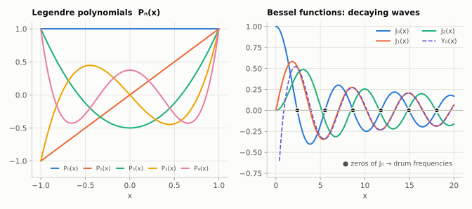
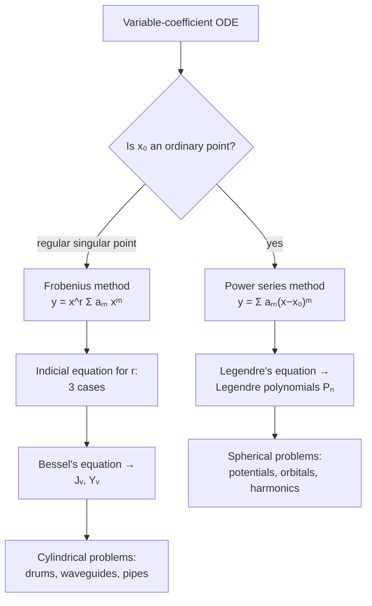

# 5 · Series Solutions of ODEs · Special Functions

> *When no elementary function solves the equation, the solution itself becomes a new function, with a name and its own place in physics.*

**Part A · Ordinary Differential Equations** · Kreyszig §5.1–5.5 · ⏱ ~10 min · Prereqs: [Ch. 2](02-second-order-linear-odes.md), power series ([Ch. 15](../part-d-complex-analysis/15-power-series-taylor-series.md))
[← Systems & Phase Plane](04-systems-phase-plane.md) · [Index](../../README.md) · [Next: Laplace Transforms →](06-laplace-transforms.md)

---

## 🧭 The big picture

Constant-coefficient ODEs are solved by exponentials. With **variable coefficients** you usually have to build the solution term by term:

```math
y = \sum_{m=0}^{\infty} a_m (x - x_0)^m
```

Substitute, collect powers, and get a **recursion** for the $a_m$. Two equations from physics keep returning: **Legendre's** (spheres) and **Bessel's** (cylinders). Their solutions are the *special functions* that appear in drums, antennas, heat flow in pipes, atomic orbitals and 3-D graphics.

<p align="center">
  <picture>
    <source media="(prefers-color-scheme: dark)" srcset="../../assets/figures/ch05-legendre-bessel-dark.svg">
    
  </picture>
</p>

## 🗺️ Concept map



## 🔑 Core ideas, section by section

| § | Idea | Key formula |
|---|---|---|
| 5.1 | **Power series method**: substitute, shift indices, match coefficients | recursion $a_{m+2} = (\dots)\,a_m$ |
| 5.2 | **Legendre's equation & polynomials** | $(1-x^2)y'' - 2xy' + n(n+1)y = 0$ |
| 5.3 | **Frobenius method** at a regular singular point | $r(r-1) + b_0 r + c_0 = 0$ (indicial equation) |
| 5.4 | **Bessel's equation, $J_\nu$, Gamma function** | $x^2y'' + xy' + (x^2 - \nu^2)y = 0$ |
| 5.5 | **Bessel functions of the second kind $Y_\nu$** | general solution $y = c_1 J_\nu + c_2 Y_\nu$ |

### Legendre polynomials $P_n(x)$

```math
P_n(x) = \frac{1}{2^n n!}\frac{d^n}{dx^n}\left(x^2 - 1\right)^n \quad\text{(Rodrigues)}, \qquad \int_{-1}^{1} P_m P_n\,dx = \frac{2\,\delta_{mn}}{2n+1}
```

$P_0 = 1,\ P_1 = x,\ P_2 = \tfrac12(3x^2-1),\ P_3 = \tfrac12(5x^3 - 3x)$. They are **orthogonal**, which makes them a "Fourier basis" for functions on $[-1, 1]$ ([Ch. 11](../part-c-fourier-pdes/11-fourier-analysis.md)).

### Frobenius: three cases of the indicial roots $r_1, r_2$

| Case | Second solution |
|---|---|
| $r_1 - r_2$ not an integer | $y_2 = x^{r_2}\sum A_m x^m$ (independent) |
| double root $r_1 = r_2$ | $y_2 = y_1 \ln x + x^{r}\sum A_m x^m$ |
| $r_1 - r_2$ a positive integer | $y_2 = k\,y_1 \ln x + x^{r_2}\sum A_m x^m$ ($k$ may be 0) |

### Bessel functions $J_\nu(x)$

```math
J_\nu(x) = \sum_{m=0}^{\infty} \frac{(-1)^m}{m!\,\Gamma(m+\nu+1)} \left(\frac{x}{2}\right)^{2m+\nu}, \qquad J_\nu(x) \approx \sqrt{\frac{2}{\pi x}}\cos\!\left(x - \frac{\nu\pi}{2} - \frac{\pi}{4}\right)
```

The asymptotic form says Bessel functions are **cosines that decay like $1/\sqrt{x}$**, the way a ripple spreads on a pond. $Y_\nu$ (second kind) blows up at $x = 0$, so it is discarded whenever the solution must stay finite at the centre.

**The Gamma function** generalises the factorial: $\Gamma(\nu + 1) = \nu\,\Gamma(\nu)$, $\Gamma(n+1) = n!$, $\Gamma(\tfrac12) = \sqrt{\pi}$.

## 💡 Aha! moments

- **You can hear the zeros of $J_0$.** A circular drum vibrates at frequencies proportional to the zeros $\alpha_1 \approx 2.405,\ \alpha_2 \approx 5.520, \dots$ of $J_0$. They are not integer multiples, which is why a drum sounds less "musical" than a string ([Ch. 12](../part-c-fourier-pdes/12-partial-differential-equations.md)).
- **FM radio is Bessel math.** A frequency-modulated carrier splits into sidebands whose amplitudes are $J_n(\beta)$, with $\beta$ the modulation index.
- **Spherical harmonics are built on the associated Legendre functions $P_n^m$.** They encode view-dependent colour in *3-D Gaussian Splatting*, lighting in real-time graphics, and the rotation-equivariant features of molecular neural networks (e3nn, equivariant GNNs).

## 🤖 Where it shows up

| Engineering | AI / computing |
|---|---|
| Vibrating membranes, optical fibre modes, antenna patterns | Spherical harmonics in 3DGS / NeRF variants and equivariant GNNs |
| Heat conduction in cylinders, skin effect in wires | Legendre and Chebyshev bases for spectral methods and HiPPO-style memory in SSMs |
| Gravitational and electrostatic multipole expansions | Polynomial feature bases and orthogonal-polynomial regression |

## ⚠️ Pitfalls

- A power series only converges within the distance to the **nearest singularity**, which may be complex ([Ch. 15](../part-d-complex-analysis/15-power-series-taylor-series.md)).
- Shift summation indices carefully. Most errors happen when you align $x^{m}$ terms from $y''$ and $y$.
- At $x = 0$, physics often forces $c_2 = 0$ because $Y_\nu$ is unbounded there.

## 🧪 Try it

```python
from scipy.special import jn_zeros, eval_legendre
print(jn_zeros(0, 4))                         # [2.405 5.520 8.654 11.79]  drum modes
print(eval_legendre(3, 0.5))                  # P3(0.5) = -0.4375
```

## ✅ Book coverage

- [x] 5.1 Power Series Method
- [x] 5.2 Legendre's Equation. Legendre Polynomials Pₙ(x)
- [x] 5.3 Extended Power Series Method: Frobenius Method
- [x] 5.4 Bessel's Equation. Bessel Functions J_ν(x)
- [x] 5.5 Bessel Functions of the Second Kind Y_ν(x)

---
[← Systems & Phase Plane](04-systems-phase-plane.md) · [Index](../../README.md) · [Next: Laplace Transforms →](06-laplace-transforms.md)
