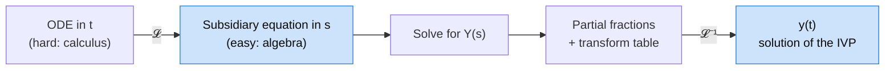
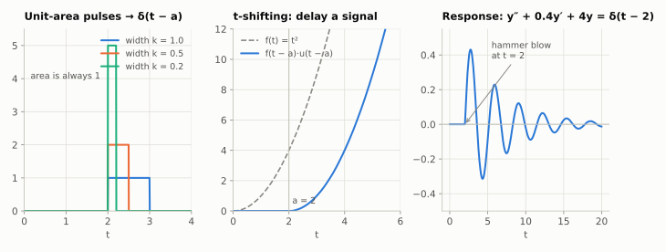

# 6 · Laplace Transforms

> *Calculus turns into algebra. You solve the ODE in the s-world, where differentiation is multiplication, then come back.*

**Part A · Ordinary Differential Equations** · Kreyszig §6.1–6.9 · ⏱ ~12 min · Prereqs: [Ch. 2](02-second-order-linear-odes.md), partial fractions
[← Series Solutions](05-series-solutions-special-functions.md) · [Index](../../README.md) · [Next Part: Linear Algebra →](../part-b-linear-algebra-vector-calculus/07-linear-algebra-matrices-systems.md)

---

## 🧭 The big picture

```math
F(s) = \mathcal{L}\lbrace f\rbrace(s) = \int_0^{\infty} e^{-st} f(t)\,dt
```

The Laplace transform is the engineer's trick for **initial-value problems with switches, pulses and jumps**: a voltage switched on at $t = 2$, a hammer blow, a valve that opens and closes. Its main property is

```math
\mathcal{L}(f') = sF(s) - f(0), \qquad \mathcal{L}(f'') = s^2F(s) - sf(0) - f'(0)
```

The transform turns derivatives into multiplication by $s$, and it **includes the initial conditions automatically**.



## 🔑 Core ideas, section by section

| § | Idea | Key formula |
|---|---|---|
| 6.1 | **Definition, linearity, s-shifting** | $\mathcal{L}(e^{at}f) = F(s - a)$ |
| 6.2 | **Transforms of derivatives & integrals → solve ODEs** | $\mathcal{L}\left(\int_0^t f\,d\tau\right) = F(s)/s$ |
| 6.3 | **Unit step (Heaviside), t-shifting** | $\mathcal{L}\lbrace f(t-a)u(t-a)\rbrace = e^{-as}F(s)$ |
| 6.4 | **Dirac delta, short impulses, partial fractions** | $\mathcal{L}\lbrace\delta(t - a)\rbrace = e^{-as}$ |
| 6.5 | **Convolution, integral equations** | $\mathcal{L}(f * g) = F\,G$, where $(f*g)(t) = \int_0^t f(\tau)g(t-\tau)\,d\tau$ |
| 6.6 | **Differentiation & integration of transforms** | $\mathcal{L}(tf) = -F'(s)$, $\ \mathcal{L}(f/t) = \int_s^\infty F\,d\tilde s$ |
| 6.7 | **Systems of ODEs** | transform each equation, then solve a linear system in $s$ |
| 6.8–6.9 | **General formulas & table** | see below |

<p align="center">
  <picture>
    <source media="(prefers-color-scheme: dark)" srcset="../../assets/figures/ch06-step-delta-response-dark.svg">
    
  </picture>
</p>

### The pocket transform table

| $f(t)$ | $F(s)$ | | $f(t)$ | $F(s)$ |
|---|---|---|---|---|
| $1$ | $1/s$ | | $\cos\omega t$ | $s/(s^2+\omega^2)$ |
| $t^n$ | $n!/s^{n+1}$ | | $\sin\omega t$ | $\omega/(s^2+\omega^2)$ |
| $t^a\ (a > -1)$ | $\Gamma(a+1)/s^{a+1}$ | | $\cosh at$ | $s/(s^2-a^2)$ |
| $e^{at}$ | $1/(s-a)$ | | $\sinh at$ | $a/(s^2-a^2)$ |
| $t e^{at}$ | $1/(s-a)^2$ | | $e^{at}\cos\omega t$ | $(s-a)/((s-a)^2+\omega^2)$ |
| $u(t-a)$ | $e^{-as}/s$ | | $e^{at}\sin\omega t$ | $\omega/((s-a)^2+\omega^2)$ |
| $\delta(t-a)$ | $e^{-as}$ | | $f * g$ | $F(s)\,G(s)$ |

### The two shifting theorems

| | Shift in… | Effect |
|---|---|---|
| **First (s-shifting)** | multiply $f$ by $e^{at}$ | $F(s) \to F(s - a)$ |
| **Second (t-shifting)** | delay $f$ by $a$, i.e. $f(t-a)u(t-a)$ | $F(s) \to e^{-as}F(s)$ |

### Worked micro-example: the hammer blow

$y'' + 0.4y' + 4y = \delta(t - 2)$ with $y(0) = y'(0) = 0$. Transforming gives $(s^2 + 0.4s + 4)\,Y = e^{-2s}$, so

```math
Y(s) = \frac{e^{-2s}}{(s+0.2)^2 + 3.96} \;\;\Longrightarrow\;\; y(t) = \frac{u(t-2)}{\sqrt{3.96}}\, e^{-0.2(t-2)} \sin\!\big(\sqrt{3.96}\,(t-2)\big)
```

The system is silent until $t = 2$, then it rings down. That is the right-hand panel of the figure.

## 💡 Aha! moments

- **Transfer functions.** For zero initial conditions, $Y(s) = H(s)\,R(s)$ with $H = 1/(\text{characteristic polynomial})$. All of control engineering (poles, zeros, Bode plots, stability margins) grows from this one line.
- **The impulse response is the system's fingerprint.** Since $\mathcal{L}(\delta) = 1$, the response to $\delta$ is $h(t) = \mathcal{L}^{-1}(H)$, and the response to any input is the **convolution** $y = h * r$. Linear time-invariant systems are fully described by $h$.
- **Convolutions in deep learning.** A 1-D convolution layer and the long-convolution view of state-space models (S4, Hyena) both use this identity: $y = h * u$, computed fast in the frequency domain where convolution becomes multiplication.
- **The Laplace and Fourier transforms are siblings.** Put $s = i\omega$ and you get the Fourier transform of a causal signal ([Ch. 11](../part-c-fourier-pdes/11-fourier-analysis.md)).

## 🤖 Where it shows up

| Engineering | AI / computing |
|---|---|
| Control systems (PID design, stability via poles) | Long-convolution sequence models (S4, Hyena), causal filters |
| Circuit analysis with switches, impulse testing of structures | Queueing and reliability (Laplace transforms of distributions) |
| Signal processing (continuous-time filters) | Moment-generating functions are Laplace transforms of densities |

## ⚠️ Pitfalls

- $\mathcal{L}\lbrace f(t)u(t-a)\rbrace \ne e^{-as}F(s)$. You must first write $f$ as a function of $(t - a)$.
- Do not forget the initial conditions in $\mathcal{L}(y')$ and $\mathcal{L}(y'')$.
- Repeated and complex factors need the matching partial-fraction forms: $\frac{A}{s-a} + \frac{B}{(s-a)^2}$ and $\frac{As + B}{(s-a)^2 + \omega^2}$.

## 🧪 Try it

```python
import sympy as sp
t, s = sp.symbols("t s", positive=True)
Y = sp.exp(-2*s) / (s**2 + sp.Rational(2, 5)*s + 4)
print(sp.simplify(sp.inverse_laplace_transform(Y, s, t)))   # rings after t = 2
```

## ✅ Book coverage

- [x] 6.1 Laplace Transform. Linearity. First Shifting Theorem (s-Shifting)
- [x] 6.2 Transforms of Derivatives and Integrals. ODEs
- [x] 6.3 Unit Step Function (Heaviside Function). Second Shifting Theorem (t-Shifting)
- [x] 6.4 Short Impulses. Dirac's Delta Function. Partial Fractions
- [x] 6.5 Convolution. Integral Equations
- [x] 6.6 Differentiation and Integration of Transforms. ODEs with Variable Coefficients
- [x] 6.7 Systems of ODEs
- [x] 6.8 Laplace Transform: General Formulas
- [x] 6.9 Table of Laplace Transforms

---
[← Series Solutions](05-series-solutions-special-functions.md) · [Index](../../README.md) · [Next Part: Linear Algebra →](../part-b-linear-algebra-vector-calculus/07-linear-algebra-matrices-systems.md)
