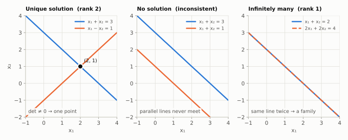
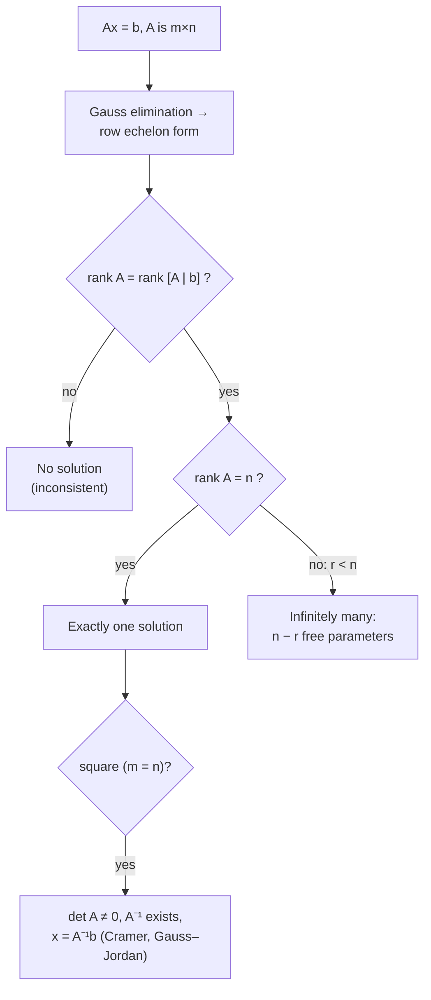
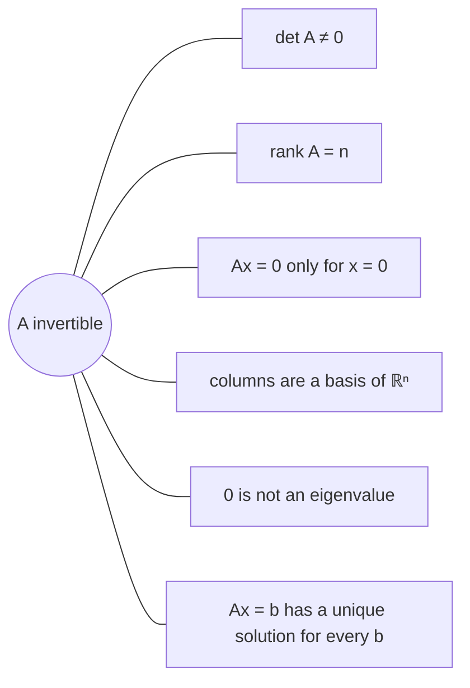

# 7 · Linear Algebra: Matrices, Vectors, Determinants, Linear Systems

> *Machine learning is mostly linear algebra. Every neural network layer, every embedding and every GPU kernel lives in this chapter.*

**Part B · Linear Algebra, Vector Calculus** · Kreyszig §7.1–7.9 · ⏱ ~12 min · Prereqs: none
[← Laplace Transforms](../part-a-odes/06-laplace-transforms.md) · [Index](../../README.md) · [Next: Eigenvalue Problems →](08-eigenvalue-problems.md)

---

## 🧭 The big picture

A matrix is a **linear map**: it takes vectors to vectors, preserving sums and scalings. One equation sums up the chapter:

```math
A\mathbf{x} = \mathbf{b}, \qquad A \in \mathbb{R}^{m\times n},\ \ \mathbf{x}\in\mathbb{R}^n,\ \ \mathbf{b}\in\mathbb{R}^m
```

It raises three questions. **Does a solution exist? Is it unique? How do I compute it?** The answers come down to one number, the **rank**.

<p align="center">
  <picture>
    <source media="(prefers-color-scheme: dark)" srcset="../../assets/figures/ch07-three-fates-dark.svg">
    
  </picture>
</p>

## 🗺️ Concept map: the fate of $A\mathbf{x} = \mathbf{b}$



## 🔑 Core ideas, section by section

| § | Idea | Key formula |
|---|---|---|
| 7.1 | **Matrices, vectors**: addition and scalar multiplication | $(A + B)_{jk} = a_{jk} + b_{jk}$ |
| 7.2 | **Matrix multiplication**: rows times columns, *not commutative* | $(AB)_{jk} = \sum_l a_{jl} b_{lk}$, $(AB)^T = B^TA^T$ |
| 7.3 | **Linear systems, Gauss elimination**: row operations → echelon form → back substitution | cost $\approx \tfrac23 n^3$ flops |
| 7.4 | **Linear independence, rank, vector space** | rank = number of independent rows = number of independent columns |
| 7.5 | **Existence & uniqueness** | consistent $\iff \operatorname{rank}A = \operatorname{rank}[A\mid\mathbf{b}]$ |
| 7.6 | **2nd- and 3rd-order determinants** | $\det\begin{bmatrix}a&b\\c&d\end{bmatrix} = ad - bc$ |
| 7.7 | **Determinants, Cramer's rule** | $x_k = D_k / D$, $\ \det(AB) = \det A\,\det B$ |
| 7.8 | **Inverse, Gauss–Jordan** | $[A \mid I] \to [I \mid A^{-1}]$, $\ (AB)^{-1} = B^{-1}A^{-1}$ |
| 7.9 | **Vector spaces, inner products, linear transformations** | $\vert\mathbf{a}\cdot\mathbf{b}\vert \le \Vert\mathbf{a}\Vert\,\Vert\mathbf{b}\Vert$ (Cauchy–Schwarz) |

### Four ways to look at $A\mathbf{x}$

| View | Picture | Where you meet it |
|---|---|---|
| **Row view** | each row is a hyperplane, and $\mathbf{x}$ is their intersection | solving equations |
| **Column view** | $A\mathbf{x} = x_1\mathbf{a}_1 + \dots + x_n\mathbf{a}_n$, a mix of columns | span, rank, least squares |
| **Map view** | $A$ moves space: rotate, stretch, shear, project | graphics, robotics, layers of a neural net |
| **Data view** | rows are samples, columns are features | statistics, ML design matrices |

### Rank–nullity: the conservation law of dimensions

```math
\underbrace{\operatorname{rank} A}_{\text{dimensions that survive}} + \underbrace{\operatorname{nullity} A}_{\text{dimensions crushed to } \mathbf{0}} = n
```

### The Invertible Matrix Theorem (square $A$): all of these are equivalent



### Determinant facts that save time

- A row swap flips the sign. Scaling a row by $c$ scales $\det$ by $c$. Adding a multiple of one row to another changes **nothing**.
- For a triangular matrix, $\det$ is the product of the diagonal.
- $\vert\det A\vert$ is the **volume scaling factor** of the map, and the sign tells you whether orientation is flipped.

## 💡 Aha! moments

- **A neural network layer is $\sigma(W\mathbf{x} + \mathbf{b})$.** A transformer forward pass is mostly matrix multiplications such as $QK^T$, $\text{softmax}(\cdot)V$ and the MLP layers. GPUs and TPUs are machines built for $C = AB$.
- **The cost of a matrix multiplication drives AI budgets.** $C_{m\times n} = A_{m\times k}B_{k\times n}$ costs $2mnk$ FLOPs. That is where the rule *"training ≈ 6 × parameters × tokens FLOPs"* comes from ([Ch. 33](../part-h-math-for-ai/33-efficient-inference.md)).
- **Rank is compressibility.** A $4096\times 4096$ weight update of rank 8 needs only $2\cdot 4096\cdot 8$ numbers instead of 16.7 M. That is the idea behind **LoRA** fine-tuning ([Ch. 30](../part-h-math-for-ai/30-low-rank-svd-pca.md)).
- **Never compute $A^{-1}$ just to solve $A\mathbf{x} = \mathbf{b}$.** Elimination or LU factorisation is faster and more accurate ([Ch. 20](../part-e-numerics/20-numeric-linear-algebra.md)).

## 🤖 Where it shows up

| Engineering | AI / computing |
|---|---|
| Circuit analysis (Kirchhoff), truss forces, chemical balancing | Dense and linear layers, embeddings, attention |
| Markov processes: $\mathbf{x}_{k+1} = P\mathbf{x}_k$ | Transformations in graphics (homogeneous coordinates) |
| Finite-element stiffness systems $K\mathbf{u} = \mathbf{f}$ | Least squares / linear regression ([Ch. 20](../part-e-numerics/20-numeric-linear-algebra.md)) |

## ⚠️ Pitfalls

- $AB \ne BA$ in general, and $AB = 0$ does **not** imply $A = 0$ or $B = 0$.
- Cramer's rule is elegant but costs $O(n \cdot n!)$ if determinants are expanded naively. Use it for theory and 2×2 or 3×3 hand work only.
- $\det(A + B) \ne \det A + \det B$.

## 🧪 Try it

```python
import numpy as np
A = np.array([[1., 1.], [1., -1.]]); b = np.array([3., 1.])
print(np.linalg.solve(A, b), np.linalg.matrix_rank(A), np.linalg.det(A))  # [2,1] 2 -2
```

## ✅ Book coverage

- [x] 7.1 Matrices, Vectors: Addition and Scalar Multiplication
- [x] 7.2 Matrix Multiplication
- [x] 7.3 Linear Systems of Equations. Gauss Elimination
- [x] 7.4 Linear Independence. Rank of a Matrix. Vector Space
- [x] 7.5 Solutions of Linear Systems: Existence, Uniqueness
- [x] 7.6 For Reference: Second- and Third-Order Determinants
- [x] 7.7 Determinants. Cramer's Rule
- [x] 7.8 Inverse of a Matrix. Gauss–Jordan Elimination
- [x] 7.9 Vector Spaces, Inner Product Spaces. Linear Transformations

---
[← Laplace Transforms](../part-a-odes/06-laplace-transforms.md) · [Index](../../README.md) · [Next: Eigenvalue Problems →](08-eigenvalue-problems.md)
