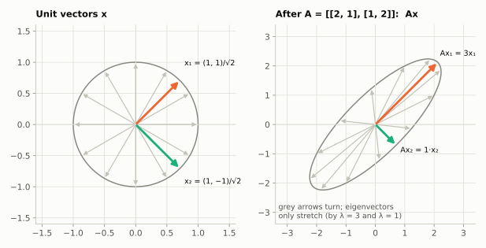
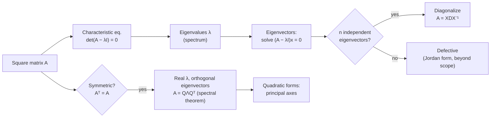

# 8 · Linear Algebra: Matrix Eigenvalue Problems

> *Most directions get turned by a matrix. A few only get stretched, and those directions describe the matrix completely.*

**Part B · Linear Algebra, Vector Calculus** · Kreyszig §8.1–8.5 · ⏱ ~10 min · Prereqs: [Ch. 7](07-linear-algebra-matrices-systems.md)
[← Matrices & Linear Systems](07-linear-algebra-matrices-systems.md) · [Index](../../README.md) · [Next: Grad, Div, Curl →](09-vector-differential-calculus.md)

---

## 🧭 The big picture

```math
A\mathbf{x} = \lambda\mathbf{x}, \qquad \mathbf{x} \neq \mathbf{0} \qquad\Longleftrightarrow\qquad \det(A - \lambda I) = 0
```

An **eigenvector** keeps its direction under $A$, and the **eigenvalue** $\lambda$ is its stretch factor. In an eigenbasis, a complicated matrix becomes a diagonal list of numbers. Vibration modes, principal stresses, the steady state of a Markov chain, PageRank, PCA and loss-surface curvature are all eigenvalue problems.

<p align="center">
  <picture>
    <source media="(prefers-color-scheme: dark)" srcset="../../assets/figures/ch08-eigen-directions-dark.svg">
    
  </picture>
</p>

## 🗺️ Concept map



## 🔑 Core ideas, section by section

| § | Idea | Key formula |
|---|---|---|
| 8.1 | **The eigenvalue problem**: characteristic polynomial, algebraic and geometric multiplicity | $\sum \lambda_i = \operatorname{tr}A,\ \ \prod \lambda_i = \det A$ |
| 8.2 | **Applications**: elastic membrane (principal directions), Markov limit state, Leslie population model, vibrating masses | $P\mathbf{x} = 1\cdot\mathbf{x}$ (steady state) |
| 8.3 | **Symmetric, skew-symmetric, orthogonal matrices** | $A^T = A$, $A^T = -A$, $A^T = A^{-1}$ |
| 8.4 | **Eigenbases, diagonalization, quadratic forms** | $D = X^{-1}AX$, $\ A^k = XD^kX^{-1}$ |
| 8.5 | **Complex matrices: Hermitian, skew-Hermitian, unitary** | $\bar A^T = A$, $\ \bar A^T = -A$, $\ \bar A^T = A^{-1}$ |

### Where do the eigenvalues live?

| Matrix type | Definition | Eigenvalues | Eigenvectors |
|---|---|---|---|
| Symmetric (real) | $A^T = A$ | **real** | orthogonal |
| Skew-symmetric | $A^T = -A$ | pure imaginary or 0 | — |
| Orthogonal | $A^TA = I$ | modulus 1 (rotations and reflections) | — |
| Hermitian | $\bar A^T = A$ | **real** | orthogonal (unitary) |
| Unitary | $\bar A^T A = I$ | on the unit circle | — |
| Positive definite | $\mathbf{x}^TA\mathbf{x} > 0$ | all $> 0$ | — |

### Diagonalization: change to the matrix's own coordinates

```math
A = X D X^{-1} \quad\Rightarrow\quad A^{k} = X D^{k} X^{-1}, \qquad e^{At} = X e^{Dt} X^{-1}
```

The columns of $X$ are eigenvectors and $D = \operatorname{diag}(\lambda_1,\dots,\lambda_n)$. Powers, exponentials and ODE solutions ([Ch. 4](../part-a-odes/04-systems-phase-plane.md)) reduce to scalar arithmetic.

### Quadratic forms & the principal axes theorem

$Q(\mathbf{x}) = \mathbf{x}^TA\mathbf{x}$ with $A$ symmetric. Rotating to the eigenvector coordinates $\mathbf{y} = Q^T\mathbf{x}$ removes every cross term:

```math
Q = \lambda_1 y_1^2 + \lambda_2 y_2^2 + \dots + \lambda_n y_n^2
```

The signs of the $\lambda_i$ tell you whether the level set is an ellipse (all positive), a hyperbola (mixed signs), or something degenerate.

## 💡 Aha! moments

- **PageRank is an eigenvector.** The importance of web pages is the eigenvector of the (damped) link matrix for $\lambda = 1$. It is found with the **power method** ([Ch. 20](../part-e-numerics/20-numeric-linear-algebra.md)).
- **PCA is an eigenvalue problem.** The principal components of data are the eigenvectors of its covariance matrix, and the eigenvalues give the variance captured along each one ([Ch. 30](../part-h-math-for-ai/30-low-rank-svd-pca.md)).
- **The Hessian's eigenvalues describe the loss surface.** At a minimum, all $\lambda > 0$. A saddle has mixed signs. The largest eigenvalue (the "sharpness") limits the stable learning rate to $\eta < 2/\lambda_{\max}$ ([Ch. 27](../part-h-math-for-ai/27-optimization-for-ml.md)).
- **Spectral normalisation** divides a layer's weights by its largest singular value to control the Lipschitz constant. This stabilises GAN discriminators.
- **Quantum mechanics** is the eigenvalue theory of Hermitian operators. Measured energies are eigenvalues, so they are always real.

## 🤖 Where it shows up

| Engineering | AI / computing |
|---|---|
| Vibration modes of structures (natural frequencies) | PCA, spectral clustering (graph Laplacian), PageRank |
| Principal stresses and strains, moments of inertia | Hessian analysis, sharpness, curvature-aware optimisers |
| Stability of linear systems (eigenvalues of $A$) | Markov chains, stationary distributions, mixing time |

## ⚠️ Pitfalls

- Real matrices can have **complex** eigenvalues; a rotation is the classic example.
- Not every matrix is diagonalizable. $\begin{bmatrix}1&1\\0&1\end{bmatrix}$ has only one eigenvector direction.
- The eigenvalues of $A + B$ are **not** the sums of the eigenvalues of $A$ and $B$, unless the two matrices share eigenvectors.

## 🧪 Try it

```python
import numpy as np
A = np.array([[2., 1.], [1., 2.]])
lam, X = np.linalg.eigh(A)          # eigh: for symmetric/Hermitian matrices
print(lam, X)                        # [1, 3], columns ∝ (1,-1), (1,1)
print(np.allclose(X @ np.diag(lam) @ X.T, A))
```

## ✅ Book coverage

- [x] 8.1 The Matrix Eigenvalue Problem. Determining Eigenvalues and Eigenvectors
- [x] 8.2 Some Applications of Eigenvalue Problems
- [x] 8.3 Symmetric, Skew-Symmetric, and Orthogonal Matrices
- [x] 8.4 Eigenbases. Diagonalization. Quadratic Forms
- [x] 8.5 Complex Matrices and Forms

---
[← Matrices & Linear Systems](07-linear-algebra-matrices-systems.md) · [Index](../../README.md) · [Next: Grad, Div, Curl →](09-vector-differential-calculus.md)
