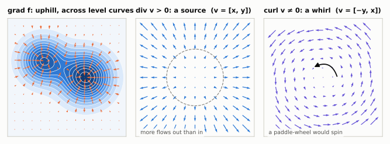
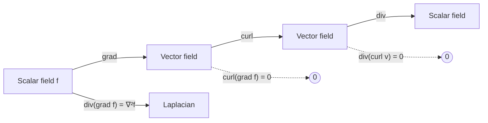

# 9 · Vector Differential Calculus · Grad, Div, Curl

> *One symbol, ∇, gives three different questions about a field: which way is uphill, how much is flowing out, and how much it swirls.*

**Part B · Linear Algebra, Vector Calculus** · Kreyszig §9.1–9.9 · ⏱ ~12 min · Prereqs: multivariable derivatives
[← Eigenvalue Problems](08-eigenvalue-problems.md) · [Index](../../README.md) · [Next: Integral Theorems →](10-vector-integral-calculus.md)

---

## 🧭 The big picture

Physics and engineering happen in **fields**: temperature $T(x,y,z)$ (a scalar field), wind velocity $\mathbf{v}(x,y,z)$ (a vector field), electric and magnetic fields. The **nabla** operator

```math
\nabla = \left(\frac{\partial}{\partial x},\ \frac{\partial}{\partial y},\ \frac{\partial}{\partial z}\right)
```

combines with a field in three ways, and each one measures something different:

| Operation | Input → Output | Measures |
|---|---|---|
| $\operatorname{grad} f = \nabla f$ | scalar → vector | direction and rate of steepest increase |
| $\operatorname{div}\mathbf{v} = \nabla\cdot\mathbf{v}$ | vector → scalar | net outflow per unit volume (sources and sinks) |
| $\operatorname{curl}\mathbf{v} = \nabla\times\mathbf{v}$ | vector → vector | local rotation (vorticity) |

<p align="center">
  <picture>
    <source media="(prefers-color-scheme: dark)" srcset="../../assets/figures/ch09-grad-div-curl-dark.svg">
    
  </picture>
</p>

## 🗺️ Concept map: the ∇ chain



Applying two steps of the chain in a row always gives zero. **Gradient fields never swirl, and curl fields have no sources.** This pattern (an *exact sequence*) is the seed of differential forms and de Rham cohomology.

## 🔑 Core ideas, section by section

| § | Idea | Key formula |
|---|---|---|
| 9.1 | **Vectors in 2- and 3-space**: components, length, unit vectors | $\Vert\mathbf{a}\Vert = \sqrt{a_1^2 + a_2^2 + a_3^2}$ |
| 9.2 | **Inner (dot) product**: angle, projection, work | $\mathbf{a}\cdot\mathbf{b} = \Vert\mathbf{a}\Vert\Vert\mathbf{b}\Vert\cos\gamma$ |
| 9.3 | **Vector (cross) product**: area, torque, normal vectors; scalar triple product = volume | $\Vert\mathbf{a}\times\mathbf{b}\Vert = \Vert\mathbf{a}\Vert\Vert\mathbf{b}\Vert\sin\gamma$ |
| 9.4 | **Vector & scalar functions and fields, derivatives** | $\mathbf{v}'(t) = (v_1', v_2', v_3')$ |
| 9.5 | **Curves, arc length, curvature, torsion** | $s = \int \Vert\mathbf{r}'(t)\Vert\,dt$, $\ \kappa = \Vert\mathbf{u}'(s)\Vert$ |
| 9.6 | **Review: functions of several variables**, chain rule, mean value theorem | $\frac{dw}{dt} = \sum_i \frac{\partial w}{\partial x_i}\frac{dx_i}{dt}$ |
| 9.7 | **Gradient, directional derivative** | $D_{\mathbf{b}}f = \mathbf{b}\cdot\nabla f$ (unit $\mathbf{b}$) |
| 9.8 | **Divergence**: continuity equation, incompressibility | $\operatorname{div}\mathbf{v} = \partial_x v_1 + \partial_y v_2 + \partial_z v_3$ |
| 9.9 | **Curl**: rotation of a rigid body | $\operatorname{curl}\mathbf{v} = 2\boldsymbol{\omega}$ for rigid rotation |

### The three formulas in components

```math
\nabla f = \begin{bmatrix} f_x \\ f_y \\ f_z \end{bmatrix},\qquad
\nabla\cdot\mathbf{v} = \frac{\partial v_1}{\partial x} + \frac{\partial v_2}{\partial y} + \frac{\partial v_3}{\partial z},\qquad
\nabla\times\mathbf{v} = \det\begin{bmatrix} \mathbf{i} & \mathbf{j} & \mathbf{k} \\ \partial_x & \partial_y & \partial_z \\ v_1 & v_2 & v_3 \end{bmatrix}
```

### Curves: the moving frame (Frenet–Serret)

A curve $\mathbf{r}(s)$ parametrised by arc length carries a unit tangent $\mathbf{u}$, a principal normal $\mathbf{p}$ and a binormal $\mathbf{b} = \mathbf{u}\times\mathbf{p}$. **Curvature** $\kappa$ measures bending and **torsion** $\tau$ measures twisting out of the plane. Velocity $\mathbf{v} = \mathbf{r}'$, and acceleration splits into tangential and centripetal ($\kappa v^2$) parts.

### Three facts about the gradient

1. $\nabla f$ points in the direction of **fastest increase**, and its length is that rate.
2. $\nabla f$ is **perpendicular to level surfaces** $f = c$, so it gives the surface normals used in graphics.
3. If $\mathbf{v} = \nabla f$, then $\mathbf{v}$ is **conservative** and $f$ is its potential, with $\operatorname{curl}\mathbf{v} = \mathbf{0}$.

## 💡 Aha! moments

- **Backpropagation computes $\nabla L$.** Training a network means following $-\nabla L$ downhill in a space with billions of dimensions. A directional derivative $\mathbf{b}\cdot\nabla f$ is what autodiff calls a **JVP** (Jacobian–vector product) ([Ch. 26](../part-h-math-for-ai/26-matrix-calculus-autodiff.md)).
- **Cosine similarity is the dot product.** Embedding search, RAG retrieval and attention scores all measure angles: $\cos\gamma = \frac{\mathbf{a}\cdot\mathbf{b}}{\Vert\mathbf{a}\Vert\Vert\mathbf{b}\Vert}$.
- **Diffusion models learn a gradient field.** The *score* $\nabla_{\mathbf{x}}\log p(\mathbf{x})$ points toward more probable data, and sampling follows it uphill ([Ch. 34](../part-h-math-for-ai/34-stochastic-processes-diffusion.md)).
- **Continuous normalizing flows use divergence.** Density changes along a flow as $\frac{d}{dt}\log p = -\nabla\cdot\mathbf{f}$, which is the continuity equation from §9.8 applied to probability.

## 🤖 Where it shows up

| Engineering | AI / computing |
|---|---|
| Heat flux $\mathbf{q} = -k\nabla T$, Fick's law of diffusion | Gradient descent, backprop, saliency maps ($\nabla_{\text{input}}$) |
| Maxwell's equations (div and curl of $\mathbf{E}$, $\mathbf{B}$) | Score-based diffusion, continuous normalizing flows |
| Fluid vorticity, aerodynamics; torque $\mathbf{M} = \mathbf{r}\times\mathbf{F}$ | 3-D graphics normals, robot kinematics, path curvature limits |

## ⚠️ Pitfalls

- The cross product is **anti-commutative**, $\mathbf{a}\times\mathbf{b} = -\mathbf{b}\times\mathbf{a}$, and **not associative**.
- A directional derivative needs a **unit** direction vector $\mathbf{b}$.
- Curl is defined in 3-D. In 2-D, use the scalar $\partial_x v_2 - \partial_y v_1$ (the $z$-component).

## 🧪 Try it

```python
import sympy as sp
x, y, z = sp.symbols("x y z")
f = x**2 * y + sp.sin(z)
grad = [sp.diff(f, s) for s in (x, y, z)]
curl_grad = [sp.diff(grad[2], y) - sp.diff(grad[1], z),
             sp.diff(grad[0], z) - sp.diff(grad[2], x),
             sp.diff(grad[1], x) - sp.diff(grad[0], y)]
print(grad, curl_grad)                        # curl(grad f) = [0, 0, 0]
```

## ✅ Book coverage

- [x] 9.1 Vectors in 2-Space and 3-Space
- [x] 9.2 Inner Product (Dot Product)
- [x] 9.3 Vector Product (Cross Product)
- [x] 9.4 Vector and Scalar Functions and Their Fields. Vector Calculus: Derivatives
- [x] 9.5 Curves. Arc Length. Curvature. Torsion
- [x] 9.6 Calculus Review: Functions of Several Variables
- [x] 9.7 Gradient of a Scalar Field. Directional Derivative
- [x] 9.8 Divergence of a Vector Field
- [x] 9.9 Curl of a Vector Field

---
[← Eigenvalue Problems](08-eigenvalue-problems.md) · [Index](../../README.md) · [Next: Integral Theorems →](10-vector-integral-calculus.md)
