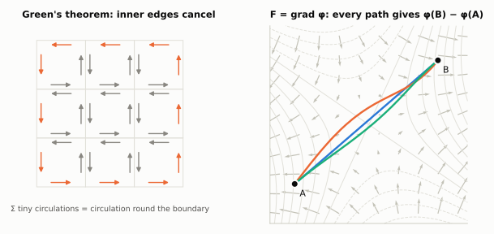
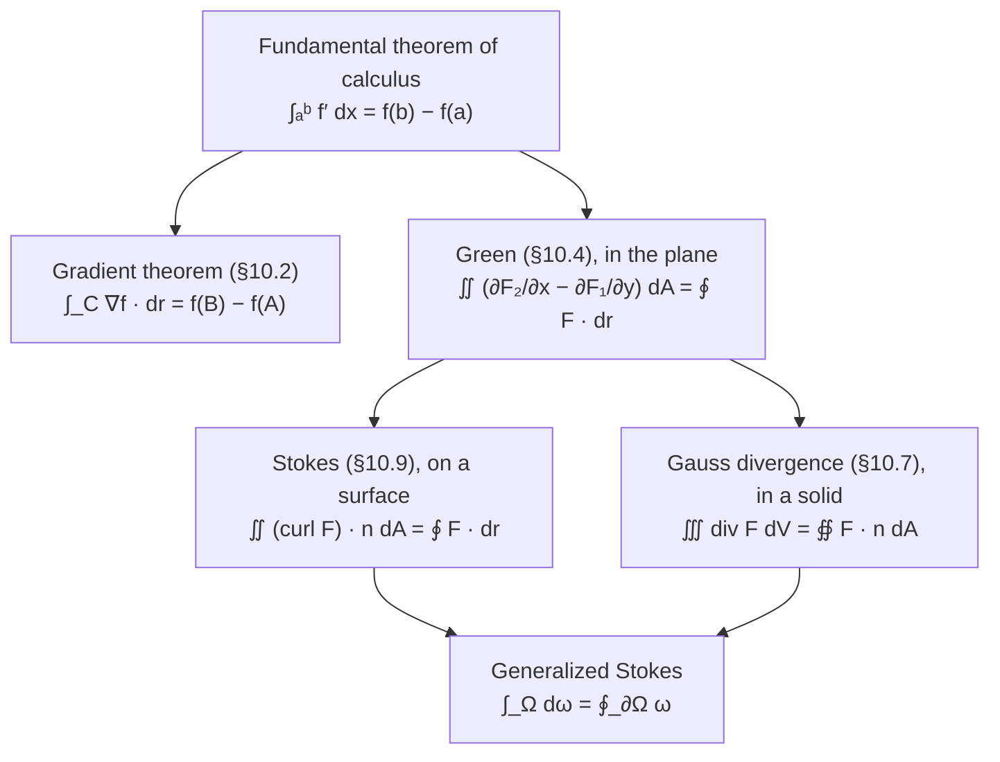
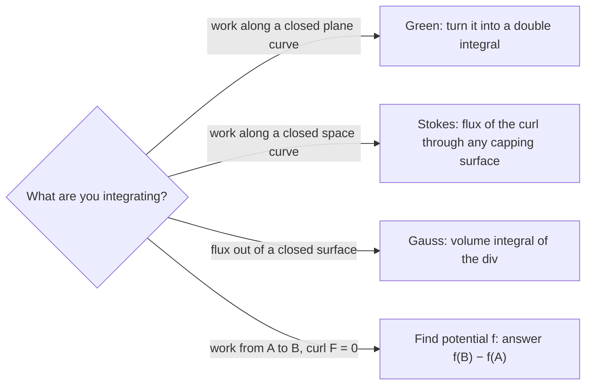

# 10 · Vector Integral Calculus · Integral Theorems

> *Green, Gauss and Stokes are one theorem: what happens inside a region equals what crosses its boundary.*

**Part B · Linear Algebra, Vector Calculus** · Kreyszig §10.1–10.9 · ⏱ ~12 min · Prereqs: [Ch. 9](09-vector-differential-calculus.md), double integrals
[← Grad, Div, Curl](09-vector-differential-calculus.md) · [Index](../../README.md) · [Next Part: Fourier Analysis →](../part-c-fourier-pdes/11-fourier-analysis.md)

---

## 🧭 The big picture

The Fundamental Theorem of Calculus, $\int_a^b f'(x)\,dx = f(b) - f(a)$, says the total change inside an interval is set by its two endpoints. This chapter lifts that idea to curves, surfaces and solids:

```math
\underbrace{\int_{\Omega} d\omega}_{\text{inside}} \;=\; \underbrace{\oint_{\partial\Omega} \omega}_{\text{boundary}} \qquad\text{(generalized Stokes theorem)}
```

<p align="center">
  <picture>
    <source media="(prefers-color-scheme: dark)" srcset="../../assets/figures/ch10-why-green-works-dark.svg">
    
  </picture>
</p>

## 🗺️ Concept map: one theorem, four faces



## 🔑 Core ideas, section by section

| § | Idea | Key formula |
|---|---|---|
| 10.1 | **Line integrals**: work along a path | $\int_C \mathbf{F}\cdot d\mathbf{r} = \int_a^b \mathbf{F}(\mathbf{r}(t))\cdot\mathbf{r}'(t)\,dt$ |
| 10.2 | **Path independence** | $\mathbf{F} = \nabla f \iff \oint\mathbf{F}\cdot d\mathbf{r} = 0 \iff \operatorname{curl}\mathbf{F} = \mathbf{0}$ (simply connected) |
| 10.3 | **Double integrals, change of variables** | $dx\,dy = \left\vert\frac{\partial(x,y)}{\partial(u,v)}\right\vert du\,dv$, polar: $r\,dr\,d\theta$ |
| 10.4 | **Green's theorem in the plane** | area $= \tfrac12\oint (x\,dy - y\,dx)$ |
| 10.5 | **Surfaces**: parametric $\mathbf{r}(u,v)$, normal vector | $\mathbf{N} = \mathbf{r}_u \times \mathbf{r}_v$ |
| 10.6 | **Surface integrals, flux, orientation** | $\iint_S \mathbf{F}\cdot\mathbf{n}\,dA = \iint_R \mathbf{F}(\mathbf{r})\cdot\mathbf{N}\,du\,dv$ |
| 10.7 | **Triple integrals, divergence theorem of Gauss** | $\iiint_T \operatorname{div}\mathbf{F}\,dV = \iint_S \mathbf{F}\cdot\mathbf{n}\,dA$ |
| 10.8 | **Applications**: continuity equation, heat equation, Green's identities, uniqueness | $\frac{\partial\rho}{\partial t} + \operatorname{div}(\rho\mathbf{v}) = 0$ |
| 10.9 | **Stokes's theorem** | $\iint_S (\operatorname{curl}\mathbf{F})\cdot\mathbf{n}\,dA = \oint_C \mathbf{F}\cdot\mathbf{r}'\,ds$ |

### Why the theorems are true, in one picture

Cut the region into tiny cells. For each cell, the circulation (or outflow) around its edge equals curl (or div) times its area (or volume). Add up all the cells. **Every interior edge is traversed twice in opposite directions and cancels**, so only the outer boundary is left. The left panel of the figure shows this cancellation.

### Choosing the right theorem



## 💡 Aha! moments

- **The shoelace formula is Green's theorem.** The area of a polygon with vertices $(x_i, y_i)$ is $\tfrac12\left\vert\sum (x_i y_{i+1} - x_{i+1}y_i)\right\vert$. GIS software, CAD tools and computer graphics use it constantly. Mechanical **planimeters** measure area by tracing only the boundary, for the same reason.
- **The divergence theorem gives conservation laws.** "Rate of change inside = flux through the wall" yields the continuity equation, the heat equation ([Ch. 12](../part-c-fourier-pdes/12-partial-differential-equations.md)) and Gauss's law $\oint \mathbf{E}\cdot\mathbf{n}\,dA = Q/\varepsilon_0$.
- **The Jacobian in a change of variables drives normalizing flows.** Generative models such as RealNVP and Glow compute exact likelihoods with $p_X(\mathbf{x}) = p_Z(\mathbf{z})\,\left\vert\det \partial\mathbf{z}/\partial\mathbf{x}\right\vert$, which is the $dx\,dy$ rule from §10.3 applied to densities.
- **A Möbius strip has no consistent normal**, so flux through it is undefined. Orientation matters.

## 🤖 Where it shows up

| Engineering | AI / computing |
|---|---|
| Maxwell's equations in integral form | Normalizing flows (change of variables + Jacobian determinants) |
| Fluid mass and momentum balances, CFD finite-volume schemes | Polygon area / winding numbers in graphics and mapping |
| Heat flux through walls, Ampère's circuital law | Conservation-aware physics-informed neural networks (PINNs) |

## ⚠️ Pitfalls

- Path independence requires a **simply connected** domain. The field $\mathbf{F} = \frac{(-y, x)}{x^2+y^2}$ has zero curl everywhere it is defined, yet its circulation around the origin is $2\pi$.
- Orientation: Green and Stokes use a **counter-clockwise** boundary (region on your left), and Gauss uses the **outward** normal.
- Do not forget the Jacobian factor when changing variables, such as the $r$ in $r\,dr\,d\theta$.

## 🧪 Try it

```python
import numpy as np
# Shoelace (Green's theorem) area of a polygon
x = np.array([0, 4, 4, 0]); y = np.array([0, 0, 3, 3])
print(0.5 * abs(np.dot(x, np.roll(y, -1)) - np.dot(y, np.roll(x, -1))))   # 12.0
```

## ✅ Book coverage

- [x] 10.1 Line Integrals
- [x] 10.2 Path Independence of Line Integrals
- [x] 10.3 Calculus Review: Double Integrals
- [x] 10.4 Green's Theorem in the Plane
- [x] 10.5 Surfaces for Surface Integrals
- [x] 10.6 Surface Integrals
- [x] 10.7 Triple Integrals. Divergence Theorem of Gauss
- [x] 10.8 Further Applications of the Divergence Theorem
- [x] 10.9 Stokes's Theorem

---
[← Grad, Div, Curl](09-vector-differential-calculus.md) · [Index](../../README.md) · [Next Part: Fourier Analysis →](../part-c-fourier-pdes/11-fourier-analysis.md)
