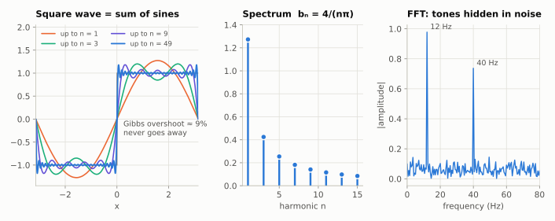
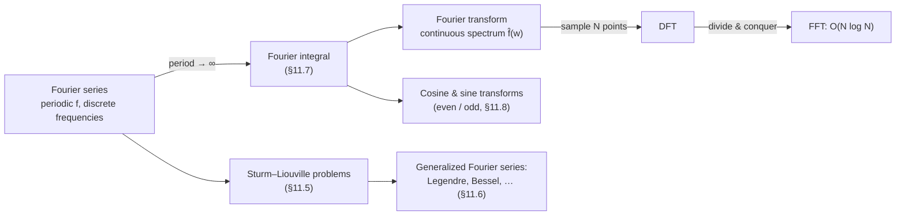

# 11 · Fourier Analysis

> *Any signal, whether a violin note, an ECG trace, a JPEG or a radio wave, is a sum of pure sine waves. Fourier analysis tells you which ones and how much of each.*

**Part C · Fourier Analysis, PDEs** · Kreyszig §11.1–11.10 · ⏱ ~12 min · Prereqs: integrals, complex exponentials
[← Integral Theorems](../part-b-linear-algebra-vector-calculus/10-vector-integral-calculus.md) · [Index](../../README.md) · [Next: Partial Differential Equations →](12-partial-differential-equations.md)

---

## 🧭 The big picture

Sines and cosines of different frequencies are **orthogonal**, like perpendicular axes:

```math
\int_{-\pi}^{\pi} \cos mx\,\cos nx\,dx = 0 \quad (m \ne n)
```

So any periodic function can be written in "coordinates" along these axes, and each coordinate is just a projection (an inner product):

```math
f(x) = a_0 + \sum_{n=1}^{\infty}\left(a_n\cos nx + b_n\sin nx\right), \qquad
a_n = \frac{1}{\pi}\int_{-\pi}^{\pi} f(x)\cos nx\,dx,\quad b_n = \frac{1}{\pi}\int_{-\pi}^{\pi} f(x)\sin nx\,dx
```

with $a_0 = \frac{1}{2\pi}\int_{-\pi}^{\pi} f\,dx$, the average value. Let the period grow to infinity and the series becomes the **Fourier transform**. Sample the signal and you get the **DFT**, which the **FFT** computes in $O(N\log N)$.

<p align="center">
  <picture>
    <source media="(prefers-color-scheme: dark)" srcset="../../assets/figures/ch11-fourier-square-wave-dark.svg">
    
  </picture>
</p>

## 🗺️ Concept map



## 🔑 Core ideas, section by section

| § | Idea | Key formula |
|---|---|---|
| 11.1 | **Fourier series** (period $2\pi$), Euler formulas, orthogonality, convergence | at a jump, the series converges to the **average** of the left and right limits |
| 11.2 | **Arbitrary period $2L$; even/odd functions; half-range expansions** | $\cos\frac{n\pi x}{L},\ \sin\frac{n\pi x}{L}$; even $\Rightarrow$ cosines only |
| 11.3 | **Forced oscillations**: expand a periodic force, then each harmonic drives its own response | the harmonic closest to $\omega_0$ dominates |
| 11.4 | **Approximation by trigonometric polynomials**: minimum square error, Parseval | $2a_0^2 + \sum (a_n^2 + b_n^2) = \frac{1}{\pi}\int_{-\pi}^{\pi} f^2\,dx$ |
| 11.5 | **Sturm–Liouville problems**, orthogonal eigenfunctions | $[p\,y']' + [q + \lambda r]\,y = 0$ |
| 11.6 | **Orthogonal series, generalized Fourier series**, completeness | $a_m = \dfrac{(f, y_m)}{\Vert y_m\Vert^2}$ |
| 11.7 | **Fourier integral** (non-periodic $f$) | $f(x) = \int_0^\infty [A(w)\cos wx + B(w)\sin wx]\,dw$ |
| 11.8 | **Fourier cosine and sine transforms** | $\hat f_c(w) = \sqrt{\tfrac{2}{\pi}}\int_0^\infty f(x)\cos wx\,dx$ |
| 11.9 | **Fourier transform, DFT, FFT** | $\hat f(w) = \frac{1}{\sqrt{2\pi}}\int_{-\infty}^{\infty} f(x)\,e^{-iwx}\,dx$ |
| 11.10 | **Tables of transforms** | see below |

### Sturm–Liouville: why so many "Fourier-like" series exist

Every regular Sturm–Liouville problem gives **real eigenvalues** and **eigenfunctions orthogonal with weight $r(x)$**. Sines and cosines are only the simplest case:

| Problem | Eigenfunctions | Series |
|---|---|---|
| $y'' + \lambda y = 0$ on $[0, L]$ | $\sin(n\pi x/L)$ | Fourier sine series |
| Legendre's equation on $[-1, 1]$ | $P_n(x)$ | Fourier–Legendre series |
| Bessel's equation on $[0, R]$ | $J_n(\alpha_{nm} r/R)$ | Fourier–Bessel series |

### Pocket table of Fourier transforms (Kreyszig's $1/\sqrt{2\pi}$ convention)

| $f(x)$ | $\hat f(w)$ |
|---|---|
| $e^{-ax^2}$ | $\frac{1}{\sqrt{2a}}\,e^{-w^2/4a}$ (a Gaussian maps to a Gaussian) |
| $e^{-a\vert x\vert}$ | $\sqrt{\frac{2}{\pi}}\,\frac{a}{a^2 + w^2}$ |
| box: $1$ on $\vert x\vert < b$, 0 elsewhere | $\sqrt{\frac{2}{\pi}}\,\frac{\sin bw}{w}$ |
| $f'(x)$ | $iw\,\hat f(w)$ |
| $f * g$ | $\sqrt{2\pi}\,\hat f\,\hat g$ |

### Discrete Fourier Transform

For $N$ samples $f_k$:

```math
\hat f_n = \sum_{k=0}^{N-1} f_k\, e^{-2\pi i\,nk/N}, \qquad n = 0,\dots,N-1
```

The **FFT** splits the sum into even- and odd-indexed samples recursively, which brings the cost from $N^2$ down to $N\log_2 N$. For $N = 10^6$ that is a speed-up of about 50,000×.

## 💡 Aha! moments

- **Transformer positional encodings are Fourier features.** The original transformer encodes position $p$ as $\sin(p/10000^{2i/d})$ and $\cos(p/10000^{2i/d})$, a bank of sinusoids at geometrically spaced frequencies. **RoPE** rotates query and key vectors by position-dependent angles, so attention scores depend on *relative* position through $e^{i\theta(m-n)}$ ([Ch. 31](../part-h-math-for-ai/31-neural-networks-transformers.md)).
- **NeRF and Fourier-feature networks** map coordinates through $[\sin(2^k\pi x), \cos(2^k\pi x)]$ so an MLP can learn fine detail. Without that mapping, networks show *spectral bias*: they learn low frequencies first.
- **JPEG is a cosine transform.** It takes the DCT of 8×8 blocks and throws away the high-frequency coefficients your eye barely notices. MP3 does the same for sound.
- **Speech models use spectrograms.** Whisper-style models take a log-Mel spectrogram (short-time FFTs) as input.
- **The Gibbs phenomenon:** near a jump, the partial sums overshoot by about 9% of the jump, and adding more terms does not remove it. This is why sharp cut-offs in filters cause "ringing".

## 🤖 Where it shows up

| Engineering | AI / computing |
|---|---|
| Vibration and spectrum analysis, audio EQ, power-system harmonics | Positional encodings, RoPE, Fourier features, NeRF |
| Radio/OFDM (Wi-Fi, 4G/5G), radar, MRI reconstruction | Fourier Neural Operators for PDE surrogates |
| Image compression (DCT), filtering, deconvolution | FFT-based long convolutions (Hyena, S4), spectrogram front-ends |

## ⚠️ Pitfalls

- **Conventions differ.** Factors of $2\pi$, the sign in the exponent, and where $1/\sqrt{2\pi}$ goes all vary between books and libraries. Check before you combine formulas.
- **Aliasing:** sampling at rate $f_s$ cannot represent frequencies above $f_s/2$ (Nyquist). They fold back as false low frequencies.
- **Spectral leakage:** an FFT of a non-periodic window smears the peaks. Apply a window function such as Hann.

## 🧪 Try it

```python
import numpy as np
fs, N = 256, 512
t = np.arange(N) / fs
x = np.sin(2*np.pi*12*t) + 0.6*np.sin(2*np.pi*40*t) + 0.8*np.random.randn(N)
X = np.abs(np.fft.rfft(x)); f = np.fft.rfftfreq(N, 1/fs)
print(f[np.argsort(X)[-2:]])          # → [40. 12.]  the hidden tones
```

## ✅ Book coverage

- [x] 11.1 Fourier Series
- [x] 11.2 Arbitrary Period. Even and Odd Functions. Half-Range Expansions
- [x] 11.3 Forced Oscillations
- [x] 11.4 Approximation by Trigonometric Polynomials
- [x] 11.5 Sturm–Liouville Problems. Orthogonal Functions
- [x] 11.6 Orthogonal Series. Generalized Fourier Series
- [x] 11.7 Fourier Integral
- [x] 11.8 Fourier Cosine and Sine Transforms
- [x] 11.9 Fourier Transform. Discrete and Fast Fourier Transforms
- [x] 11.10 Tables of Transforms

---
[← Integral Theorems](../part-b-linear-algebra-vector-calculus/10-vector-integral-calculus.md) · [Index](../../README.md) · [Next: Partial Differential Equations →](12-partial-differential-equations.md)
