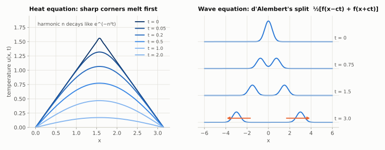
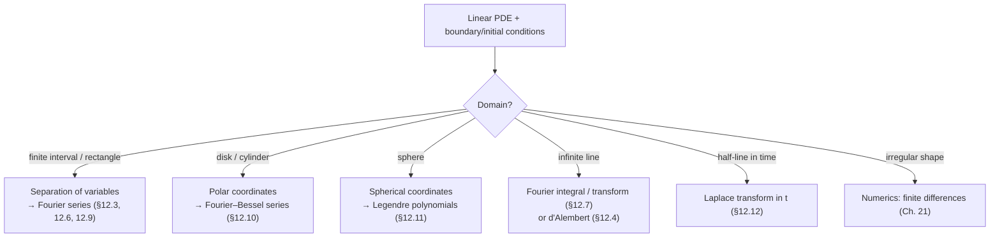
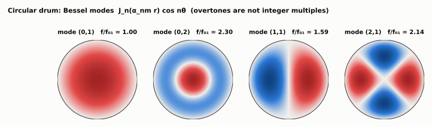

# 12 · Partial Differential Equations (PDEs)

> *Three equations describe most of classical physics: waves move, heat spreads, and potentials settle.*

**Part C · Fourier Analysis, PDEs** · Kreyszig §12.1–12.12 · ⏱ ~14 min · Prereqs: [Ch. 11](11-fourier-analysis.md), [Ch. 5](../part-a-odes/05-series-solutions-special-functions.md)
[← Fourier Analysis](11-fourier-analysis.md) · [Index](../../README.md) · [Next Part: Complex Numbers →](../part-d-complex-analysis/13-complex-numbers-functions.md)

---

## 🧭 The big picture

When a quantity depends on **space and time**, its law is a PDE. Three model equations cover most of engineering:

| Equation | Formula | Type | Behaviour |
|---|---|---|---|
| **Wave** | $u_{tt} = c^2\nabla^2 u$ | hyperbolic | signals travel at finite speed $c$ and keep their shape |
| **Heat / diffusion** | $u_t = c^2\nabla^2 u$ | parabolic | everything smooths out, and high frequencies die fastest |
| **Laplace / Poisson** | $\nabla^2 u = 0$ or $= f$ | elliptic | equilibrium: each point equals the average of its surroundings |

The main tool is **separation of variables** $u = F(x)\,G(t)$. It turns one PDE into ODEs ([Part A](../part-a-odes/01-first-order-odes.md)), and the boundary conditions select Fourier modes ([Ch. 11](11-fourier-analysis.md)).

<p align="center">
  <picture>
    <source media="(prefers-color-scheme: dark)" srcset="../../assets/figures/ch12-heat-and-wave-dark.svg">
    
  </picture>
</p>

## 🗺️ Concept map: which method?



## 🔑 Core ideas, section by section

| § | Idea | Key formula |
|---|---|---|
| 12.1 | **Basic concepts**: order, linearity, superposition, BCs and ICs | elliptic / parabolic / hyperbolic via $AC - B^2$ |
| 12.2 | **Vibrating string → wave equation** | $u_{tt} = c^2 u_{xx},\ c^2 = T/\rho$ |
| 12.3 | **Separation of variables + Fourier series** | $u = \sum_n (B_n\cos\lambda_n t + B_n^*\sin\lambda_n t)\sin\frac{n\pi x}{L},\ \lambda_n = \frac{cn\pi}{L}$ |
| 12.4 | **D'Alembert's solution, characteristics** | $u = \tfrac12[f(x+ct) + f(x-ct)] + \tfrac{1}{2c}\int_{x-ct}^{x+ct} g\,ds$ |
| 12.5 | **Heat flow modeling** | $u_t = c^2\nabla^2 u,\ c^2 = K/(\sigma\rho)$ |
| 12.6 | **Heat via Fourier series; steady 2-D heat; Dirichlet problem** | $u = \sum_n B_n \sin\frac{n\pi x}{L}\,e^{-\lambda_n^2 t},\ \lambda_n = \frac{cn\pi}{L}$ |
| 12.7 | **Very long bars: Fourier integrals & transforms** | $u = \frac{1}{2c\sqrt{\pi t}}\int f(v)\,e^{-(x-v)^2/4c^2t}\,dv$ |
| 12.8 | **Membranes: 2-D wave equation** | $u_{tt} = c^2(u_{xx} + u_{yy})$ |
| 12.9 | **Rectangular membrane, double Fourier series** | $\lambda_{mn} = c\pi\sqrt{m^2/a^2 + n^2/b^2}$ |
| 12.10 | **Laplacian in polar coordinates; circular membrane; Fourier–Bessel** | $\nabla^2 u = u_{rr} + \tfrac1r u_r + \tfrac{1}{r^2}u_{\theta\theta}$ |
| 12.11 | **Laplace's equation in cylindrical & spherical coordinates; potential** | solutions involve $r^n P_n(\cos\phi)$ |
| 12.12 | **Solving PDEs by Laplace transforms** | transform in $t$, solve an ODE in $x$ |

### Separation of variables in four steps

1. **Assume** $u(x,t) = F(x)G(t)$ and substitute. Divide to get $\frac{F''}{F} = \frac{\ddot G}{c^2 G} = -k$, a constant.
2. **Solve the space ODE** with the boundary conditions. Only certain $k$ work (eigenvalues), for example $F_n = \sin\frac{n\pi x}{L}$.
3. **Solve the time ODE** for each $n$: oscillation for waves, exponential decay for heat.
4. **Superpose** and fit the initial condition with Fourier coefficients.

### Hearing the shape of a drum

<p align="center">
  <picture>
    <source media="(prefers-color-scheme: dark)" srcset="../../assets/figures/ch12-drum-modes-dark.svg">
    
  </picture>
</p>

The circular membrane vibrates in modes $J_n(\alpha_{nm} r/R)\cos n\theta$. Their frequencies are set by the zeros of the Bessel functions, so the overtones are **not** whole-number multiples of the fundamental. A string's overtones are, which is why a guitar sounds pitched and a drum sounds percussive.

## 💡 Aha! moments

- **Diffusion models run the heat equation.** The solution of the heat equation is the initial data **convolved with a Gaussian** whose variance grows as $2c^2t$. Adding Gaussian noise to data, the forward process of score-based diffusion models, evolves the data density by exactly this kind of equation. Generation runs it *backwards* using a learned score ([Ch. 34](../part-h-math-for-ai/34-stochastic-processes-diffusion.md)).
- **Graph neural networks diffuse.** Repeated neighbour averaging $\mathbf{x} \leftarrow \mathbf{x} - \eta L\mathbf{x}$ (with $L$ the graph Laplacian) is the heat equation on a graph. It explains *over-smoothing*: after many layers every node looks alike.
- **Laplace's equation means "be the average".** A harmonic function equals its average on every circle. Jacobi iteration on a grid ([Ch. 21](../part-e-numerics/21-numerics-odes-pdes.md)) uses this directly.
- **Physics-informed neural networks (PINNs)** add $\Vert u_t - c^2 u_{xx}\Vert^2$ to the loss so the network must obey the PDE. Neural operators (FNO, DeepONet) learn the map from initial data to solution.

## 🤖 Where it shows up

| Engineering | AI / computing |
|---|---|
| Acoustics, seismology, transmission lines (wave) | Diffusion and score-based generative models |
| Heat sinks, chip thermal design, curing, groundwater (diffusion) | GNN message passing, over-smoothing analysis |
| Electrostatics, steady heat, potential flow (Laplace) | PINNs, Fourier Neural Operators, image denoising and inpainting (Poisson editing) |

## ⚠️ Pitfalls

- The boundary conditions determine the eigenfunctions. Insulated ends ($u_x = 0$) give **cosines**, and fixed temperature ($u = 0$) gives **sines**.
- Non-homogeneous BCs: first subtract a steady-state solution so that the BCs become homogeneous.
- The heat equation is **ill-posed backwards in time**, because high frequencies blow up like $e^{+n^2 t}$. Deblurring is hard for this reason, and diffusion models need a learned score to reverse it.

## 🧪 Try it

```python
import numpy as np
L, c, N = np.pi, 1.0, 50
x = np.linspace(0, L, 200)
f = np.minimum(x, L - x)                                   # triangle
B = [2/L*np.trapezoid(f*np.sin(n*x), x) for n in range(1, N)]
u = lambda t: sum(b*np.sin(n*x)*np.exp(-(c*n)**2*t) for n, b in enumerate(B, 1))
print(u(0).max().round(3), u(1).max().round(3))           # 1.557 → 0.468  (peak melts)
```

## ✅ Book coverage

- [x] 12.1 Basic Concepts of PDEs
- [x] 12.2 Modeling: Vibrating String, Wave Equation
- [x] 12.3 Solution by Separating Variables. Use of Fourier Series
- [x] 12.4 D'Alembert's Solution of the Wave Equation. Characteristics
- [x] 12.5 Modeling: Heat Flow from a Body in Space. Heat Equation
- [x] 12.6 Heat Equation: Solution by Fourier Series. Steady Two-Dimensional Heat Problems. Dirichlet Problem
- [x] 12.7 Heat Equation: Modeling Very Long Bars. Solution by Fourier Integrals and Transforms
- [x] 12.8 Modeling: Membrane, Two-Dimensional Wave Equation
- [x] 12.9 Rectangular Membrane. Double Fourier Series
- [x] 12.10 Laplacian in Polar Coordinates. Circular Membrane. Fourier–Bessel Series
- [x] 12.11 Laplace's Equation in Cylindrical and Spherical Coordinates. Potential
- [x] 12.12 Solution of PDEs by Laplace Transforms

---
[← Fourier Analysis](11-fourier-analysis.md) · [Index](../../README.md) · [Next Part: Complex Numbers →](../part-d-complex-analysis/13-complex-numbers-functions.md)
