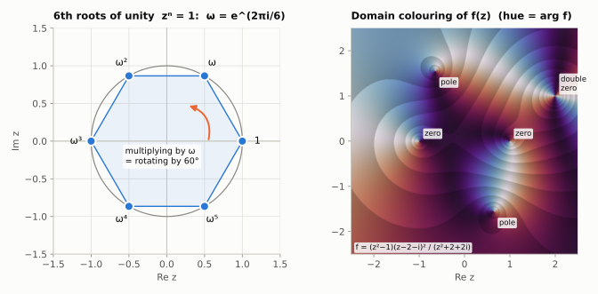
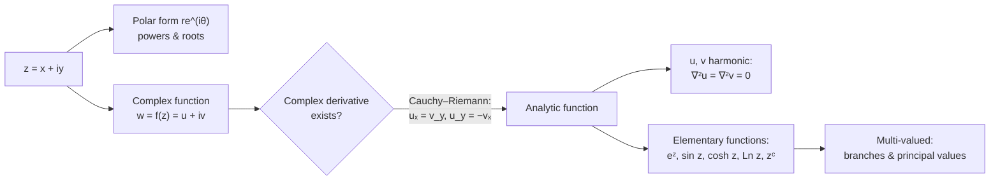

# 13 · Complex Numbers and Functions · Complex Differentiation

> *$e^{i\pi} + 1 = 0$ links five fundamental constants in one equation. It is also how every AC circuit, rotation and quantum state gets computed.*

**Part D · Complex Analysis** · Kreyszig §13.1–13.7 · ⏱ ~11 min · Prereqs: trigonometry, partial derivatives
[← PDEs](../part-c-fourier-pdes/12-partial-differential-equations.md) · [Index](../../README.md) · [Next: Complex Integration →](14-complex-integration.md)

---

## 🧭 The big picture

A complex number $z = x + iy$ is a point in the plane that you can also **multiply**, and multiplying means rotating and scaling:

```math
z = r\,e^{i\theta} = r(\cos\theta + i\sin\theta), \qquad z_1 z_2 = r_1 r_2\, e^{i(\theta_1 + \theta_2)}
```

A complex function $w = f(z)$ maps the plane to itself. Requiring $f$ to be **differentiable in the complex sense** (*analytic*) is a strong condition, and it brings strong consequences: harmonic real and imaginary parts, angle-preserving maps ([Ch. 17](17-conformal-mapping.md)) and the integral theorems of the next chapters.

<p align="center">
  <picture>
    <source media="(prefers-color-scheme: dark)" srcset="../../assets/figures/ch13-roots-domain-coloring-dark.svg">
    
  </picture>
</p>

In a **domain colouring**, hue shows $\arg f(z)$. Around a **zero** the colours cycle once in one direction, around a **pole** they cycle the other way, and around a double zero they cycle twice.

## 🗺️ Concept map



## 🔑 Core ideas, section by section

| § | Idea | Key formula |
|---|---|---|
| 13.1 | **Complex numbers & the complex plane** | $\bar z = x - iy$, $\ z\bar z = \vert z\vert^2$ |
| 13.2 | **Polar form, powers, roots** | $z^{1/n} = r^{1/n}\,e^{i(\theta + 2k\pi)/n}$, $k = 0..n-1$ |
| 13.3 | **Derivative, analytic function** | $f'(z) = \lim_{\Delta z\to 0}\frac{f(z+\Delta z) - f(z)}{\Delta z}$ from **every** direction |
| 13.4 | **Cauchy–Riemann equations, Laplace's equation** | $u_x = v_y,\ \ u_y = -v_x$ |
| 13.5 | **Exponential function** | $e^z = e^x(\cos y + i\sin y)$, period $2\pi i$, never 0 |
| 13.6 | **Trig & hyperbolic functions, Euler's formula** | $\cos z = \tfrac12(e^{iz} + e^{-iz})$, $\ \cos iy = \cosh y$ |
| 13.7 | **Logarithm, general power, principal value** | $\ln z = \ln\vert z\vert + i\arg z$, $\ z^c = e^{c\ln z}$ |

### Cauchy–Riemann, derived in one line

Approach $z$ horizontally ($\Delta z = \Delta x$) and vertically ($\Delta z = i\Delta y$). The two limits must agree:

```math
f'(z) = u_x + i v_x = \frac{1}{i}(u_y + i v_y) = v_y - i u_y \;\;\Longrightarrow\;\; u_x = v_y,\quad u_y = -v_x
```

Differentiate again and add to get $u_{xx} + u_{yy} = 0$. **The real and imaginary parts of an analytic function are automatically harmonic**, which is why complex analysis solves 2-D potential problems ([Ch. 18](18-complex-analysis-potential-theory.md)).

### Things that surprise people

| Real-variable intuition | Complex reality |
|---|---|
| $\vert\cos x\vert \le 1$ | $\cos(iy) = \cosh y \to \infty$: complex sine and cosine are **unbounded** |
| $e^x$ is one-to-one | $e^z$ is periodic: $e^{z + 2\pi i} = e^z$ |
| $\ln$ has one value | $\ln z$ has infinitely many values, $\operatorname{Ln}z + 2k\pi i$ |
| Powers of imaginary numbers are imaginary | $i^i = e^{i\ln i} = e^{-\pi/2} \approx 0.208$, a **real** number (principal value) |
| $\vert z\vert^2$ is smooth, so it is "differentiable" | $f(z) = \bar z$ is differentiable **nowhere**: it fails Cauchy–Riemann |

## 💡 Aha! moments

- **Rotations are multiplications.** Multiplying by $e^{i\theta}$ rotates by $\theta$. **RoPE**, the rotary positional embedding in most modern LLMs, treats pairs of query and key coordinates as complex numbers and multiplies them by $e^{im\theta}$ at position $m$. The attention score then depends only on $m - n$, because $e^{im\theta}\,\overline{e^{in\theta}} = e^{i(m-n)\theta}$ ([Ch. 31](../part-h-math-for-ai/31-neural-networks-transformers.md)).
- **Phasors make AC circuits algebraic.** With $V = V_0 e^{i\omega t}$, an inductor becomes the impedance $i\omega L$ and a capacitor becomes $1/(i\omega C)$. Ohm's law $V = ZI$ then works for the whole circuit.
- **Quantum amplitudes are complex.** Interference comes from adding complex numbers with different phases.
- **The Mandelbrot set** is just the iteration $z \mapsto z^2 + c$, using only this chapter's arithmetic.

## 🤖 Where it shows up

| Engineering | AI / computing |
|---|---|
| AC circuit analysis, impedance, power factor | RoPE positional embeddings, complex-valued SSM eigenvalues |
| Control (poles in the $s$-plane), signal processing | FFT (built from roots of unity $e^{-2\pi i k/N}$) |
| 2-D potential flow, electrostatics | Quantum computing (unitary complex matrices) |

## ⚠️ Pitfalls

- $\arg z$ is defined only up to $2\pi$. Use the principal value $\operatorname{Arg} z \in (-\pi, \pi]$ consistently.
- $\operatorname{Ln}(z_1 z_2) \ne \operatorname{Ln}z_1 + \operatorname{Ln}z_2$ in general, because of branch cuts.
- In code, `atan(y/x)` loses the quadrant. Use `atan2(y, x)` (or `np.angle`).

## 🧪 Try it

```python
import numpy as np, cmath
print(cmath.exp(1j*np.pi) + 1)               # ≈ 0 (Euler's identity)
print((1j)**(1j))                            # 0.2078… real!
print(np.exp(2j*np.pi*np.arange(6)/6).round(3))   # 6th roots of unity
```

## ✅ Book coverage

- [x] 13.1 Complex Numbers and Their Geometric Representation
- [x] 13.2 Polar Form of Complex Numbers. Powers and Roots
- [x] 13.3 Derivative. Analytic Function
- [x] 13.4 Cauchy–Riemann Equations. Laplace's Equation
- [x] 13.5 Exponential Function
- [x] 13.6 Trigonometric and Hyperbolic Functions. Euler's Formula
- [x] 13.7 Logarithm. General Power. Principal Value

---
[← PDEs](../part-c-fourier-pdes/12-partial-differential-equations.md) · [Index](../../README.md) · [Next: Complex Integration →](14-complex-integration.md)
