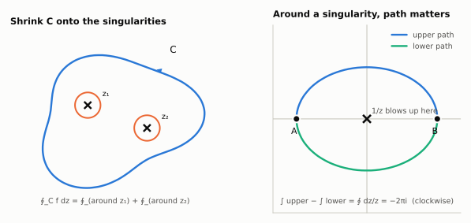
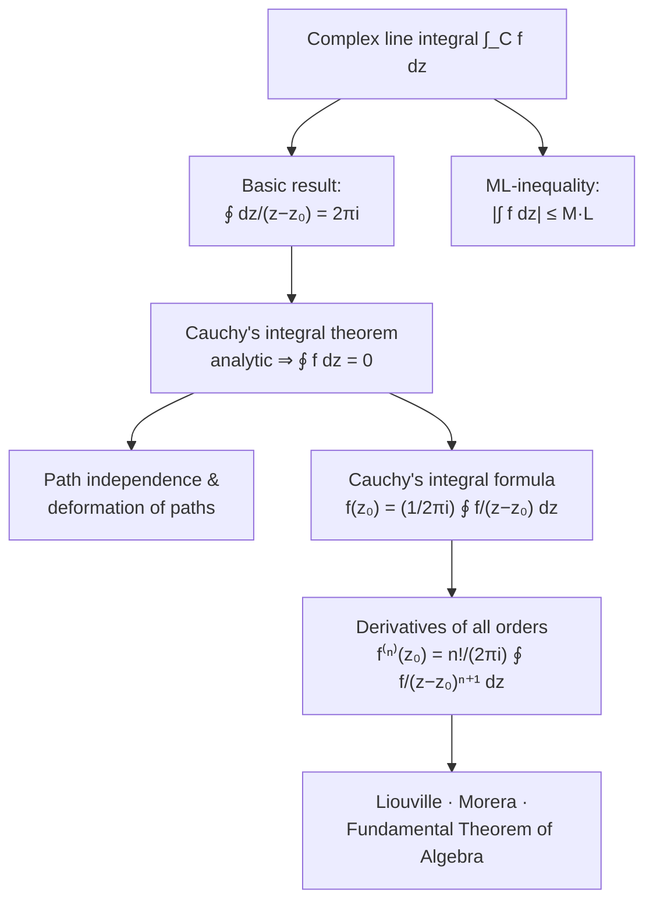

# 14 · Complex Integration

> *Know an analytic function on a closed curve and you know it at every point inside, together with all its derivatives.*

**Part D · Complex Analysis** · Kreyszig §14.1–14.4 · ⏱ ~9 min · Prereqs: [Ch. 13](13-complex-numbers-functions.md), line integrals ([Ch. 10](../part-b-linear-algebra-vector-calculus/10-vector-integral-calculus.md))
[← Complex Numbers](13-complex-numbers-functions.md) · [Index](../../README.md) · [Next: Power & Taylor Series →](15-power-series-taylor-series.md)

---

## 🧭 The big picture

Integrate $f(z)$ along a curve $C$ given by $z(t)$, $a \le t \le b$:

```math
\int_C f(z)\,dz = \int_a^b f\big(z(t)\big)\,\dot z(t)\,dt
```

The chapter rests on one calculation and two theorems:

```math
\oint_{\vert z - z_0\vert = \rho} (z - z_0)^m\,dz = \begin{cases} 2\pi i, & m = -1 \\ 0, & m \ne -1 \end{cases}
```

- **Cauchy's integral theorem:** if $f$ is analytic inside and on $C$, then $\oint_C f\,dz = 0$.
- **Cauchy's integral formula:** $f(z_0) = \dfrac{1}{2\pi i}\oint_C \dfrac{f(z)}{z - z_0}\,dz$.

<p align="center">
  <picture>
    <source media="(prefers-color-scheme: dark)" srcset="../../assets/figures/ch14-contour-deformation-dark.svg">
    
  </picture>
</p>

## 🗺️ Concept map



## 🔑 Core ideas, section by section

| § | Idea | Key formula |
|---|---|---|
| 14.1 | **Line integral in the complex plane**: parametrise, then integrate; ML bound | $\left\vert\int_C f\,dz\right\vert \le ML$ |
| 14.2 | **Cauchy's integral theorem**: path independence, deformation principle, multiply connected domains | $\oint_C f\,dz = 0$ (analytic, simply connected) |
| 14.3 | **Cauchy's integral formula** | $\oint_C \frac{f(z)}{z - z_0}\,dz = 2\pi i\,f(z_0)$ |
| 14.4 | **Derivatives of analytic functions**, Cauchy's inequality, Liouville, Morera | $f^{(n)}(z_0) = \frac{n!}{2\pi i}\oint_C\frac{f(z)}{(z - z_0)^{n+1}}\,dz$ |

### The deformation principle

You can deform a contour freely as long as you do not **cross a singularity**. A complicated contour around several singular points therefore equals the sum of small circles around each one (left panel). Chapter 16 turns this into **residue integration**.

### Consequences you should know by name

| Theorem | Statement | Why it is remarkable |
|---|---|---|
| **Infinitely differentiable** | analytic ⇒ $f', f'', \dots$ all exist and are analytic | in real analysis, one derivative guarantees nothing about the next |
| **Cauchy's inequality** | $\vert f^{(n)}(z_0)\vert \le n!\,M/r^n$ | bounds on $f$ give bounds on all its derivatives |
| **Liouville** | bounded and analytic on all of $\mathbb{C}$ ⇒ constant | $\sin z$ is entire, so it *must* be unbounded |
| **Morera** | continuous, and $\oint f\,dz = 0$ around every loop ⇒ analytic | converse of Cauchy's theorem |
| **Fundamental Theorem of Algebra** | every non-constant polynomial has a complex root | a two-line proof from Liouville applied to $1/p(z)$ |
| **Mean value** | $f(z_0)$ = average of $f$ on any circle around $z_0$ | the basis of harmonic-function theory ([Ch. 18](18-complex-analysis-potential-theory.md)) |

## 💡 Aha! moments

- **The value inside is fixed by the boundary.** The integral formula reconstructs $f$ at every interior point from boundary data alone. Real functions have no such rigidity.
- **S4's Cauchy kernel.** The S4 state-space model computes its convolution kernel by evaluating a *Cauchy kernel* $\sum_j \frac{c_j}{\omega - \lambda_j}$, the same $1/(z - z_0)$ structure as this chapter, with fast algorithms borrowed from numerical analysis.
- **Contour integrals in numerical linear algebra.** Matrix functions $f(A) = \frac{1}{2\pi i}\oint f(z)(zI - A)^{-1}dz$ and contour-based eigensolvers (such as FEAST) apply Cauchy's formula to matrices.
- **The inverse Laplace transform is a contour integral** (the Bromwich integral). Table lookups in [Ch. 6](../part-a-odes/06-laplace-transforms.md) are shortcuts for it.

## 🤖 Where it shows up

| Engineering | AI / computing |
|---|---|
| Inverse Laplace / z-transforms in control | Structured SSM kernels (Cauchy kernels in S4) |
| Nyquist stability criterion (counting encirclements) | Contour-integral eigensolvers, matrix functions |
| Lift on airfoils via circulation ([Ch. 18](18-complex-analysis-potential-theory.md)) | Analytic combinatorics: asymptotics of counting sequences |

## ⚠️ Pitfalls

- Cauchy's theorem needs **simple connectivity**, or must account for every hole. $\oint dz/z = 2\pi i \ne 0$ around the origin, even though $1/z$ is analytic on the circle.
- Orientation: the standard direction is counter-clockwise. Clockwise flips the sign.
- $\oint f\,dz = 0$ does **not** imply $f$ is analytic (for example, $\oint dz/z^2 = 0$). Morera's theorem needs this for *every* closed path.

## 🧪 Try it

```python
import numpy as np
t = np.linspace(0, 2*np.pi, 20001); z = np.exp(1j*t); dz = 1j*z
f = lambda z: np.exp(z)
print(np.trapezoid(f(z)/z * dz, t) / (2j*np.pi))        # ≈ e^0 = 1  (Cauchy formula)
print(np.trapezoid(f(z)/z**3 * dz, t) * 2/(2j*np.pi))   # ≈ f''(0) = 1
```

## ✅ Book coverage

- [x] 14.1 Line Integral in the Complex Plane
- [x] 14.2 Cauchy's Integral Theorem
- [x] 14.3 Cauchy's Integral Formula
- [x] 14.4 Derivatives of Analytic Functions

---
[← Complex Numbers](13-complex-numbers-functions.md) · [Index](../../README.md) · [Next: Power & Taylor Series →](15-power-series-taylor-series.md)
