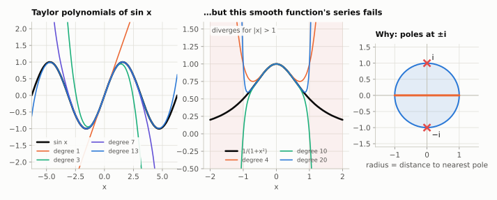
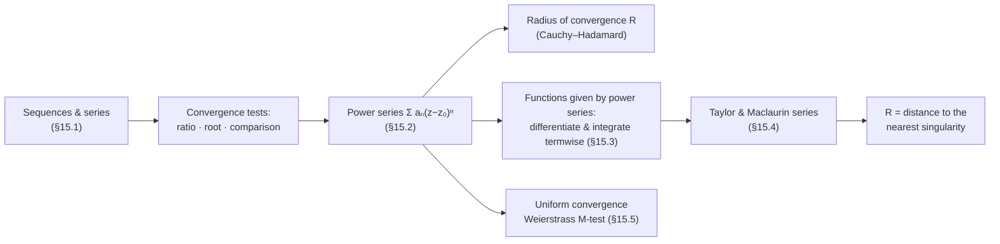

# 15 · Power Series · Taylor Series

> *Why does the series for $1/(1+x^2)$, a smooth function on the whole real line, fail for $\vert x\vert > 1$? The cause is a pole off the real axis, at $\pm i$.*

**Part D · Complex Analysis** · Kreyszig §15.1–15.5 · ⏱ ~9 min · Prereqs: [Ch. 14](14-complex-integration.md), limits
[← Complex Integration](14-complex-integration.md) · [Index](../../README.md) · [Next: Laurent Series & Residues →](16-laurent-series-residue-integration.md)

---

## 🧭 The big picture

A power series is an "infinite polynomial":

```math
\sum_{n=0}^{\infty} a_n (z - z_0)^n
```

It converges inside a **disk** of radius $R$ and diverges outside it. Every analytic function equals its **Taylor series**, and the disk extends exactly to the **nearest singularity**. That explains why the real series for $1/(1+x^2)$ stops at $\vert x\vert = 1$: the poles at $\pm i$ lie at distance 1 from the origin.

<p align="center">
  <picture>
    <source media="(prefers-color-scheme: dark)" srcset="../../assets/figures/ch15-taylor-radius-dark.svg">
    
  </picture>
</p>

## 🗺️ Concept map



## 🔑 Core ideas, section by section

| § | Idea | Key formula |
|---|---|---|
| 15.1 | **Sequences, series, convergence tests** | ratio test: $\lim\left\vert\frac{z_{n+1}}{z_n}\right\vert < 1 \Rightarrow$ converges |
| 15.2 | **Power series, radius of convergence** | $R = 1\Big/\lim\sqrt[n]{\vert a_n\vert}$, or $R = \lim\left\vert\frac{a_n}{a_{n+1}}\right\vert$ |
| 15.3 | **Functions given by power series**: termwise calculus, uniqueness | $\left(\sum a_n z^n\right)' = \sum n a_n z^{n-1}$ (same $R$) |
| 15.4 | **Taylor & Maclaurin series** | $f(z) = \sum_{n=0}^\infty \frac{f^{(n)}(z_0)}{n!}(z - z_0)^n$ |
| 15.5 | **Uniform convergence**: M-test, continuity of the sum, termwise integration | $\vert f_n\vert \le M_n,\ \sum M_n < \infty \Rightarrow$ uniform |

### The Maclaurin series worth memorising

| Function | Series | Converges for |
|---|---|---|
| $\dfrac{1}{1-z}$ | $1 + z + z^2 + z^3 + \cdots$ | $\vert z\vert < 1$ |
| $e^z$ | $1 + z + \dfrac{z^2}{2!} + \dfrac{z^3}{3!} + \cdots$ | all $z$ |
| $\sin z$ | $z - \dfrac{z^3}{3!} + \dfrac{z^5}{5!} - \cdots$ | all $z$ |
| $\cos z$ | $1 - \dfrac{z^2}{2!} + \dfrac{z^4}{4!} - \cdots$ | all $z$ |
| $\operatorname{Ln}(1+z)$ | $z - \dfrac{z^2}{2} + \dfrac{z^3}{3} - \cdots$ | $\vert z\vert < 1$ |
| $\arctan z$ | $z - \dfrac{z^3}{3} + \dfrac{z^5}{5} - \cdots$ | $\vert z\vert < 1$ |
| $(1+z)^\alpha$ | $\sum \binom{\alpha}{n} z^n$ (binomial series) | $\vert z\vert < 1$ |

**Euler's formula falls out of these series.** Substitute $z = i\theta$ into $e^z$ and group the real and imaginary terms: $e^{i\theta} = \cos\theta + i\sin\theta$.

### Truncation error (Taylor's theorem)

Stopping after the degree-$n$ term leaves a remainder of order $(z - z_0)^{n+1}$. Close to $z_0$, **each extra term adds roughly one more order of accuracy**. Numerical methods ([Part E](../part-e-numerics/19-numerics-in-general.md)) are built on this fact.

## 💡 Aha! moments

- **Linearisation drives optimisation.** Gradient descent uses the first-order Taylor model $L(\theta + \delta) \approx L + \nabla L^T\delta$. Newton's method uses the second-order model with the Hessian. Quantisation-error analysis (GPTQ, OBS) also uses the second-order expansion: $\Delta L \approx \tfrac12\delta^T H\delta$ ([Ch. 32](../part-h-math-for-ai/32-number-formats-quantization.md)).
- **The Neural Tangent Kernel** is the first-order Taylor expansion of a network in its *weights*. Very wide networks stay close to this linear model during training.
- **GELU's popular approximation** $0.5x\left(1 + \tanh\left[\sqrt{2/\pi}\,(x + 0.044715x^3)\right]\right)$ is a truncated series fit. Hardware and homomorphic-encryption inference replace activations with **low-degree polynomials** for the same reason.
- **`log1p(x)` and `expm1(x)` exist** because evaluating $\ln(1+x)$ directly loses precision for tiny $x$. These functions use the series instead.

## 🤖 Where it shows up

| Engineering | AI / computing |
|---|---|
| Small-angle approximations ($\sin\theta \approx \theta$) | Gradient/Newton steps, Laplace approximation, NTK |
| Perturbation methods, sensitivity analysis | Polynomial activation approximations (hardware, FHE) |
| Numerical methods: finite differences, Runge–Kutta derivations | Numerically stable `log1p`, `expm1`, `logsumexp` |

## ⚠️ Pitfalls

- A function can be infinitely differentiable on $\mathbb{R}$ and still not equal its Taylor series. The classic example is $e^{-1/x^2}$, whose Maclaurin series is identically 0.
- Check the **endpoints** of the interval of convergence separately: $\sum z^n/n$ converges at $z = -1$ but not at $z = 1$.
- Pointwise convergence is not enough to swap limits and integrals. You need **uniform** convergence.

## 🧪 Try it

```python
import numpy as np
x = 1.2                                       # outside the radius (|x| > 1)
for N in (10, 20, 40):
    s = sum((-1)**k * x**(2*k) for k in range(N))
    print(N, round(s, 2), "vs", round(1/(1+x**2), 4))   # partial sums explode
```

## ✅ Book coverage

- [x] 15.1 Sequences, Series, Convergence Tests
- [x] 15.2 Power Series
- [x] 15.3 Functions Given by Power Series
- [x] 15.4 Taylor and Maclaurin Series
- [x] 15.5 Uniform Convergence

---
[← Complex Integration](14-complex-integration.md) · [Index](../../README.md) · [Next: Laurent Series & Residues →](16-laurent-series-residue-integration.md)
