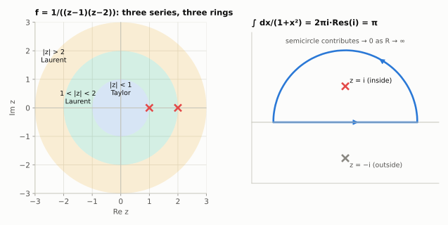
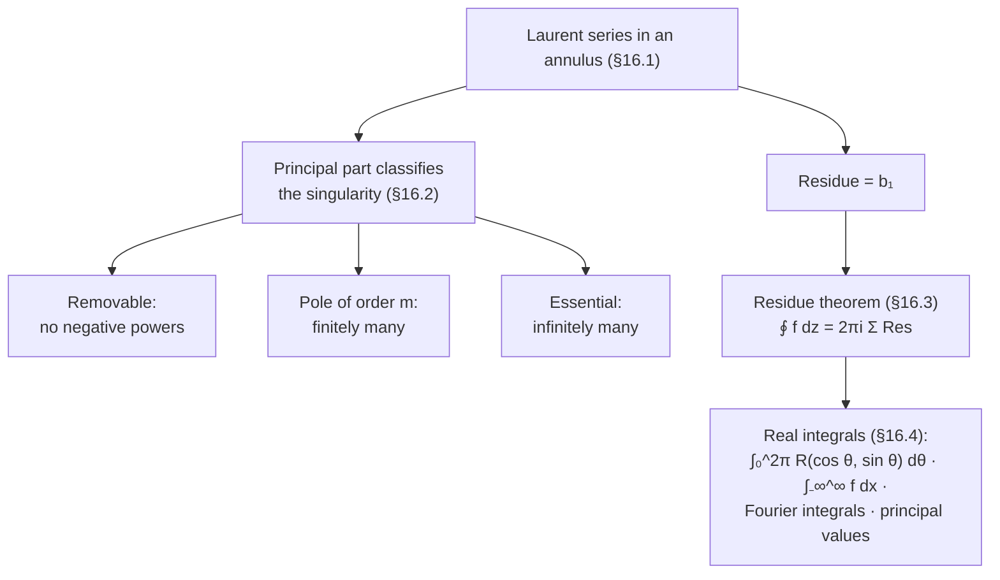

# 16 · Laurent Series · Residue Integration

> *To evaluate a hard real integral, step into the complex plane, walk around the poles, and add up their residues.*

**Part D · Complex Analysis** · Kreyszig §16.1–16.4 · ⏱ ~10 min · Prereqs: [Ch. 14](14-complex-integration.md), [Ch. 15](15-power-series-taylor-series.md)
[← Power & Taylor Series](15-power-series-taylor-series.md) · [Index](../../README.md) · [Next: Conformal Mapping →](17-conformal-mapping.md)

---

## 🧭 The big picture

Taylor series break down at singularities. **Laurent series** handle them by allowing **negative powers**:

```math
f(z) = \underbrace{\sum_{n=0}^{\infty} a_n (z - z_0)^n}_{\text{analytic part}} + \underbrace{\sum_{n=1}^{\infty} \frac{b_n}{(z - z_0)^n}}_{\text{principal part}}
```

The series converges in an **annulus** $r < \vert z - z_0\vert < R$. When you integrate it around $z_0$, only one coefficient survives, $b_1$, the **residue**, because $\oint (z-z_0)^m dz = 0$ unless $m = -1$. That gives the residue theorem:

```math
\oint_C f(z)\,dz = 2\pi i \sum_{\text{poles } z_j \text{ inside } C} \operatorname{Res}_{z = z_j} f(z)
```

<p align="center">
  <picture>
    <source media="(prefers-color-scheme: dark)" srcset="../../assets/figures/ch16-laurent-residues-dark.svg">
    
  </picture>
</p>

## 🗺️ Concept map



## 🔑 Core ideas, section by section

| § | Idea | Key formula |
|---|---|---|
| 16.1 | **Laurent series**: different annuli give different series | $b_n = \frac{1}{2\pi i}\oint \frac{f(z^*)}{(z^* - z_0)^{-n+1}}\,dz^*$ |
| 16.2 | **Singularities & zeros**, behaviour at infinity | pole of order $m$: $f \sim \frac{b_m}{(z-z_0)^m}$ |
| 16.3 | **Residue integration method** | simple pole: $\operatorname{Res} = \lim_{z\to z_0}(z - z_0)f(z) = \frac{p(z_0)}{q'(z_0)}$ |
| 16.4 | **Residue integration of real integrals** | $\int_{-\infty}^{\infty} f(x)\,dx = 2\pi i\sum_{\operatorname{Im} z_j > 0}\operatorname{Res} f$ |

### Computing residues

| Situation | Residue at $z_0$ |
|---|---|
| Simple pole | $\lim_{z\to z_0}(z - z_0)\,f(z)$ |
| $f = p/q$, simple zero of $q$ | $p(z_0)/q'(z_0)$ |
| Pole of order $m$ | $\dfrac{1}{(m-1)!}\lim_{z\to z_0}\dfrac{d^{m-1}}{dz^{m-1}}\big[(z - z_0)^m f(z)\big]$ |
| Anything else | read $b_1$ off the Laurent series |

### Three kinds of singularity

| Type | Laurent principal part | Example | Behaviour near $z_0$ |
|---|---|---|---|
| **Removable** | none | $\frac{\sin z}{z}$ at 0 | bounded, and can be patched |
| **Pole of order $m$** | finite, ending at $b_m$ | $\frac{1}{z^2}$ at 0 | $\vert f\vert \to \infty$ |
| **Essential** | infinite | $e^{1/z}$ at 0 | takes every complex value, with at most one exception, infinitely often near $z_0$ (Picard) |

### Three recipes for real integrals

| Integral type | Trick |
|---|---|
| $\int_0^{2\pi} R(\cos\theta, \sin\theta)\,d\theta$ | set $z = e^{i\theta}$ and integrate around the unit circle |
| $\int_{-\infty}^{\infty} \frac{p(x)}{q(x)}\,dx$ with $\deg q \ge \deg p + 2$ | close with a large upper semicircle, whose contribution vanishes |
| $\int_{-\infty}^{\infty} f(x)\cos sx\,dx$ | use $f(z)e^{isz}$ and Jordan's lemma |

Worked example: $\int_{-\infty}^{\infty}\frac{dx}{1+x^2} = 2\pi i\,\operatorname{Res}_{z=i}\frac{1}{(z-i)(z+i)} = 2\pi i\cdot\frac{1}{2i} = \pi$.

## 💡 Aha! moments

- **Partial fractions are residues.** $\frac{p(s)}{q(s)} = \sum \frac{\operatorname{Res}_j}{s - s_j}$ for simple poles. The inverse Laplace transform of a rational function is $\sum \operatorname{Res}_j\,e^{s_j t}$, so every pole contributes one exponential mode.
- **Diagonal state-space models use this structure.** A diagonal SSM has transfer function $H(s) = \sum_j \frac{c_j}{s - \lambda_j}$ (poles $\lambda_j$, residues $c_j$), so its convolution kernel is $K(t) = \sum_j c_j e^{\lambda_j t}$. S4D, Mamba and related models parametrise long-range memory this way.
- **A classic real integral done with complex methods:** $\int_{-\infty}^{\infty}\frac{\sin x}{x}\,dx = \pi$. It is hard with real techniques and short with an indented contour.

## 🤖 Where it shows up

| Engineering | AI / computing |
|---|---|
| Inverse Laplace / z-transforms, impulse responses | Pole–residue parametrisation of SSM sequence layers |
| Stability: poles in the left half-plane | Generating functions and asymptotic counting |
| Evaluating Fourier integrals in optics and signal processing | Characteristic-function inversion in probability |

## ⚠️ Pitfalls

- The Laurent series depends on the **annulus**: $\frac{1}{1-z}$ is $\sum z^n$ inside $\vert z\vert < 1$ but $-\sum z^{-n-1}$ outside.
- Include only the poles **inside** the contour. For the upper semicircle, that means the poles with $\operatorname{Im}z > 0$.
- Poles **on** the real axis call for a principal value and a small indentation, which contributes $\pi i\operatorname{Res}$ (half of a full turn).

## 🧪 Try it

```python
import sympy as sp
z = sp.symbols("z")
f = 1/(1 + z**2)
print(2*sp.pi*sp.I*sp.residue(f, z, sp.I))          # → pi
print(sp.integrate(1/(1+sp.Symbol('x')**2), (sp.Symbol('x'), -sp.oo, sp.oo)))  # pi
```

## ✅ Book coverage

- [x] 16.1 Laurent Series
- [x] 16.2 Singularities and Zeros. Infinity
- [x] 16.3 Residue Integration Method
- [x] 16.4 Residue Integration of Real Integrals

---
[← Power & Taylor Series](15-power-series-taylor-series.md) · [Index](../../README.md) · [Next: Conformal Mapping →](17-conformal-mapping.md)
