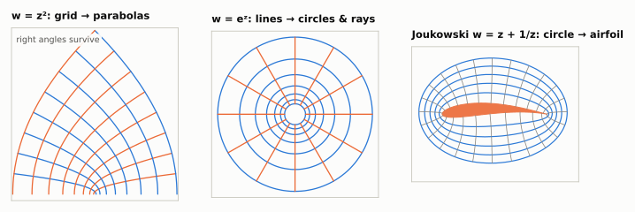
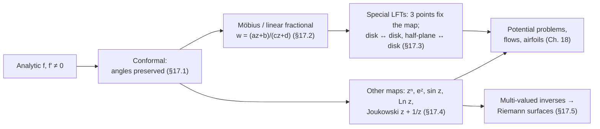
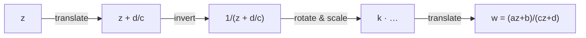

# 17 · Conformal Mapping

> *Analytic functions bend the plane while keeping every angle intact. A circle becomes an airfoil and a hard domain becomes an easy one.*

**Part D · Complex Analysis** · Kreyszig §17.1–17.5 · ⏱ ~9 min · Prereqs: [Ch. 13](13-complex-numbers-functions.md)
[← Laurent Series & Residues](16-laurent-series-residue-integration.md) · [Index](../../README.md) · [Next: Potential Theory →](18-complex-analysis-potential-theory.md)

---

## 🧭 The big picture

Near any point where $f'(z_0) \ne 0$, an analytic map $w = f(z)$ acts like **multiplication by the complex number $f'(z_0)$**: a rotation by $\arg f'(z_0)$ and a scaling by $\vert f'(z_0)\vert$. Small shapes keep their angles and orientation, so the map is **conformal**.

The practical consequence: harmonic functions stay harmonic under conformal maps. You can solve a 2-D potential problem on a **simple** domain (a disk or half-plane) and transport the answer to a complicated one ([Ch. 18](18-complex-analysis-potential-theory.md)).

<p align="center">
  <picture>
    <source media="(prefers-color-scheme: dark)" srcset="../../assets/figures/ch17-conformal-maps-dark.svg">
    
  </picture>
</p>

## 🗺️ Concept map



## 🔑 Core ideas, section by section

| § | Idea | Key formula |
|---|---|---|
| 17.1 | **Geometry of analytic functions**: conformality, critical points, magnification | local scale factor $\vert f'(z)\vert$; angles multiply by $n$ at a critical point of $z^n$ |
| 17.2 | **Linear fractional (Möbius) transformations** | $w = \dfrac{az + b}{cz + d},\ ad - bc \ne 0$ |
| 17.3 | **Special LFTs**, determined by three points (cross-ratio) | half-plane → disk: $w = \dfrac{z - i}{z + i}$ |
| 17.4 | **Other functions**: $e^z$, $\sin z$, $\operatorname{Ln}z$, Joukowski | $w = z + 1/z$: circle → ellipse, offset circle → airfoil |
| 17.5 | **Riemann surfaces**: making $\sqrt z$ and $\ln z$ single-valued | branch points and sheets |

### Möbius transformations: the circle-preserving family

Every Möbius map is a composition of four simple moves:



- They map **circles and lines to circles and lines** (a line is a circle through $\infty$).
- They form a **group** under composition, which corresponds to multiplying $2\times2$ matrices $\begin{bmatrix}a & b\\ c & d\end{bmatrix}$.
- **Three points determine one**: the map is fixed by where it sends $z_1, z_2, z_3$, via the cross-ratio.

### A small atlas of useful maps

| Map | Sends | Use |
|---|---|---|
| $w = z^2$ | quadrant → half-plane; grid → orthogonal parabolas | flow around a corner |
| $w = e^z$ | horizontal strip → half-plane; lines → rays and circles | channel and strip problems |
| $w = \operatorname{Ln}z$ | annulus/wedge → rectangle | coaxial cables, wedge heating |
| $w = \sin z$ | half-strip → half-plane | slots and channels |
| $w = \frac{z - i}{z + i}$ | upper half-plane → unit disk | Dirichlet problems ([Ch. 18](18-complex-analysis-potential-theory.md)) |
| $w = z + 1/z$ | circle → airfoil (Joukowski) | early aerodynamics and lift |

## 💡 Aha! moments

- **Mercator maps are conformal**, so they preserve angles and compass bearings, which navigators need. The cost is distorted area, which is why Greenland looks as large as Africa.
- **The Smith chart is a Möbius map.** RF engineers plot the reflection coefficient $\Gamma = \frac{z - 1}{z + 1}$ of a normalised impedance $z$. The whole right half-plane of passive impedances fits inside the unit disk.
- **Hyperbolic embeddings use Möbius arithmetic.** The Poincaré disk model embeds trees and hierarchies with low distortion. Hyperbolic neural networks combine vectors with *Möbius addition*, built from this chapter's linear fractional maps.
- **Graphics and mesh processing** use *conformal parameterisations* to flatten 3-D surfaces for texture mapping while keeping angles correct, so textures do not shear.

## 🤖 Where it shows up

| Engineering | AI / computing |
|---|---|
| Airfoil design (Joukowski, Kármán–Trefftz) | Hyperbolic / Poincaré-disk embeddings |
| Smith chart for RF matching networks | Conformal texture mapping, mesh parameterisation |
| Field problems in slots, corners, coaxial geometries | Data augmentation by conformal warps (images) |

## ⚠️ Pitfalls

- Conformality fails at **critical points**, where $f'(z_0) = 0$. For $z^2$ at the origin, angles are doubled.
- Möbius maps need $ad - bc \ne 0$, otherwise the map is constant.
- Track the branch cuts of inverse maps such as $\sqrt z$ and $\operatorname{Ln} z$. Values jump across a cut.

## 🧪 Try it

```python
import numpy as np
mobius = lambda z: (z - 1j) / (z + 1j)                  # upper half-plane → unit disk
pts = np.array([0, 1, -3, 2 + 5j, 1e6])                 # boundary & interior points
print(np.abs(mobius(pts)).round(4))                     # real axis → |w| = 1; 2+5j → < 1
```

## ✅ Book coverage

- [x] 17.1 Geometry of Analytic Functions: Conformal Mapping
- [x] 17.2 Linear Fractional Transformations (Möbius Transformations)
- [x] 17.3 Special Linear Fractional Transformations
- [x] 17.4 Conformal Mapping by Other Functions
- [x] 17.5 Riemann Surfaces

---
[← Laurent Series & Residues](16-laurent-series-residue-integration.md) · [Index](../../README.md) · [Next: Potential Theory →](18-complex-analysis-potential-theory.md)
