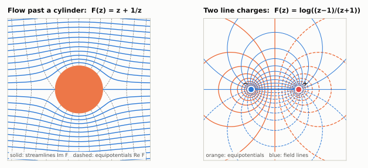
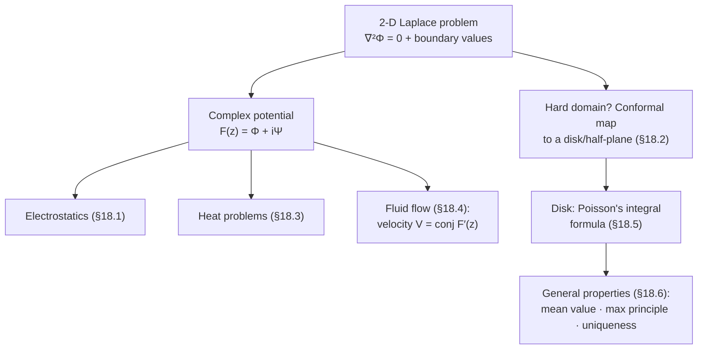

# 18 · Complex Analysis and Potential Theory

> *Electrostatics, steady heat and ideal fluid flow are one problem: find a harmonic function. Complex analysis does it with almost no effort.*

**Part D · Complex Analysis** · Kreyszig §18.1–18.6 · ⏱ ~10 min · Prereqs: [Ch. 13](13-complex-numbers-functions.md), [Ch. 17](17-conformal-mapping.md)
[← Conformal Mapping](17-conformal-mapping.md) · [Index](../../README.md) · [Next Part: Numerics →](../part-e-numerics/19-numerics-in-general.md)

---

## 🧭 The big picture

Many 2-D physical problems reduce to **Laplace's equation** $\nabla^2\Phi = 0$. If $F(z) = \Phi + i\Psi$ is analytic, then $\Phi$ and $\Psi$ are both harmonic and their level curves cross at right angles. One analytic function, the **complex potential**, gives you both families:

| Field | $\Phi = \text{const}$ (equipotentials) | $\Psi = \text{const}$ |
|---|---|---|
| Electrostatics | lines of equal voltage | electric field lines |
| Steady heat | isotherms | heat-flow lines |
| Ideal fluid | velocity potential | **streamlines** |

<p align="center">
  <picture>
    <source media="(prefers-color-scheme: dark)" srcset="../../assets/figures/ch18-potential-flow-dark.svg">
    
  </picture>
</p>

## 🗺️ Concept map



## 🔑 Core ideas, section by section

| § | Idea | Key formula |
|---|---|---|
| 18.1 | **Electrostatic fields**: complex potential, equipotentials vs field lines | line charge: $F = c\operatorname{Ln}z$ |
| 18.2 | **Use of conformal mapping**: harmonic stays harmonic | $\Phi^*(w) = \Phi(z(w))$ solves the mapped problem |
| 18.3 | **Heat problems**: steady temperature is harmonic | isotherms $T = \operatorname{Re}F$ |
| 18.4 | **Fluid flow**: incompressible + irrotational ⇒ potential flow | cylinder: $F = U\left(z + \frac{R^2}{z}\right)$ |
| 18.5 | **Poisson's integral formula** (Dirichlet problem in a disk) | $\Phi(r,\theta) = \frac{1}{2\pi}\int_0^{2\pi}\frac{(R^2 - r^2)\,\Phi(R,\alpha)}{R^2 - 2Rr\cos(\theta - \alpha) + r^2}\,d\alpha$ |
| 18.6 | **General properties of harmonic functions** | mean value, maximum principle, uniqueness |

### Building flows from simple pieces

Because Laplace's equation is linear, complex potentials **add**:

| Complex potential $F(z)$ | Flow |
|---|---|
| $Uz$ | uniform stream |
| $\frac{m}{2\pi}\operatorname{Ln}z$ | source ($m > 0$) or sink |
| $\frac{-i\Gamma}{2\pi}\operatorname{Ln}z$ | vortex with circulation $\Gamma$ |
| $U\left(z + \frac{R^2}{z}\right)$ | flow around a cylinder of radius $R$ |
| cylinder + vortex | **lift**: Kutta–Joukowski $L = \rho\,U\,\Gamma$ per unit span |

### The three properties of harmonic functions

1. **Mean value property:** $\Phi$ at the centre of a circle equals its average around the circle.
2. **Maximum principle:** a non-constant harmonic function has no interior maximum or minimum. Extremes occur on the boundary.
3. **Uniqueness:** the Dirichlet problem (boundary values given) has at most one solution, because the difference of two solutions is harmonic and zero on the boundary, so it is zero everywhere.

## 💡 Aha! moments

- **Random walks solve Laplace's equation.** Release a random walker at $z_0$. The probability that it first hits a given part of the boundary is a harmonic function of $z_0$, so $\Phi(z_0)$ is the *expected boundary value where the walker exits*. Monte Carlo "walk-on-spheres" solvers, now popular in graphics, use exactly this idea.
- **Label propagation is a harmonic function.** In graph semi-supervised learning, fix the labelled nodes (the boundary) and require every unlabelled node to equal the average of its neighbours (discrete Laplace). The resulting harmonic solution assigns soft labels to the whole graph.
- **Earnshaw's theorem:** you cannot hold a charge in stable equilibrium with static electric fields alone, because the potential has no interior minimum. Magnetic levitation needs tricks such as diamagnetism or feedback.
- **Lift comes from circulation.** A spinning ball curves (the Magnus effect) and a wing lifts because the flow around it carries circulation $\Gamma$.

## 🤖 Where it shows up

| Engineering | AI / computing |
|---|---|
| Capacitor and cable design, field around conductors | Graph label propagation (harmonic functions on graphs) |
| Heat spreaders, steady-state thermal design | Monte Carlo PDE solvers (walk-on-spheres) |
| Airfoil lift, flow past obstacles, groundwater flow | Laplacian mesh smoothing, Poisson image blending |

## ⚠️ Pitfalls

- Potential flow ignores viscosity, so it predicts **zero drag** (d'Alembert's paradox). Lift is captured, but drag needs boundary-layer theory.
- The fluid velocity is the **conjugate** of $F'(z)$: $V = V_1 + iV_2 = \overline{F'(z)}$.
- Conformal mapping only works in **2-D**. In 3-D, the only conformal maps are Möbius-type (Liouville's theorem on conformal maps).

## 🧪 Try it

```python
import numpy as np
# Mean value property for the harmonic function Φ = Re(z³) = x³ − 3xy²
z0, r = 0.3 + 0.2j, 0.5
t = np.linspace(0, 2*np.pi, 10001)[:-1]
print(np.mean(((z0 + r*np.exp(1j*t))**3).real), (z0**3).real)   # equal
```

## ✅ Book coverage

- [x] 18.1 Electrostatic Fields
- [x] 18.2 Use of Conformal Mapping. Modeling
- [x] 18.3 Heat Problems
- [x] 18.4 Fluid Flow
- [x] 18.5 Poisson's Integral Formula for Potentials
- [x] 18.6 General Properties of Harmonic Functions. Uniqueness Theorem for the Dirichlet Problem

---
[← Conformal Mapping](17-conformal-mapping.md) · [Index](../../README.md) · [Next Part: Numerics →](../part-e-numerics/19-numerics-in-general.md)
