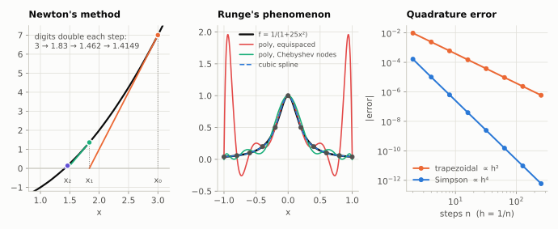
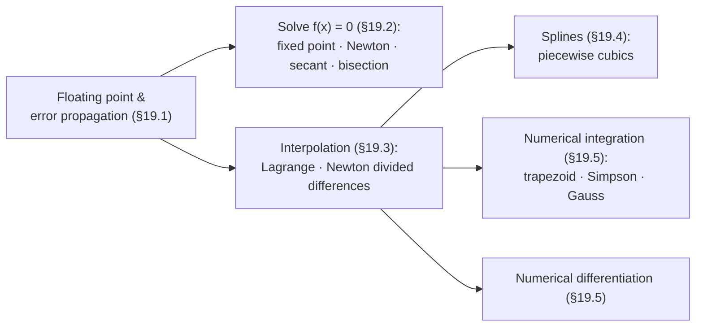

# 19 · Numerics in General

> *Computers do arithmetic with a finite number of digits. Numerical analysis is the craft of getting reliable answers from that imperfect arithmetic.*

**Part E · Numeric Analysis** · Kreyszig §19.1–19.5 · ⏱ ~11 min · Prereqs: Taylor series ([Ch. 15](../part-d-complex-analysis/15-power-series-taylor-series.md))
[← Potential Theory](../part-d-complex-analysis/18-complex-analysis-potential-theory.md) · [Index](../../README.md) · [Next: Numeric Linear Algebra →](20-numeric-linear-algebra.md)

---

## 🧭 The big picture

Most real problems have no closed-form solution, so we **approximate**. Every numerical method makes two kinds of error, and they pull in opposite directions:

| Error | Source | Shrinks when… |
|---|---|---|
| **Truncation** (discretisation) | replacing calculus by finite steps, e.g. cutting a Taylor series | $h \to 0$ |
| **Round-off** | storing numbers with finitely many bits | you use more bits, or fewer operations |

A good method balances the two, is **stable** (errors do not snowball), and is **efficient**.

<p align="center">
  <picture>
    <source media="(prefers-color-scheme: dark)" srcset="../../assets/figures/ch19-newton-runge-quadrature-dark.svg">
    
  </picture>
</p>

## 🗺️ Concept map



## 🔑 Core ideas, section by section

| § | Idea | Key formula |
|---|---|---|
| 19.1 | **Floating point, errors, stability**, loss of significant digits | relative error $\epsilon_r = \frac{\tilde a - a}{a}$; machine $\epsilon \approx 2.2\times10^{-16}$ (FP64) |
| 19.2 | **Solving equations by iteration** | Newton: $x_{n+1} = x_n - \frac{f(x_n)}{f'(x_n)}$ |
| 19.3 | **Interpolation** | Lagrange: $p(x) = \sum_k f_k \prod_{j\ne k}\frac{x - x_j}{x_k - x_j}$ |
| 19.4 | **Spline interpolation** | cubic pieces with continuous $p, p', p''$ at the knots |
| 19.5 | **Numerical integration & differentiation** | Simpson: $\frac{h}{3}(f_0 + 4f_1 + 2f_2 + \dots + 4f_{2m-1} + f_{2m})$ |

### Root-finding methods compared

| Method | Iteration | Convergence order | Needs |
|---|---|---|---|
| Bisection | halve the bracket $[a, b]$ | linear (1 bit per step) | sign change |
| Fixed point $x = g(x)$ | $x_{n+1} = g(x_n)$ | linear if $\vert g'\vert < 1$ | a good rewrite |
| **Newton** | tangent line | **quadratic**: correct digits double each step | $f'$ |
| Secant | chord through the last two points | $\approx 1.618$ (the golden ratio) | two starting points |

### Quadrature rules

| Rule | Error | Exact for polynomials of degree |
|---|---|---|
| Rectangular (midpoint) | $O(h^2)$ | 1 |
| Trapezoidal | $O(h^2)$ | 1 |
| **Simpson** | $O(h^4)$ | 3 |
| **Gauss** ($n$ nodes) | very small for smooth $f$ | $2n - 1$, the best possible |

**Numerical differentiation:** the central difference $f'(x) \approx \frac{f(x+h) - f(x-h)}{2h}$ has error $O(h^2)$. Making $h$ too small amplifies round-off, so the best step is around $h \approx \epsilon^{1/3}$.

## 💡 Aha! moments

- **Catastrophic cancellation and softmax.** Computing $e^{x_i}/\sum e^{x_j}$ directly overflows for large logits. Subtracting $\max x$ first (the *log-sum-exp trick*) gives the same result safely. FlashAttention's "online softmax" extends the trick to streaming blocks.
- **Newton's method keeps reappearing.** The famous *fast inverse square root* in 3-D graphics is one Newton step after a bit-level initial guess. The **Muon** optimiser orthogonalises its update with a *Newton–Schulz* iteration (the matrix version of Newton's method), and Newton–Schulz also computes matrix inverses and square roots on GPUs.
- **Splines are coming back in AI.** Kolmogorov–Arnold Networks (KANs) put learnable B-splines on the edges of a network instead of fixed activations on the nodes.
- **Gradient checking uses central differences.** Before trusting a hand-written backward pass, compare it against $\frac{L(\theta + h e_i) - L(\theta - h e_i)}{2h}$.

## 🤖 Where it shows up

| Engineering | AI / computing |
|---|---|
| Solving nonlinear circuit and structural equations | Stable softmax / log-sum-exp, mixed-precision training ([Ch. 32](../part-h-math-for-ai/32-number-formats-quantization.md)) |
| CAD curves and surfaces (splines, NURBS) | KANs, spline-based learning-rate schedules, lookup-table activations |
| Integrating sensor data, computing areas and energies | Gradient checking, numerical integration in probabilistic models |

## ⚠️ Pitfalls

- **Runge's phenomenon:** high-degree polynomial interpolation on equally spaced nodes oscillates badly. Use splines or Chebyshev nodes instead.
- Newton's method can diverge, or cycle, from a poor starting point or near $f' = 0$. Combine it with bisection for safety.
- Floating-point addition is **not associative**: $(a + b) + c \ne a + (b + c)$. Parallel reductions on GPUs can give slightly different answers from run to run.

## 🧪 Try it

```python
import numpy as np
x = np.array([1000., 1001., 1002.])
naive = np.exp(x) / np.exp(x).sum()                    # overflow → nan
stable = np.exp(x - x.max()) / np.exp(x - x.max()).sum()
print(naive, stable)                                   # [nan nan nan] [0.090 0.245 0.665]
```

## ✅ Book coverage

- [x] 19.1 Introduction
- [x] 19.2 Solution of Equations by Iteration
- [x] 19.3 Interpolation
- [x] 19.4 Spline Interpolation
- [x] 19.5 Numeric Integration and Differentiation

---
[← Potential Theory](../part-d-complex-analysis/18-complex-analysis-potential-theory.md) · [Index](../../README.md) · [Next: Numeric Linear Algebra →](20-numeric-linear-algebra.md)
