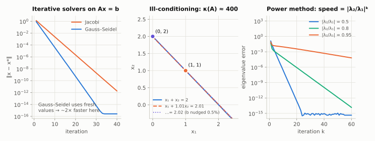
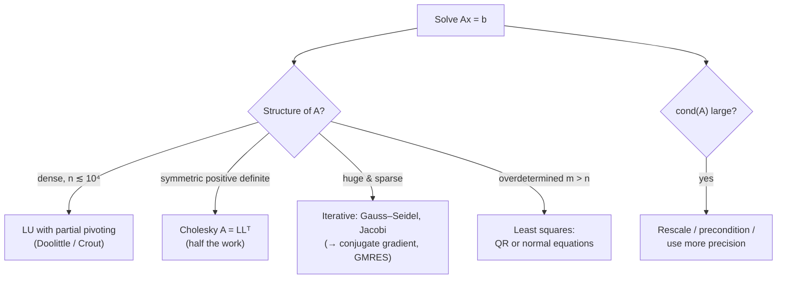

# 20 · Numeric Linear Algebra

> *The condition number tells you how much to trust a computed answer before you compute it.*

**Part E · Numeric Analysis** · Kreyszig §20.1–20.9 · ⏱ ~12 min · Prereqs: [Ch. 7](../part-b-linear-algebra-vector-calculus/07-linear-algebra-matrices-systems.md), [Ch. 8](../part-b-linear-algebra-vector-calculus/08-eigenvalue-problems.md)
[← Numerics in General](19-numerics-in-general.md) · [Index](../../README.md) · [Next: Numerics for ODEs & PDEs →](21-numerics-odes-pdes.md)

---

## 🧭 The big picture

Chapters 7–8 asked whether solutions exist. This chapter asks **how to compute them fast and accurately** when $n$ is in the thousands or millions. The topics fall into three groups:

1. **Direct solvers**: elimination and factorisations (LU, Cholesky, QR).
2. **Iterative solvers**: Jacobi and Gauss–Seidel. They are cheap per step and good for huge sparse systems.
3. **Eigenvalue algorithms**: bounds (Gerschgorin), the power method, and the QR algorithm.

Underneath all three is **conditioning**: how sensitive the answer is to small changes in the data.

<p align="center">
  <picture>
    <source media="(prefers-color-scheme: dark)" srcset="../../assets/figures/ch20-iteration-conditioning-power-dark.svg">
    
  </picture>
</p>

## 🗺️ Concept map: choosing a solver



## 🔑 Core ideas, section by section

| § | Idea | Key formula |
|---|---|---|
| 20.1 | **Gauss elimination with partial pivoting** | cost $\approx \frac{2}{3}n^3$; pivot = largest entry in the column |
| 20.2 | **LU factorisation, matrix inversion**: Doolittle, Crout, Cholesky | $A = LU$; SPD: $A = LL^T$ |
| 20.3 | **Iterative methods**: Gauss–Seidel, Jacobi | converge if $\rho(\text{iteration matrix}) < 1$, e.g. diagonally dominant $A$ |
| 20.4 | **Ill-conditioning, vector & matrix norms** | $\kappa(A) = \Vert A\Vert\,\Vert A^{-1}\Vert$ |
| 20.5 | **Least squares** | normal equations $A^TA\,\mathbf{x} = A^T\mathbf{b}$ |
| 20.6 | **Eigenvalue problems: introduction** | numerical methods for $A\mathbf{x} = \lambda\mathbf{x}$ |
| 20.7 | **Inclusion of eigenvalues**: Gerschgorin, Schur | every $\lambda$ lies in some disk $\vert z - a_{jj}\vert \le \sum_{k\ne j}\vert a_{jk}\vert$ |
| 20.8 | **Power method** with Rayleigh quotient, scaling, spectral shift | $\mathbf{x}_{k+1} = A\mathbf{x}_k/\Vert A\mathbf{x}_k\Vert$, error $\sim\vert\lambda_2/\lambda_1\vert^k$ |
| 20.9 | **Householder tridiagonalisation, QR factorisation & QR algorithm** | $A_k = Q_kR_k,\ A_{k+1} = R_kQ_k$ |

### Conditioning in one inequality

```math
\frac{\Vert\delta\mathbf{x}\Vert}{\Vert\mathbf{x}\Vert} \;\le\; \kappa(A)\,\frac{\Vert\delta\mathbf{b}\Vert}{\Vert\mathbf{b}\Vert}
```

**Rule of thumb:** with $\kappa(A) \approx 10^k$, expect to lose about $k$ significant digits. FP64 has about 16 digits, FP32 about 7, BF16 about 3. A system with $\kappa = 10^4$ is fine in FP64, marginal in FP32, and hopeless in BF16.

### Norms you will meet

| Vector norm | $\Vert\mathbf{x}\Vert_1 = \sum\vert x_i\vert$ | $\Vert\mathbf{x}\Vert_2 = \sqrt{\sum x_i^2}$ | $\Vert\mathbf{x}\Vert_\infty = \max\vert x_i\vert$ |
|---|---|---|---|
| Induced matrix norm | max column sum | $\sigma_{\max}(A)$ (spectral norm) | max row sum |

## 💡 Aha! moments

- **Linear regression is §20.5.** The fit $\hat{\mathbf{w}} = (X^TX)^{-1}X^T\mathbf{y}$ squares the condition number, $\kappa(X^TX) = \kappa(X)^2$. Good libraries solve it with **QR** or **SVD** instead. Ridge regression adds $\lambda I$ to $X^TX$, which also improves the conditioning.
- **Spectral normalisation runs the power method.** Each training step does one power iteration to estimate a layer's largest singular value $\sigma_{\max}(W)$, which is cheap because the vector is reused between steps.
- **Normalisation layers act as preconditioners.** BatchNorm, LayerNorm and feature standardisation reduce the condition number of the loss Hessian, so gradient descent zig-zags less ([Ch. 22](../part-f-optimization-graphs/22-optimization-linear-programming.md)).
- **Mixed-precision iterative refinement:** factor $A$ quickly in low precision on tensor cores, then correct the answer with a few residual steps in FP64. You get FP64 accuracy at close to low-precision speed.
- **Gaussian processes run on Cholesky.** GP regression and many Bayesian methods factor a kernel matrix $K = LL^T$ ([Ch. 29](../part-h-math-for-ai/29-bayesian-inference-sampling.md)).

## 🤖 Where it shows up

| Engineering | AI / computing |
|---|---|
| Finite-element and circuit simulators (sparse LU, iterative solvers) | Linear/ridge regression, Gaussian processes (Cholesky) |
| Structural vibration modes (QR algorithm) | Spectral normalisation, PageRank (power method) |
| Curve fitting and calibration (least squares) | Preconditioned optimisers (Shampoo, K-FAC), randomized SVD |

## ⚠️ Pitfalls

- **Never invert a matrix to solve a system.** `np.linalg.solve` is about 3× cheaper and more accurate than `inv(A) @ b`.
- Without pivoting, Gaussian elimination can fail even on well-conditioned matrices, for example when a pivot is 0 or tiny.
- The power method fails if the starting vector has no component along the top eigenvector, and it is slow when $\vert\lambda_2/\lambda_1\vert \approx 1$.

## 🧪 Try it

```python
import numpy as np
A = np.array([[1, 1], [1, 1.01]]); b = np.array([2, 2.01])
print(np.linalg.cond(A))                                  # ≈ 402
print(np.linalg.solve(A, b), np.linalg.solve(A, b + [0, 0.01]))  # (1,1) → (0,2)
```

## ✅ Book coverage

- [x] 20.1 Linear Systems: Gauss Elimination
- [x] 20.2 Linear Systems: LU-Factorization, Matrix Inversion
- [x] 20.3 Linear Systems: Solution by Iteration
- [x] 20.4 Linear Systems: Ill-Conditioning, Norms
- [x] 20.5 Least Squares Method
- [x] 20.6 Matrix Eigenvalue Problems: Introduction
- [x] 20.7 Inclusion of Matrix Eigenvalues
- [x] 20.8 Power Method for Eigenvalues
- [x] 20.9 Tridiagonalization and QR-Factorization

---
[← Numerics in General](19-numerics-in-general.md) · [Index](../../README.md) · [Next: Numerics for ODEs & PDEs →](21-numerics-odes-pdes.md)
