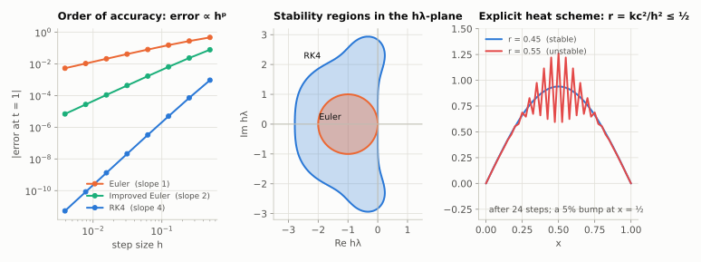
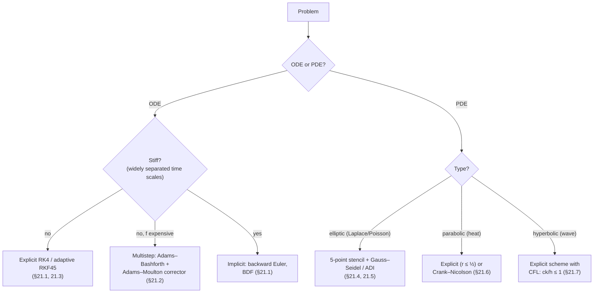

# 21 · Numerics for ODEs and PDEs

> *Every weather forecast, crash test and diffusion-model image is produced by a numerical solver taking small time steps.*

**Part E · Numeric Analysis** · Kreyszig §21.1–21.7 · ⏱ ~12 min · Prereqs: [Ch. 1](../part-a-odes/01-first-order-odes.md), [Ch. 12](../part-c-fourier-pdes/12-partial-differential-equations.md), [Ch. 19](19-numerics-in-general.md)
[← Numeric Linear Algebra](20-numeric-linear-algebra.md) · [Index](../../README.md) · [Next Part: Optimization →](../part-f-optimization-graphs/22-optimization-linear-programming.md)

---

## 🧭 The big picture

Replace derivatives by differences and march forward in steps of size $h$. A solver is judged on three things:

| Property | Question | Measured by |
|---|---|---|
| **Accuracy** | How fast does the error shrink as $h \to 0$? | order $p$: error $\propto h^p$ |
| **Stability** | Do small errors stay small? | stability region; for PDEs, $r$ or CFL limits |
| **Cost** | How many $f$-evaluations per step? | RK4 needs 4; multistep methods need about 1 |

<p align="center">
  <picture>
    <source media="(prefers-color-scheme: dark)" srcset="../../assets/figures/ch21-order-stability-dark.svg">
    
  </picture>
</p>

## 🗺️ Concept map: picking a method



## 🔑 Core ideas, section by section

| § | Idea | Key formula |
|---|---|---|
| 21.1 | **One-step methods**: Euler, improved Euler (Heun), RK4, RKF (adaptive), backward Euler | RK4: $y_{n+1} = y_n + \frac{h}{6}(k_1 + 2k_2 + 2k_3 + k_4)$ |
| 21.2 | **Multistep methods**: Adams–Bashforth (explicit), Adams–Moulton (implicit), predictor–corrector | reuse past slopes: one new $f$-evaluation per step |
| 21.3 | **Systems & higher-order ODEs**: RK for vectors, Runge–Kutta–Nyström | write $y'' = f$ as a first-order system |
| 21.4 | **Elliptic PDEs**: Laplace difference equation, Liebmann, ADI | $u_{i+1,j} + u_{i-1,j} + u_{i,j+1} + u_{i,j-1} - 4u_{ij} = 0$ |
| 21.5 | **Neumann & mixed problems, irregular boundaries** | ghost points for $\partial u/\partial n$ |
| 21.6 | **Parabolic PDEs**: explicit and Crank–Nicolson | stable explicit iff $r = \frac{k}{h^2} \le \frac12$ (with $c = 1$) |
| 21.7 | **Hyperbolic PDEs**: wave equation | stable iff $r^* = \frac{ck}{h} \le 1$ (CFL) |

### The classical RK4 step

```math
\begin{aligned}
k_1 &= f(x_n, y_n), & k_2 &= f\!\left(x_n + \tfrac h2,\ y_n + \tfrac h2 k_1\right),\\
k_3 &= f\!\left(x_n + \tfrac h2,\ y_n + \tfrac h2 k_2\right), & k_4 &= f(x_n + h,\ y_n + hk_3)
\end{aligned}
```

It is a weighted average of four slopes, and it matches the Taylor series up to $h^4$.

### Stiffness, in one example

For $y' = -1000\,(y - \cos x)$, explicit Euler needs $h < 0.002$ to stay stable, even though the solution itself varies slowly. Implicit methods remain stable for large $h$ at the price of solving an equation each step. Chemistry, circuits and control systems are often stiff.

### Why the explicit heat scheme has a speed limit

The scheme $u_i^{n+1} = u_i^n + r(u_{i+1}^n - 2u_i^n + u_{i-1}^n)$ multiplies the fastest grid mode by $1 - 4r$ each step. For $r > \tfrac12$ this factor is below $-1$, so the zig-zag mode flips sign and **grows** every step. That is the right-hand panel of the figure. Crank–Nicolson averages the explicit and implicit steps and is stable for any $r$.

## 💡 Aha! moments

- **Diffusion-model samplers are ODE solvers.** Generating an image means integrating the *probability-flow ODE* from noise to data. DDIM is essentially a first-order step. EDM (Karras et al., 2022) uses **Heun's method** (§21.1), and DPM-Solver uses higher-order multistep methods. Fewer, smarter steps mean faster image generation ([Ch. 34](../part-h-math-for-ai/34-stochastic-processes-diffusion.md)).
- **Neural ODEs call adaptive RK solvers** (for example Dormand–Prince "dopri5", a descendant of RKF) inside the forward pass, and backpropagate with the *adjoint method*.
- **A learning-rate limit is a stability limit.** Gradient descent is explicit Euler on $\theta' = -\nabla L$. On a quadratic with curvature $\lambda$ it is stable only if $\eta\lambda < 2$, which is the same kind of stability region as in the middle panel.
- **A naming coincidence:** the Adam optimiser stands for *adaptive moment estimation*. It has no relation to the Adams–Bashforth methods.

## 🤖 Where it shows up

| Engineering | AI / computing |
|---|---|
| Orbit propagation, vehicle dynamics, circuit simulation (SPICE uses implicit methods) | Diffusion samplers (Euler, Heun, DPM-Solver), flow matching |
| CFD, weather and climate models (CFL-limited time steps) | Neural ODEs, physics simulators for robotics and RL |
| Heat treatment and electronics thermal simulation | PINNs and neural operators trained against FD/FEM data |

## ⚠️ Pitfalls

- Halving $h$ only halves Euler's error. Use a higher-order method before you reach for tiny steps.
- A method can be **accurate yet unstable**. Check the stability region against your problem's eigenvalues $h\lambda$.
- Explicit PDE schemes: if you refine the space grid $h$ by 2, the heat scheme needs a time step $k$ that is 4× smaller ($k \le h^2/2c^2$).

## 🧪 Try it

```python
import numpy as np
f = lambda t, y: -1000*(y - np.cos(t))      # stiff
for h in (0.0019, 0.0021):                  # explicit Euler: stable iff h < 0.002
    y = 0.0
    for n in range(500): y += h * f(n*h, y)
    print(h, y)                             # ≈ cos(t)  vs  blows up
```

## ✅ Book coverage

- [x] 21.1 Methods for First-Order ODEs
- [x] 21.2 Multistep Methods
- [x] 21.3 Methods for Systems and Higher Order ODEs
- [x] 21.4 Methods for Elliptic PDEs
- [x] 21.5 Neumann and Mixed Problems. Irregular Boundary
- [x] 21.6 Methods for Parabolic PDEs
- [x] 21.7 Method for Hyperbolic PDEs

---
[← Numeric Linear Algebra](20-numeric-linear-algebra.md) · [Index](../../README.md) · [Next Part: Optimization →](../part-f-optimization-graphs/22-optimization-linear-programming.md)
