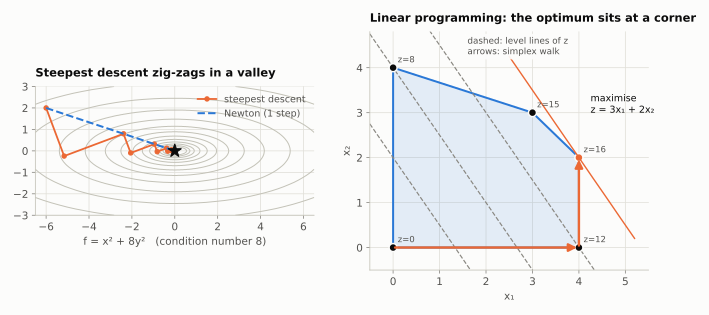
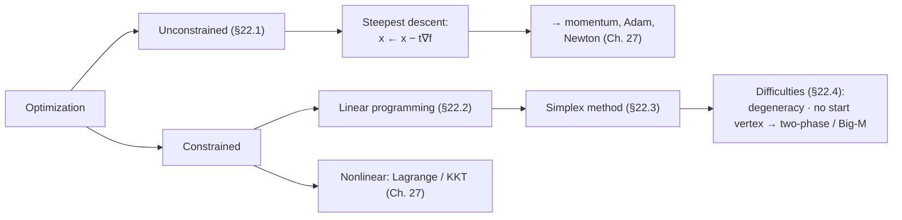
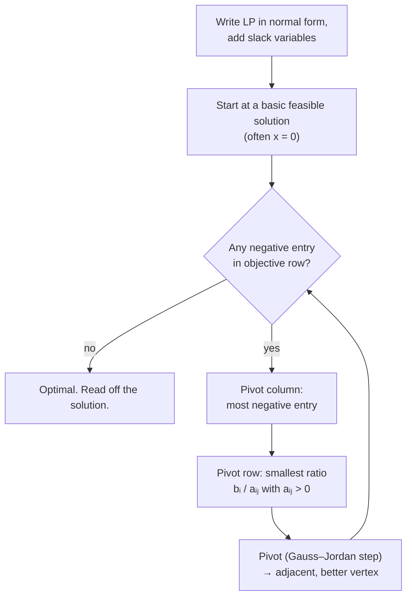

# 22 · Unconstrained Optimization · Linear Programming

> *Gradient descent trains every neural network. The simplex method schedules airlines, factories and power grids. Both are in this chapter.*

**Part F · Optimization, Graphs** · Kreyszig §22.1–22.4 · ⏱ ~10 min · Prereqs: gradients ([Ch. 9](../part-b-linear-algebra-vector-calculus/09-vector-differential-calculus.md)), linear systems ([Ch. 7](../part-b-linear-algebra-vector-calculus/07-linear-algebra-matrices-systems.md))
[← Numerics for ODEs & PDEs](../part-e-numerics/21-numerics-odes-pdes.md) · [Index](../../README.md) · [Next: Graphs & Combinatorial Optimization →](23-graphs-combinatorial-optimization.md)

---

## 🧭 The big picture

Optimisation means choosing the best $\mathbf{x}$:

```math
\min_{\mathbf{x}}\ f(\mathbf{x}) \quad\text{subject to constraints}
```

This chapter covers the two extreme cases:

| | **Unconstrained, smooth** | **Linear programming (LP)** |
|---|---|---|
| Problem | minimise any differentiable $f$ | minimise or maximise linear $\mathbf{c}^T\mathbf{x}$ subject to $A\mathbf{x} \le \mathbf{b}$, $\mathbf{x} \ge 0$ |
| Geometry | walk downhill on a landscape | the feasible region is a polytope, and the optimum is at a **vertex** |
| Algorithm | **steepest descent** (gradient method) | **simplex method**: walk from vertex to vertex |

<p align="center">
  <picture>
    <source media="(prefers-color-scheme: dark)" srcset="../../assets/figures/ch22-descent-and-lp-dark.svg">
    
  </picture>
</p>

## 🗺️ Concept map



## 🔑 Core ideas, section by section

| § | Idea | Key formula |
|---|---|---|
| 22.1 | **Basic concepts, steepest descent**: move against the gradient, with a line search for the step length $t$ | $\mathbf{x}_{k+1} = \mathbf{x}_k - t_k\nabla f(\mathbf{x}_k)$ |
| 22.2 | **Linear programming**: normal form, slack variables, feasible solutions | $\max z = \mathbf{c}^T\mathbf{x}$ s.t. $A\mathbf{x} = \mathbf{b},\ \mathbf{x} \ge 0$ |
| 22.3 | **Simplex method**: tableau, pivot column (most negative cost), pivot row (minimum ratio test) | each pivot moves to an adjacent vertex with better $z$ |
| 22.4 | **Simplex difficulties**: degeneracy (cycling), finding a first feasible vertex | two-phase method or Big-M with artificial variables |

### Why steepest descent zig-zags

With exact line search, each new gradient is **perpendicular** to the previous step. In a narrow valley, with condition number $\kappa = \lambda_{\max}/\lambda_{\min} \gg 1$, the path bounces between the walls. The error shrinks by about

```math
\left(\frac{\kappa - 1}{\kappa + 1}\right)^2 \text{ per step}
```

which approaches 1 (painfully slow) as $\kappa \to \infty$. Momentum, Adam, preconditioning and Newton's method ([Ch. 27](../part-h-math-for-ai/27-optimization-for-ml.md)) all exist to fix this.

### The simplex method in one flowchart



## 💡 Aha! moments

- **Training a network is steepest descent with noise.** SGD estimates $\nabla f$ from a mini-batch. The zig-zag problem above explains why plain SGD struggles on ill-conditioned losses and why **momentum** helps: it averages out the oscillating components.
- **Optimal transport is a linear program.** The Wasserstein (*earth mover's*) distance between two distributions is the optimum of an LP over transport plans. Sinkhorn's algorithm solves an entropy-regularised version on GPUs, and it is used in generative modelling, domain adaptation and token-to-expert routing.
- **LP duality pairs every LP with a twin.** Each maximisation problem has a minimisation partner with the same optimal value. Shadow prices, max-flow/min-cut ([Ch. 23](23-graphs-combinatorial-optimization.md)) and SVM theory all come from duality.
- **Simplex is exponential in the worst case but fast in practice.** Klee and Minty built cubes where it visits every vertex. Interior-point methods (Karmarkar, 1984) are polynomial and are the default for very large LPs.

## 🤖 Where it shows up

| Engineering | AI / computing |
|---|---|
| Production planning, blending, diet and transport problems | SGD and its variants for training every neural network |
| Power-grid dispatch, network design | Optimal transport (Wasserstein), LP relaxations for routing and scheduling |
| Supply chains, airline crew scheduling (integer LP) | GPU-cluster job scheduling, compiler instruction scheduling |

## ⚠️ Pitfalls

- Steepest descent finds a **local** minimum, and only a stationary point if $f$ is non-convex.
- The step length matters as much as the direction: too large diverges, too small crawls.
- LP: an unbounded feasible region can make the objective unbounded, and an empty feasible region means no solution at all. Check both before pivoting.

## 🧪 Try it

```python
from scipy.optimize import linprog
# maximise 3x1 + 2x2  s.t.  x1 ≤ 4,  x1 + x2 ≤ 6,  x1 + 3x2 ≤ 12,  x ≥ 0
res = linprog(c=[-3, -2], A_ub=[[1, 0], [1, 1], [1, 3]], b_ub=[4, 6, 12])
print(res.x, -res.fun)          # [4. 2.] 16.0  ← a vertex of the polygon
```

## ✅ Book coverage

- [x] 22.1 Basic Concepts. Unconstrained Optimization: Method of Steepest Descent
- [x] 22.2 Linear Programming
- [x] 22.3 Simplex Method
- [x] 22.4 Simplex Method: Difficulties

---
[← Numerics for ODEs & PDEs](../part-e-numerics/21-numerics-odes-pdes.md) · [Index](../../README.md) · [Next: Graphs & Combinatorial Optimization →](23-graphs-combinatorial-optimization.md)
