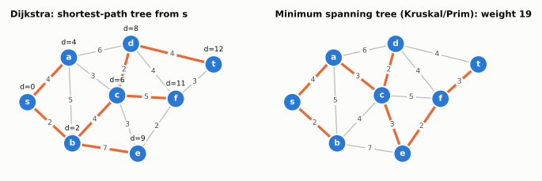
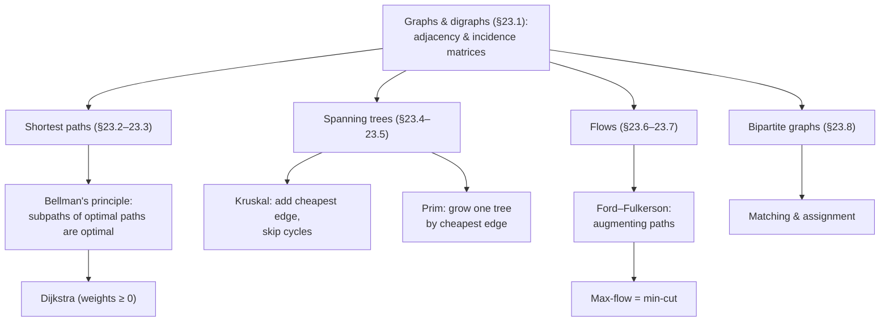

# 23 · Graphs · Combinatorial Optimization

> *Road networks, the internet, molecules, social networks, neural-network computation graphs and agent workflows are all graphs, made of nodes and edges.*

**Part F · Optimization, Graphs** · Kreyszig §23.1–23.8 · ⏱ ~11 min · Prereqs: none (matrices help)
[← Optimization & LP](22-optimization-linear-programming.md) · [Index](../../README.md) · [Next Part: Probability →](../part-g-probability-statistics/24-data-analysis-probability.md)

---

## 🧭 The big picture

A **graph** $G = (V, E)$ is a set of vertices joined by edges, which may be directed and may carry weights. Combinatorial optimisation asks for the best *discrete* structure inside a graph:

| Problem | Question | Classic algorithm | Cost |
|---|---|---|---|
| Shortest path | cheapest route from $s$ to $t$? | Moore's BFS (unweighted), **Dijkstra** | $O(m\log n)$ with a heap |
| Minimum spanning tree | cheapest way to connect everything? | **Kruskal**, **Prim** (greedy) | $O(m\log n)$ |
| Maximum flow | how much can the network carry? | **Ford–Fulkerson** (augmenting paths) | polynomial (Edmonds–Karp) |
| Assignment / matching | best pairing of two sets? | augmenting paths, Hungarian method | $O(n^3)$ |

<p align="center">
  <picture>
    <source media="(prefers-color-scheme: dark)" srcset="../../assets/figures/ch23-dijkstra-mst-dark.svg">
    
  </picture>
</p>

The same graph gives **different trees** depending on the question. A shortest-path tree minimises distances *from $s$*. A spanning tree minimises the *total* edge weight.

## 🗺️ Concept map



## 🔑 Core ideas, section by section

| § | Idea | Key fact |
|---|---|---|
| 23.1 | **Graphs and digraphs**: degree, paths, cycles, adjacency matrix $A$, incidence matrix | $(A^k)_{ij}$ = number of walks of length $k$ from $i$ to $j$ |
| 23.2 | **Shortest paths, complexity**: Moore's BFS; polynomial vs exponential time | BFS: $O(m)$ for unweighted graphs |
| 23.3 | **Bellman's principle, Dijkstra's algorithm** | $d(v) = \min_{u}\,[d(u) + w(u,v)]$ |
| 23.4 | **Shortest spanning trees: greedy (Kruskal)** | sort edges, add if no cycle (union–find) |
| 23.5 | **Prim's algorithm** | grow a single tree from a root |
| 23.6 | **Flows in networks**: capacity, conservation, cuts | flow value $\le$ capacity of any cut |
| 23.7 | **Maximum flow: Ford–Fulkerson** | stop when no augmenting path exists ⇒ max-flow = min-cut |
| 23.8 | **Bipartite graphs, assignment problems** | maximum matching via augmenting paths |

### Bellman's principle

> *An optimal path has the property that whatever the first step, the remaining path is optimal from the point that step reaches.*

This one sentence is the foundation of **dynamic programming**. It gives Dijkstra's algorithm here and the **Bellman equation** of reinforcement learning ([Ch. 35](../part-h-math-for-ai/35-reinforcement-learning.md)):

```math
d(v) = \min_{u \to v}\big[d(u) + w(u, v)\big] \qquad\longleftrightarrow\qquad V(s) = \max_a\Big[r(s,a) + \gamma\sum_{s'} P(s'\mid s,a)\,V(s')\Big]
```

### Complexity in one table

| Growth | $n = 10$ | $n = 100$ | Feasible? |
|---|---|---|---|
| $n\log n$ | 33 | 664 | always |
| $n^3$ | 1,000 | $10^6$ | yes |
| $2^n$ | 1,024 | $10^{30}$ | no (brute-force TSP and many subset problems) |

## 💡 Aha! moments

- **A neural network is a graph.** Autodiff records the forward pass as a **directed acyclic graph (DAG)** and runs backprop in reverse topological order ([Ch. 26](../part-h-math-for-ai/26-matrix-calculus-autodiff.md)).
- **Agent workflows are graphs.** LangGraph-style orchestration, tool-call plans and multi-agent pipelines are DAGs or state machines. Scheduling them means topological sort plus critical-path analysis ([Ch. 36](../part-h-math-for-ai/36-agentic-workflows.md)). Planning agents search graphs with **A\***, which is Dijkstra plus a heuristic.
- **DETR uses the Hungarian algorithm.** The object-detection transformer matches its predicted boxes to ground-truth boxes with an optimal bipartite assignment (§23.8) at every training step.
- **Graph cuts segment images.** Max-flow/min-cut separates foreground from background in classic computer vision.
- **Graph neural networks** pass messages along edges, using the adjacency matrix of §23.1 as their wiring diagram.

## 🤖 Where it shows up

| Engineering | AI / computing |
|---|---|
| GPS routing, network routing protocols (OSPF uses Dijkstra) | Computational graphs, autodiff, compilers for ML (XLA, TVM) |
| Power/water/telecom network design (MST, max flow) | Agent planning (A\*, tree search), DAG workflow orchestration |
| Job assignment, transport logistics | GNNs, knowledge graphs, RAG over graphs, bipartite matching losses |

## ⚠️ Pitfalls

- Dijkstra **fails with negative edge weights**. Use Bellman–Ford, which also detects negative cycles.
- Greedy algorithms work for spanning trees (matroid structure) but are **not** optimal in general, for example for the travelling salesman problem.
- An adjacency matrix costs $O(n^2)$ memory. Use adjacency lists for sparse graphs.

## 🧪 Try it

```python
import heapq
G = {"s": {"a": 4, "b": 2}, "a": {"c": 3}, "b": {"a": 1, "c": 7}, "c": {}}
dist, pq = {"s": 0}, [(0, "s")]
while pq:
    d, u = heapq.heappop(pq)
    for v, w in G[u].items():
        if d + w < dist.get(v, float("inf")):
            dist[v] = d + w; heapq.heappush(pq, (d + w, v))
print(dist)                       # {'s': 0, 'a': 3, 'b': 2, 'c': 6}
```

## ✅ Book coverage

- [x] 23.1 Graphs and Digraphs
- [x] 23.2 Shortest Path Problems. Complexity
- [x] 23.3 Bellman's Principle. Dijkstra's Algorithm
- [x] 23.4 Shortest Spanning Trees: Greedy Algorithm
- [x] 23.5 Shortest Spanning Trees: Prim's Algorithm
- [x] 23.6 Flows in Networks
- [x] 23.7 Maximum Flow: Ford–Fulkerson Algorithm
- [x] 23.8 Bipartite Graphs. Assignment Problems

---
[← Optimization & LP](22-optimization-linear-programming.md) · [Index](../../README.md) · [Next Part: Probability →](../part-g-probability-statistics/24-data-analysis-probability.md)
