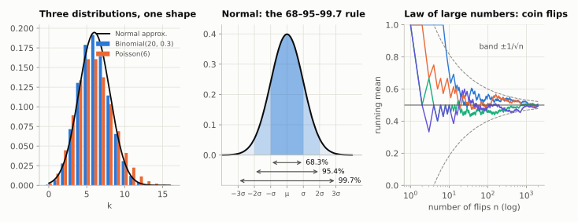
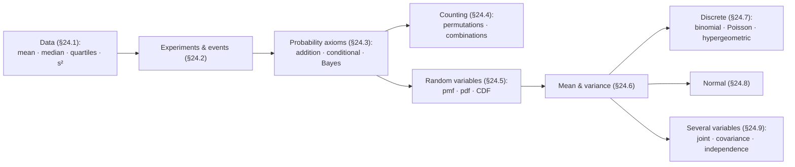

# 24 · Data Analysis · Probability Theory

> *A single coin flip is unpredictable. Ten thousand flips give an almost exact 50%. Probability is the mathematics of that predictability in aggregate.*

**Part G · Probability, Statistics** · Kreyszig §24.1–24.9 · ⏱ ~12 min · Prereqs: sums and integrals
[← Graphs](../part-f-optimization-graphs/23-graphs-combinatorial-optimization.md) · [Index](../../README.md) · [Next: Mathematical Statistics →](25-mathematical-statistics.md)

---

## 🧭 The big picture

Probability turns uncertainty into numbers you can calculate with. The chapter has three layers:

1. **Describe data**: averages, spread, histograms, boxplots.
2. **Model chance**: events, probability rules, conditional probability, Bayes' theorem, counting.
3. **Random variables & distributions**: binomial, Poisson, hypergeometric, normal, and their means and variances.

<p align="center">
  <picture>
    <source media="(prefers-color-scheme: dark)" srcset="../../assets/figures/ch24-distributions-lln-dark.svg">
    
  </picture>
</p>

## 🗺️ Concept map



## 🔑 Core ideas, section by section

| § | Idea | Key formula |
|---|---|---|
| 24.1 | **Data representation, average, spread** | $\bar x = \frac1n\sum x_j$, $\ s^2 = \frac{1}{n-1}\sum (x_j - \bar x)^2$ |
| 24.2 | **Experiments, outcomes, events** | sample space $S$, events as subsets, $A\cup B$, $A\cap B$, $A^c$ |
| 24.3 | **Probability**: axioms, addition rule, conditional probability, independence | $P(A\mid B) = \frac{P(A\cap B)}{P(B)}$ |
| 24.4 | **Permutations & combinations** | $\binom{n}{k} = \frac{n!}{k!(n-k)!}$; Stirling: $n! \approx \sqrt{2\pi n}\,(n/e)^n$ |
| 24.5 | **Random variables, distributions** | $F(x) = P(X \le x)$; $\ f = F'$ |
| 24.6 | **Mean & variance** | $\mu = E[X]$, $\ \sigma^2 = E[X^2] - \mu^2$ |
| 24.7 | **Binomial, Poisson, hypergeometric** | see table below |
| 24.8 | **Normal distribution** | $Z = \frac{X - \mu}{\sigma} \sim N(0, 1)$ |
| 24.9 | **Several random variables**: joint and marginal distributions, covariance | $\operatorname{Var}(X+Y) = \operatorname{Var}X + \operatorname{Var}Y + 2\operatorname{Cov}(X,Y)$ |

### Bayes' theorem: updating beliefs

```math
P(A\mid B) = \frac{P(B\mid A)\,P(A)}{P(B)}, \qquad P(B) = \sum_i P(B\mid A_i)\,P(A_i)
```

**The classic surprise:** a test that is 99% accurate for a disease affecting 1 in 1000 people. If you test positive, the chance you are actually sick is only about **9%**, because the many healthy people produce more false positives than the few sick people produce true positives.

### The distribution cheat sheet

| Distribution | $P(X = k)$ or $f(x)$ | Mean | Variance | Models |
|---|---|---|---|---|
| **Binomial** $B(n,p)$ | $\binom{n}{k}p^k(1-p)^{n-k}$ | $np$ | $np(1-p)$ | successes in $n$ independent trials |
| **Poisson** $(\mu)$ | $\frac{\mu^k e^{-\mu}}{k!}$ | $\mu$ | $\mu$ | rare events per interval (arrivals, defects) |
| **Hypergeometric** | $\frac{\binom{M}{k}\binom{N-M}{n-k}}{\binom{N}{n}}$ | $n\frac{M}{N}$ | $n\frac{M}{N}\left(1-\frac{M}{N}\right)\frac{N-n}{N-1}$ | sampling **without** replacement |
| **Uniform** $[a,b]$ | $\frac{1}{b-a}$ | $\frac{a+b}{2}$ | $\frac{(b-a)^2}{12}$ | rounding error, random init |
| **Normal** $N(\mu,\sigma^2)$ | $\frac{1}{\sigma\sqrt{2\pi}}e^{-(x-\mu)^2/2\sigma^2}$ | $\mu$ | $\sigma^2$ | sums of many small effects |
| **Exponential** $(\lambda)$ | $\lambda e^{-\lambda x}$ | $1/\lambda$ | $1/\lambda^2$ | waiting times between Poisson events |

**Why the normal distribution is everywhere:** by the **Central Limit Theorem**, the sum of many independent small effects is approximately normal, whatever their individual distributions. The binomial and Poisson curves in the figure already look Gaussian.

## 💡 Aha! moments

- **Weight initialisation is §24.9.** A neuron computes $\sum_{i=1}^{n} w_i x_i$. With independent, zero-mean terms, $\operatorname{Var} = n\operatorname{Var}(w)\operatorname{Var}(x)$. To keep signals from exploding or vanishing through depth, choose $\operatorname{Var}(w) = 1/n$ (Xavier/LeCun) or $2/n$ for ReLU (He initialisation).
- **An LLM samples a categorical distribution.** Every generated token is a draw from $\text{softmax}(\text{logits}/T)$ ([Ch. 31](../part-h-math-for-ai/31-neural-networks-transformers.md)).
- **Serving capacity uses Poisson arrivals.** Request arrivals at an inference endpoint are often modelled as a Poisson process, with exponential gaps between requests. Queueing theory built on that model sizes GPU fleets.
- **The birthday paradox:** with only 23 people, the chance that two share a birthday exceeds 50%. The same arithmetic governs hash collisions and near-duplicate detection in training data.

## 🤖 Where it shows up

| Engineering | AI / computing |
|---|---|
| Reliability (failure probabilities), quality defects (Poisson) | Weight initialisation, dropout (Bernoulli masks) |
| Signal noise modelling (Gaussian) | Token sampling, Bayesian updating ([Ch. 29](../part-h-math-for-ai/29-bayesian-inference-sampling.md)) |
| Traffic and queueing (Poisson arrivals) | Load modelling for inference serving, A/B test design |

## ⚠️ Pitfalls

- $P(A\mid B) \ne P(B\mid A)$. Confusing the two is the *prosecutor's fallacy*.
- Independence is **not** the same as being mutually exclusive. Exclusive events with positive probability are always dependent.
- Zero correlation does not imply independence. $X$ and $X^2$ for symmetric $X$ have zero correlation but are clearly dependent.

## 🧪 Try it

```python
p_d, sens, spec = 0.001, 0.99, 0.99
p_pos = sens*p_d + (1-spec)*(1-p_d)
print(f"P(sick | positive) = {sens*p_d/p_pos:.1%}")      # ≈ 9.0%
```

## ✅ Book coverage

- [x] 24.1 Data Representation. Average. Spread
- [x] 24.2 Experiments, Outcomes, Events
- [x] 24.3 Probability
- [x] 24.4 Permutations and Combinations
- [x] 24.5 Random Variables. Probability Distributions
- [x] 24.6 Mean and Variance of a Distribution
- [x] 24.7 Binomial, Poisson, and Hypergeometric Distributions
- [x] 24.8 Normal Distribution
- [x] 24.9 Distributions of Several Random Variables

---
[← Graphs](../part-f-optimization-graphs/23-graphs-combinatorial-optimization.md) · [Index](../../README.md) · [Next: Mathematical Statistics →](25-mathematical-statistics.md)
