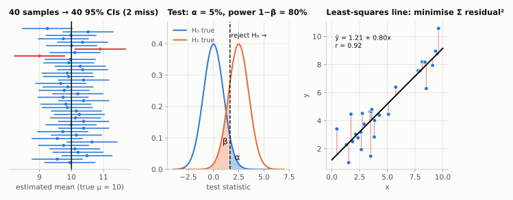
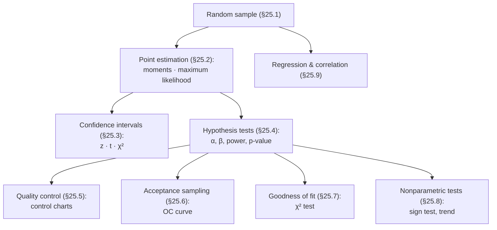

# 25 · Mathematical Statistics

> *Statistics answers three questions: what does the data say, how sure can we be, and how likely is it that the pattern is a fluke?*

**Part G · Probability, Statistics** · Kreyszig §25.1–25.9 · ⏱ ~12 min · Prereqs: [Ch. 24](24-data-analysis-probability.md)
[← Probability](24-data-analysis-probability.md) · [Index](../../README.md) · [Next Part: Math for AI →](../part-h-math-for-ai/26-matrix-calculus-autodiff.md)

---

## 🧭 The big picture

Probability goes from a **known model to data**. Statistics goes the other way, from **data back to the model**:

| Task | Question | Tool |
|---|---|---|
| **Estimation** | what is $\mu$ (or $p$, $\sigma$, …)? | sample mean, maximum likelihood |
| **Confidence** | how precise is that estimate? | confidence intervals |
| **Decision** | is this effect real? | hypothesis tests, p-values |
| **Relationships** | how does $y$ depend on $x$? | regression, correlation |
| **Monitoring** | is the process still behaving? | control charts, acceptance sampling |

<p align="center">
  <picture>
    <source media="(prefers-color-scheme: dark)" srcset="../../assets/figures/ch25-ci-test-regression-dark.svg">
    
  </picture>
</p>

**How to read a 95% CI (left panel):** the *procedure* captures the true value in 95% of repeated samples. Any single interval either contains $\mu$ or it does not.

## 🗺️ Concept map



## 🔑 Core ideas, section by section

| § | Idea | Key formula |
|---|---|---|
| 25.1 | **Random sampling**: population vs sample | sample statistics are random variables |
| 25.2 | **Point estimation**: method of moments, **maximum likelihood** | $\hat\theta = \arg\max_\theta \prod_j f(x_j;\theta)$ |
| 25.3 | **Confidence intervals** | $\bar x \pm z_{\alpha/2}\,\sigma/\sqrt n$; with unknown $\sigma$: $\bar x \pm t_{n-1}\,s/\sqrt n$ |
| 25.4 | **Hypothesis testing**: type I and II errors, power, one- and two-sided tests | reject $H_0$ if the test statistic falls in the critical region |
| 25.5 | **Quality control**: $\bar x$, $s$ and $R$ charts | control limits $\mu \pm 3\sigma/\sqrt n$ |
| 25.6 | **Acceptance sampling**: OC curve, producer's and consumer's risk | $P(\text{accept}) = \sum_{k \le c} \binom{n}{k}\theta^k(1-\theta)^{n-k}$ |
| 25.7 | **Goodness of fit: χ² test** | $\chi^2_0 = \sum_j \frac{(b_j - e_j)^2}{e_j}$ |
| 25.8 | **Nonparametric tests**: sign test, test for trend | distribution-free, uses only order or sign |
| 25.9 | **Regression, fitting straight lines, correlation** | $k_1 = \frac{s_{xy}}{s_x^2}$, $\ r = \frac{s_{xy}}{s_x s_y}$ |

### The two errors of a test

| | $H_0$ true | $H_0$ false |
|---|---|---|
| **Reject $H_0$** | Type I error (prob. $\alpha$) | correct: **power** $1 - \beta$ |
| **Keep $H_0$** | correct | Type II error (prob. $\beta$) |

Lowering $\alpha$ raises $\beta$ unless you collect **more data**. Precision improves only like $1/\sqrt n$, so halving the error bar takes **four times** the samples.

### Which interval or test?

| Situation | Statistic | Distribution |
|---|---|---|
| mean, $\sigma$ known (or $n$ large) | $z = \frac{\bar x - \mu_0}{\sigma/\sqrt n}$ | normal |
| mean, $\sigma$ unknown, small $n$ | $t = \frac{\bar x - \mu_0}{s/\sqrt n}$ | Student $t$, $n - 1$ d.o.f. |
| variance | $\frac{(n-1)s^2}{\sigma_0^2}$ | $\chi^2$, $n - 1$ d.o.f. |
| comparing two variances | $s_1^2/s_2^2$ | $F$ |
| observed vs expected counts | $\sum (b - e)^2/e$ | $\chi^2$ |

## 💡 Aha! moments

- **Benchmark scores need error bars.** A model scoring 80% on 500 questions has standard error $\sqrt{0.8\cdot0.2/500} \approx 1.8\%$, so a 95% CI of about ±3.5 points. A one-point gain on a leaderboard is often **noise**. Paired tests on the same questions help a lot.
- **Maximum likelihood is the training objective.** Minimising cross-entropy loss is exactly maximising the likelihood of the training data ([Ch. 28](../part-h-math-for-ai/28-information-theory.md)). Least-squares regression is MLE under Gaussian noise.
- **Control charts fit MLOps.** Plot a production metric (latency, refusal rate, eval accuracy) with $\pm 3\sigma$ limits. Points outside the limits, or long runs on one side, signal drift. This is Shewhart's 1920s factory method applied to model monitoring.
- **χ² and nonparametric tests detect distribution shift** between training and live data without assuming normality.
- **Multiple comparisons:** test 20 prompt variants at $\alpha = 0.05$ and you expect one false "winner" by chance. Use Bonferroni-style corrections or hold-out confirmation.

## 🤖 Where it shows up

| Engineering | AI / computing |
|---|---|
| Statistical process control (SPC), Six Sigma | Eval confidence intervals, A/B testing of model versions |
| Acceptance testing of supplied parts | Drift detection, data-quality monitoring |
| Calibration curves (regression) | MLE training, scaling-law fits (regression on log–log data) |

## ⚠️ Pitfalls

- A p-value is **not** the probability that $H_0$ is true. It is $P(\text{data this extreme}\mid H_0)$.
- "Not significant" does not mean "no effect". The test may simply be underpowered.
- Correlation is not causation, and $r$ only measures **linear** association.

## 🧪 Try it

```python
import numpy as np
from scipy import stats
acc, n = 0.80, 500
se = np.sqrt(acc*(1-acc)/n)
print(f"95% CI: {acc-1.96*se:.3f} – {acc+1.96*se:.3f}")      # 0.765 – 0.835
# paired comparison of two models on the same 500 questions:
a, b = np.random.default_rng(0).random((2, n)) < [[0.80], [0.82]]
print(stats.ttest_rel(a.astype(float), b.astype(float)).pvalue)
```

## ✅ Book coverage

- [x] 25.1 Introduction. Random Sampling
- [x] 25.2 Point Estimation of Parameters
- [x] 25.3 Confidence Intervals
- [x] 25.4 Testing of Hypotheses. Decisions
- [x] 25.5 Quality Control
- [x] 25.6 Acceptance Sampling
- [x] 25.7 Goodness of Fit. χ²-Test
- [x] 25.8 Nonparametric Tests
- [x] 25.9 Regression. Fitting Straight Lines. Correlation

---
[← Probability](24-data-analysis-probability.md) · [Index](../../README.md) · [Next Part: Math for AI →](../part-h-math-for-ai/26-matrix-calculus-autodiff.md)
