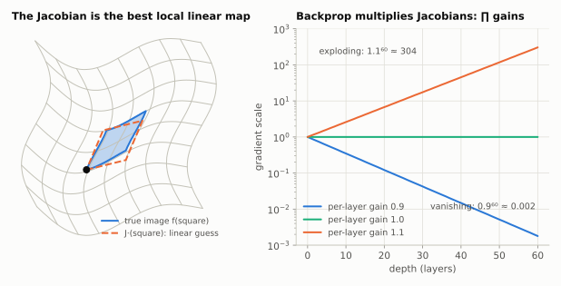
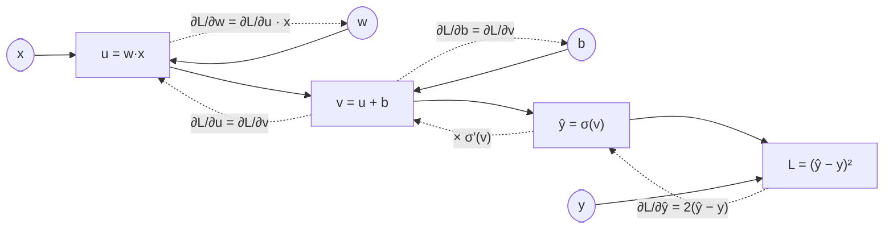

# 26 · Matrix Calculus, Tensors & Automatic Differentiation

> *Backpropagation is the chain rule from first-year calculus, applied systematically to a graph with billions of parameters.*

**Part H · Mathematics for AI** (beyond Kreyszig) · ⏱ ~12 min · Builds on: [Ch. 7](../part-b-linear-algebra-vector-calculus/07-linear-algebra-matrices-systems.md) matrices, [Ch. 9](../part-b-linear-algebra-vector-calculus/09-vector-differential-calculus.md) gradients, [Ch. 23](../part-f-optimization-graphs/23-graphs-combinatorial-optimization.md) graphs
[← Mathematical Statistics](../part-g-probability-statistics/25-mathematical-statistics.md) · [Index](../../README.md) · [Next: Optimization for ML →](27-optimization-for-ml.md)

---

## 🧭 The big picture

Training a model means computing $\nabla_\theta L$, the gradient of one scalar loss with respect to millions or billions of parameters, many times per second. Three ideas make that possible:

1. **Derivatives of vector functions are matrices.** The Jacobian $J_{ij} = \partial f_i/\partial x_j$ is the best local linear approximation of $f$.
2. **The chain rule multiplies Jacobians.** For $L = f_n \circ \cdots \circ f_1$, the gradient is $J_n J_{n-1}\cdots J_1$.
3. **Multiply in the cheap order.** Evaluating that product from the *output side* (reverse mode, i.e. backprop) costs only a small constant multiple of the forward pass, whatever the number of parameters.

<p align="center">
  <picture>
    <source media="(prefers-color-scheme: dark)" srcset="../../assets/figures/ch26-jacobian-gradient-flow-dark.svg">
    
  </picture>
</p>

## 🗺️ The vocabulary of derivatives

| Function type | Derivative | Shape | Name |
|---|---|---|---|
| $f: \mathbb{R} \to \mathbb{R}$ | $f'(x)$ | scalar | derivative |
| $f: \mathbb{R}^n \to \mathbb{R}$ | $\nabla f$ | $n$ | **gradient** |
| $\mathbf{f}: \mathbb{R}^n \to \mathbb{R}^m$ | $J = \partial\mathbf{f}/\partial\mathbf{x}$ | $m \times n$ | **Jacobian** |
| $f: \mathbb{R}^n \to \mathbb{R}$ (2nd order) | $H = \nabla^2 f$ | $n \times n$, symmetric | **Hessian** |
| $f: \mathbb{R}^{m\times n} \to \mathbb{R}$ | $\partial f/\partial W$ | $m \times n$ | matrix gradient |

## 🔑 Core ideas

### Identities worth memorising

| $f$ | $\nabla f$ or derivative |
|---|---|
| $\mathbf{a}^T\mathbf{x}$ | $\mathbf{a}$ |
| $\mathbf{x}^TA\mathbf{x}$ | $(A + A^T)\mathbf{x}$, which is $2A\mathbf{x}$ when $A$ is symmetric |
| $\Vert A\mathbf{x} - \mathbf{b}\Vert^2$ | $2A^T(A\mathbf{x} - \mathbf{b})$ (set to 0 to get the normal equations, [Ch. 20](../part-e-numerics/20-numeric-linear-algebra.md)) |
| $L(W)$ with $\mathbf{y} = W\mathbf{x}$ | $\frac{\partial L}{\partial W} = \frac{\partial L}{\partial\mathbf{y}}\,\mathbf{x}^T$ (an outer product) |
| $\operatorname{tr}(AX)$ | $A^T$ |
| $\log\det X$ | $X^{-T}$ |
| $\mathbf{p} = \text{softmax}(\mathbf{z})$ | $J = \operatorname{diag}(\mathbf{p}) - \mathbf{p}\mathbf{p}^T$ |
| $-\log p_y$ with $\mathbf{p} = \text{softmax}(\mathbf{z})$ | $\nabla_{\mathbf{z}} = \mathbf{p} - \mathbf{e}_y$ ("prediction minus target") |

The last line explains why softmax and cross-entropy are always fused in practice: the combined gradient is short and numerically stable.

### Backprop on a tiny network



Solid arrows are the **forward pass**, which stores intermediate values. Dashed arrows are the **backward pass**: each node multiplies the incoming gradient by its *local* derivative and passes the result on.

### Forward mode vs reverse mode

| | Forward mode (JVP) | Reverse mode (VJP) = backprop |
|---|---|---|
| Computes | $J\mathbf{v}$: how all outputs change along one input direction | $\mathbf{u}^TJ$: how one output depends on all inputs |
| Cost for $f: \mathbb{R}^n \to \mathbb{R}^m$ | $n$ passes for the full $J$ | $m$ passes for the full $J$ |
| Best when | few inputs, many outputs | **many inputs, one scalar loss**, which is the case for deep learning |
| Memory | low | must store activations (use checkpointing to trade compute for memory) |
| Mechanism | dual numbers $a + b\varepsilon$, $\varepsilon^2 = 0$ | tape / graph + reverse topological order |

**The cheap-gradient principle:** with reverse mode, the full gradient costs only a small constant multiple of the cost of evaluating $L$ itself. This is why a training step costs about **3× a forward pass** (forward + backward ≈ 1 + 2), which gives the "6 × params × tokens" FLOPs rule ([Ch. 33](33-efficient-inference.md)).

### Tensors & einsum

A tensor is an array with $k$ indices. **Index notation** (Einstein summation) makes most deep-learning operations one line:

| Operation | einsum |
|---|---|
| matrix product $C = AB$ | `ij,jk->ik` |
| batched attention scores $QK^T$ | `bhqd,bhkd->bhqk` |
| weighted sum of values | `bhqk,bhkd->bhqd` |
| outer product (the weight gradient) | `i,j->ij` |
| trace | `ii->` |

## 💡 Aha! moments

- **Vanishing and exploding gradients are products of Jacobians.** Through 60 layers, a per-layer gain of 0.9 shrinks the gradient about 500× and a gain of 1.1 grows it about 300× (figure, right). **Residual connections** give each layer the Jacobian $I + \partial f/\partial x$, which stays close to the identity. Careful initialisation ([Ch. 24](../part-g-probability-statistics/24-data-analysis-probability.md)) and normalisation keep the gains near 1.
- **Reverse-mode autodiff was published in 1970** (Linnainmaa) and popularised for neural networks in 1986 (Rumelhart, Hinton & Williams). The math is decades old; GPUs made it practical at scale.
- **The Jacobian links to Ch. 10.** Its determinant measures local volume change, which is the change-of-variables factor behind normalizing flows.
- **Hessian-vector products cost about as much as a gradient** (reverse-over-forward). Curvature-aware tools such as sharpness measures, influence functions and GPTQ's second-order quantization ([Ch. 32](32-number-formats-quantization.md)) build on them.

## ⚠️ Pitfalls

- **Layout conventions differ.** Some texts write gradients as rows, others as columns. Check that the shapes match: $\partial L/\partial W$ must have the same shape as $W$.
- Non-differentiable points such as ReLU at 0 or `max` use **subgradients**. Frameworks pick a convention, usually 0.
- In-place operations and detached tensors silently break the graph, giving a gradient of `None` or 0.

## 🧪 Try it: a 20-line reverse-mode autodiff

```python
import math
class V:
    def __init__(s, x, kids=(), grad_fns=()):
        s.x, s.g, s.kids, s.fns = x, 0.0, kids, grad_fns
    def __add__(a, b): return V(a.x + b.x, (a, b), (lambda g: g, lambda g: g))
    def __mul__(a, b): return V(a.x * b.x, (a, b), (lambda g: g * b.x, lambda g: g * a.x))
    def tanh(a):
        t = math.tanh(a.x); return V(t, (a,), (lambda g: g * (1 - t*t),))
    def backward(s):
        order, seen = [], set()
        def topo(v):
            if id(v) not in seen:
                seen.add(id(v)); [topo(k) for k in v.kids]; order.append(v)
        topo(s); s.g = 1.0
        for v in reversed(order):
            for k, fn in zip(v.kids, v.fns): k.g += fn(v.g)
w, x, b = V(0.5), V(2.0), V(-0.3)
y = (w * x + b).tanh(); y.backward()
print(y.x, w.g, b.g)        # dy/dw = (1 - tanh²)·x,  dy/db = 1 - tanh²
```

## 🔗 Connections

[Ch. 9](../part-b-linear-algebra-vector-calculus/09-vector-differential-calculus.md) (gradient, chain rule) · [Ch. 15](../part-d-complex-analysis/15-power-series-taylor-series.md) (Taylor = linearisation) · [Ch. 23](../part-f-optimization-graphs/23-graphs-combinatorial-optimization.md) (DAGs, topological order) · [Ch. 27](27-optimization-for-ml.md) (what we do with the gradient)

---
[← Mathematical Statistics](../part-g-probability-statistics/25-mathematical-statistics.md) · [Index](../../README.md) · [Next: Optimization for ML →](27-optimization-for-ml.md)
