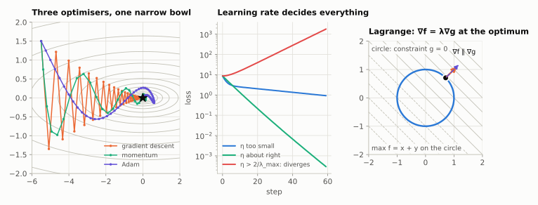
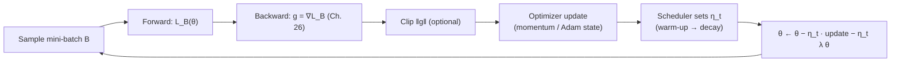

# 27 · Optimization for Machine Learning

> *Every model you have used was found by a sequence of small downhill steps on a loss surface with billions of dimensions.*

**Part H · Mathematics for AI** (beyond Kreyszig) · ⏱ ~13 min · Builds on: [Ch. 22](../part-f-optimization-graphs/22-optimization-linear-programming.md) steepest descent, [Ch. 8](../part-b-linear-algebra-vector-calculus/08-eigenvalue-problems.md) eigenvalues, [Ch. 2](../part-a-odes/02-second-order-linear-odes.md) damped oscillators
[← Matrix Calculus & Autodiff](26-matrix-calculus-autodiff.md) · [Index](../../README.md) · [Next: Information Theory →](28-information-theory.md)

---

## 🧭 The big picture

Kreyszig's Chapter 22 introduces steepest descent and linear programming. Modern ML adds four things on top:

1. **Stochastic gradients.** You never see the full loss, only mini-batch estimates.
2. **Adaptive, momentum-based optimisers** (Adam and its relatives) that deal with ill-conditioning.
3. **Constraints and regularisation**: Lagrange multipliers, KKT conditions, weight decay.
4. **Schedules**: warm-up and decay of the learning rate, which is the step size $h$ of the Euler method being run.

<p align="center">
  <picture>
    <source media="(prefers-color-scheme: dark)" srcset="../../assets/figures/ch27-optimizers-lagrange-dark.svg">
    
  </picture>
</p>

## 🗺️ The training loop



## 🔑 Core ideas

### Convexity: when "downhill" is guaranteed to work

$f$ is **convex** if $f(t\mathbf{x} + (1-t)\mathbf{y}) \le t f(\mathbf{x}) + (1-t)f(\mathbf{y})$, i.e. the Hessian is $\succeq 0$. For convex $f$, **every local minimum is global**.

| Assumption | GD with step $\eta \le 1/L$ converges like | Comment |
|---|---|---|
| $L$-smooth, convex | $O(1/k)$ | linear and logistic regression, SVMs |
| $\mu$-strongly convex | $(1 - \mu/L)^k$, linear | the rate depends on $\kappa = L/\mu$ |
| non-convex (deep nets) | to a stationary point | saddles are common; SGD noise helps escape them |

The stability limit $\eta < 2/\lambda_{\max}(H)$ is the same condition as the stability region of explicit Euler ([Ch. 21](../part-e-numerics/21-numerics-odes-pdes.md)).

### The optimiser family tree

| Optimiser | Update (per parameter) | Idea |
|---|---|---|
| **SGD** | $\theta \leftarrow \theta - \eta g$ | follow the noisy gradient |
| **Momentum** | $v \leftarrow \beta v + g,\ \theta \leftarrow \theta - \eta v$ | heavy ball: damped oscillator ([Ch. 2](../part-a-odes/02-second-order-linear-odes.md)) |
| **Nesterov** | evaluate $g$ at the look-ahead point $\theta - \eta\beta v$ | anticipates the next position |
| **AdaGrad / RMSProp** | divide by $\sqrt{\text{running avg of } g^2}$ | per-coordinate step size |
| **Adam** | $m \leftarrow \beta_1 m + (1-\beta_1)g,\ \ s \leftarrow \beta_2 s + (1-\beta_2)g^2$; $\ \theta \leftarrow \theta - \eta\,\hat m/(\sqrt{\hat s} + \epsilon)$ | momentum + RMS scaling + bias correction |
| **AdamW** | Adam + *decoupled* weight decay $-\eta\lambda\theta$ | the default for transformers |
| **Newton / quasi-Newton** | $\theta \leftarrow \theta - H^{-1}g$ (L-BFGS approximates $H^{-1}$) | uses curvature, so one step on a quadratic |
| **Shampoo / K-FAC / Muon** | precondition with (approximate) matrix structure | second-order ideas at scale |

Adam's bias correction $\hat m = m/(1 - \beta_1^t)$ removes the bias toward zero in the early steps, because $m$ starts at 0.

### Constrained optimisation: Lagrange & KKT

To minimise $f(\mathbf{x})$ subject to $g_i(\mathbf{x}) \le 0$ and $h_j(\mathbf{x}) = 0$, form the **Lagrangian** $\mathcal{L} = f + \sum\mu_i g_i + \sum\lambda_j h_j$. At an optimum the **KKT conditions** hold:

| Condition | Meaning |
|---|---|
| $\nabla f + \sum\mu_i\nabla g_i + \sum\lambda_j\nabla h_j = 0$ | **stationarity**: forces balance (figure, right) |
| $g_i \le 0,\ h_j = 0$ | primal feasibility |
| $\mu_i \ge 0$ | dual feasibility |
| $\mu_i\,g_i = 0$ | **complementary slackness**: a constraint either binds or its multiplier is 0 |

Examples: SVMs (support vectors are exactly the points with $\mu_i > 0$), maximum-entropy distributions, which turn out to be softmax ([Ch. 28](28-information-theory.md)), and the equivalence between weight decay and a norm-ball constraint.

### Beyond Kreyszig: calculus of variations

To optimise over **functions** rather than vectors, minimise the functional $J[y] = \int F(x, y, y')\,dx$. The Euler–Lagrange equation $\frac{\partial F}{\partial y} - \frac{d}{dx}\frac{\partial F}{\partial y'} = 0$ gives the brachistochrone, geodesics, Lagrangian mechanics and optimal control. The **adjoint method** used to train Neural ODEs is the same machinery.

### Learning-rate schedules & regularisation

| Tool | Why |
|---|---|
| **Warm-up** (linear ramp over the first ~1% of steps) | Adam's second-moment estimates are noisy early on, and large early steps can destabilise training |
| **Cosine / linear decay** | big steps to explore, then small steps to settle |
| **Weight decay** ($L_2$) | MAP with a Gaussian prior ([Ch. 29](29-bayesian-inference-sampling.md)); prefers small weights |
| **$L_1$** | Laplace prior: drives weights to exactly 0 (sparsity) |
| **Gradient clipping** | caps $\Vert g\Vert$ against rare loss spikes |
| **Batch size $B$** | gradient noise $\propto \eta/B$; doubling $B$ often allows about $2\eta$ (linear scaling rule, within limits) |

## 💡 Aha! moments

- **In high dimensions, saddles outnumber minima.** A critical point needs every Hessian eigenvalue to be positive to be a minimum. With millions of dimensions, most critical points have some negative curvature, so the real challenge is escaping saddles, and SGD's noise helps.
- **The "edge of stability":** in full-batch training, sharpness $\lambda_{\max}$ often rises until it hovers near $2/\eta$, the stability limit, and training continues there without diverging.
- **Momentum is a damped oscillator,** $\theta'' + \gamma\theta' + \nabla L = 0$. Critical damping gives the fastest settling ([Ch. 2](../part-a-odes/02-second-order-linear-odes.md)).
- **Adam approximates a diagonal preconditioner**, rescaling each coordinate to undo some ill-conditioning. That is why it follows a direct path in the left panel.

## ⚠️ Pitfalls

- Plain L2 regularisation inside Adam is **not** the same as weight decay, because the adaptive scaling changes its effect. Use AdamW.
- A loss that suddenly becomes NaN usually means the step size is too large, or a numerical overflow ([Ch. 32](32-number-formats-quantization.md)). Lower $\eta$ or add warm-up before changing the architecture.
- Comparing optimisers at a **single** learning rate is meaningless. Tune each one.

## 🧪 Try it: Adam in 8 lines

```python
import numpy as np
f  = lambda p: (1 - p[0])**2 + 100*(p[1] - p[0]**2)**2            # Rosenbrock
df = lambda p: np.array([-2*(1-p[0]) - 400*p[0]*(p[1]-p[0]**2), 200*(p[1]-p[0]**2)])
p, m, s = np.array([-1.5, 2.0]), 0, 0
for t in range(1, 5001):
    g = df(p); m = 0.9*m + 0.1*g; s = 0.999*s + 0.001*g*g
    p -= 0.02 * (m/(1-0.9**t)) / (np.sqrt(s/(1-0.999**t)) + 1e-8)
print(p, f(p))                                                    # → near (1, 1)
```

## 🔗 Connections

[Ch. 22](../part-f-optimization-graphs/22-optimization-linear-programming.md) steepest descent, LP · [Ch. 21](../part-e-numerics/21-numerics-odes-pdes.md) stability regions · [Ch. 8](../part-b-linear-algebra-vector-calculus/08-eigenvalue-problems.md) Hessian eigenvalues · [Ch. 35](35-reinforcement-learning.md) policy optimisation

---
[← Matrix Calculus & Autodiff](26-matrix-calculus-autodiff.md) · [Index](../../README.md) · [Next: Information Theory →](28-information-theory.md)
