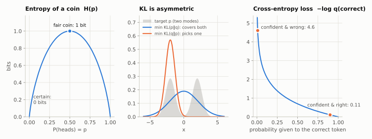
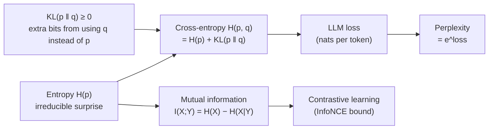

# 28 · Information Theory

> *An LLM's training loss is measured in bits. Predicting well and compressing well turn out to be the same problem.*

**Part H · Mathematics for AI** (beyond Kreyszig) · ⏱ ~11 min · Builds on: [Ch. 24](../part-g-probability-statistics/24-data-analysis-probability.md) probability, [Ch. 25](../part-g-probability-statistics/25-mathematical-statistics.md) maximum likelihood
[← Optimization for ML](27-optimization-for-ml.md) · [Index](../../README.md) · [Next: Bayesian Inference & Sampling →](29-bayesian-inference-sampling.md)

---

## 🧭 The big picture

Claude Shannon (1948) asked how many bits are needed to describe the outcome of a random source. The answer is its **entropy**:

```math
H(X) = -\sum_x p(x)\log_2 p(x) \quad\text{bits}
```

That one definition grows into the language of modern ML: **cross-entropy** is the loss function, **KL divergence** measures the gap between two distributions, **perplexity** reports model quality, and **mutual information** quantifies what one variable tells you about another.

<p align="center">
  <picture>
    <source media="(prefers-color-scheme: dark)" srcset="../../assets/figures/ch28-entropy-kl-dark.svg">
    
  </picture>
</p>

## 🗺️ How the quantities relate



## 🔑 Core ideas

| Quantity | Formula | Meaning |
|---|---|---|
| **Surprise** of an outcome | $-\log p(x)$ | rare events carry more information |
| **Entropy** | $H(p) = E_p[-\log p]$ | average surprise; maximal for the uniform distribution ($\log N$) |
| **Cross-entropy** | $H(p,q) = E_p[-\log q]$ | average code length using a code built for $q$ when data come from $p$ |
| **KL divergence** | $D_{KL}(p\Vert q) = E_p\left[\log\frac{p}{q}\right] = H(p,q) - H(p)$ | always $\ge 0$ (Gibbs), $= 0$ iff $p = q$; **not symmetric** |
| **Conditional entropy** | $H(X\mid Y)$ | remaining uncertainty about $X$ once $Y$ is known |
| **Mutual information** | $I(X;Y) = H(X) - H(X\mid Y) = D_{KL}(p_{XY}\Vert p_Xp_Y)$ | shared information; 0 iff independent |
| **Perplexity** | $e^{H}$ (nats) or $2^{H}$ (bits) | effective number of equally likely choices |

Units: $\log_2$ gives **bits** and $\ln$ gives **nats** ($1\text{ nat} \approx 1.443\text{ bits}$). Frameworks report losses in nats.

### Why cross-entropy is *the* loss

Training data come from an unknown $p$, and the model predicts $q_\theta$. Then

```math
\underbrace{\frac{1}{N}\sum_i -\log q_\theta(x_i)}_{\text{training loss}} \;\approx\; H(p, q_\theta) = H(p) + D_{KL}(p\Vert q_\theta)
```

$H(p)$ does not depend on $\theta$. So **minimising cross-entropy = minimising KL to the data = maximising likelihood** ([Ch. 25](../part-g-probability-statistics/25-mathematical-statistics.md)). The loss can never fall below $H(p)$, the data's own entropy. That floor is the "irreducible loss" $E$ in scaling laws ([Ch. 31](31-neural-networks-transformers.md)).

### Forward vs reverse KL (figure, middle)

| Minimise | Behaviour | Used in |
|---|---|---|
| $D_{KL}(p\Vert q)$ (forward) | **mass-covering**: $q$ must be positive wherever $p$ is | maximum likelihood, standard distillation |
| $D_{KL}(q\Vert p)$ (reverse) | **mode-seeking**: $q$ may ignore modes but must avoid regions where $p \approx 0$ | variational inference, RLHF KL penalty, some on-policy distillation |

### Engineering corner: channel capacity

A channel with bandwidth $B$ and signal-to-noise ratio $\text{SNR}$ can carry at most $C = B\log_2(1 + \text{SNR})$ bits/s (Shannon–Hartley). Wi-Fi, 5G and deep-space links all operate against this limit.

## 💡 Aha! moments

- **Prediction is compression.** Arithmetic coding turns any probabilistic predictor into a compressor whose size is close to the model's cross-entropy. An LLM with a loss of 0.7 nats/token would compress its text to about $0.7\times 1.443 \approx 1$ bit per token.
- **Softmax is a maximum-entropy distribution.** Among all distributions with given expected "energies", the one with maximum entropy is $p_i \propto e^{z_i/T}$. Temperature trades entropy against fitting the logits.
- **Knowledge distillation** trains a student on the teacher's softened distribution: $T^2\,D_{KL}(p_{\text{teacher}}^{(T)}\Vert p_{\text{student}}^{(T)})$. The "dark knowledge" sits in the relative probabilities of the wrong answers ([Ch. 33](33-efficient-inference.md)).
- **CLIP-style contrastive learning** maximises the InfoNCE objective, which lower-bounds the mutual information between image and text embeddings.
- **RLHF keeps the model close to its reference** with a KL penalty $\beta\,D_{KL}(\pi\Vert\pi_{\text{ref}})$, a budget on how far the model may move ([Ch. 35](35-reinforcement-learning.md)).

## ⚠️ Pitfalls

- $D_{KL}(p\Vert q) = \infty$ if $q(x) = 0$ anywhere that $p(x) > 0$. Label smoothing and probability floors exist for this reason.
- Perplexities are only comparable with the **same tokenizer**. Bits-per-byte normalises across tokenizers.
- Entropy of a continuous variable (*differential* entropy) can be negative and depends on units. KL and mutual information stay well defined.

## 🧪 Try it

```python
import numpy as np
p_correct = np.array([0.62, 0.05, 0.91, 0.33, 0.78])   # model prob. of each true token
nats = -np.log(p_correct).mean()
print(f"loss {nats:.3f} nats/token = {nats/np.log(2):.3f} bits/token, perplexity {np.exp(nats):.2f}")
```

## 🔗 Connections

[Ch. 24](../part-g-probability-statistics/24-data-analysis-probability.md) distributions · [Ch. 25](../part-g-probability-statistics/25-mathematical-statistics.md) MLE · [Ch. 29](29-bayesian-inference-sampling.md) variational inference (ELBO) · [Ch. 33](33-efficient-inference.md) distillation · [Ch. 35](35-reinforcement-learning.md) KL-regularised RL

---
[← Optimization for ML](27-optimization-for-ml.md) · [Index](../../README.md) · [Next: Bayesian Inference & Sampling →](29-bayesian-inference-sampling.md)
