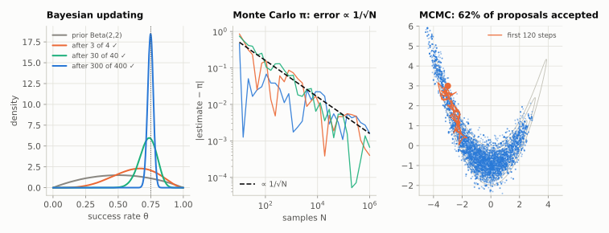
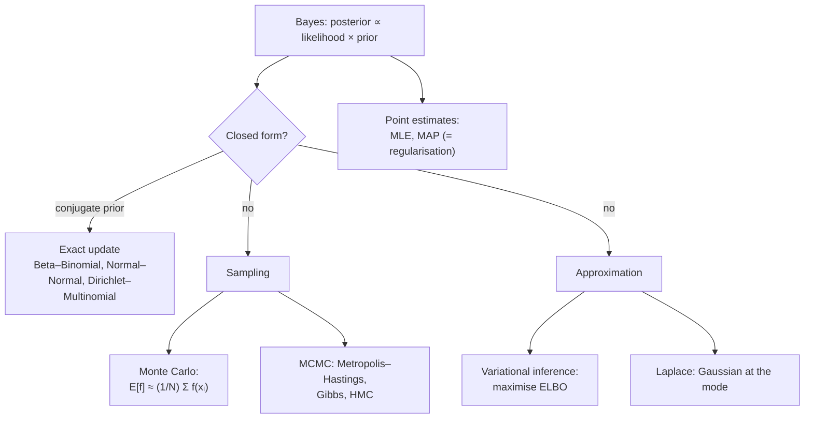

# 29 · Bayesian Inference, Sampling & Monte Carlo

> *When an integral is too hard to compute, draw random samples and average them. The error falls like $1/\sqrt{N}$ whatever the dimension.*

**Part H · Mathematics for AI** (beyond Kreyszig) · ⏱ ~12 min · Builds on: [Ch. 24](../part-g-probability-statistics/24-data-analysis-probability.md) Bayes' theorem, [Ch. 8](../part-b-linear-algebra-vector-calculus/08-eigenvalue-problems.md) eigenvectors, [Ch. 21](../part-e-numerics/21-numerics-odes-pdes.md) ODE solvers
[← Information Theory](28-information-theory.md) · [Index](../../README.md) · [Next: Low-Rank Methods →](30-low-rank-svd-pca.md)

---

## 🧭 The big picture

Bayesian inference treats unknown parameters as random variables and **updates beliefs with data**:

```math
\underbrace{p(\theta\mid\mathcal{D})}_{\text{posterior}} = \frac{\overbrace{p(\mathcal{D}\mid\theta)}^{\text{likelihood}}\;\overbrace{p(\theta)}^{\text{prior}}}{\underbrace{p(\mathcal{D})}_{\text{evidence}\,=\,\int p(\mathcal{D}\mid\theta)p(\theta)\,d\theta}}
```

The difficulty is that integral, and every prediction needs others like it. When closed forms run out, there are two escape routes: **sampling** (Monte Carlo, MCMC) and **approximation** (variational inference, Laplace).

<p align="center">
  <picture>
    <source media="(prefers-color-scheme: dark)" srcset="../../assets/figures/ch29-bayes-montecarlo-mcmc-dark.svg">
    
  </picture>
</p>

## 🗺️ Concept map



## 🔑 Core ideas

### MLE, MAP and regularisation

| Estimator | Maximises | ML equivalent |
|---|---|---|
| **MLE** | $p(\mathcal{D}\mid\theta)$ | plain cross-entropy / least squares |
| **MAP**, Gaussian prior | $p(\mathcal{D}\mid\theta)\,e^{-\Vert\theta\Vert^2/2\sigma^2}$ | **$L_2$ weight decay** |
| **MAP**, Laplace prior | $p(\mathcal{D}\mid\theta)\,e^{-\Vert\theta\Vert_1/b}$ | **$L_1$ / lasso** (sparsity) |
| **Full Bayes** | keeps the whole posterior | ensembles, MC-dropout, Bayesian NNs give uncertainty |

### Conjugate priors: updates by arithmetic

**Beta–Binomial:** prior $\text{Beta}(a, b)$, observe $k$ successes in $n$ trials, posterior $\text{Beta}(a + k,\ b + n - k)$. The prior behaves like $a + b$ "pseudo-observations", and the posterior mean $\frac{a+k}{a+b+n}$ moves from the prior guess toward the data (figure, left).

### Monte Carlo integration

```math
E_p[f(X)] \approx \frac{1}{N}\sum_{i=1}^{N} f(x_i),\quad x_i \sim p, \qquad \text{std. error} = \frac{\sigma_f}{\sqrt N}
```

The $1/\sqrt N$ rate **does not depend on dimension**, which is why Monte Carlo beats grid quadrature ([Ch. 19](../part-e-numerics/19-numerics-in-general.md)) in high dimensions. **Importance sampling** draws from an easier $q$ and reweights: $E_p[f] = E_q\left[f\,\frac{p}{q}\right]$.

### Markov chains & MCMC

A Markov chain with transition matrix $P$ has a **stationary distribution** $\pi = \pi P$, a left eigenvector with eigenvalue 1 ([Ch. 8](../part-b-linear-algebra-vector-calculus/08-eigenvalue-problems.md)). MCMC *designs* a chain whose stationary distribution is the target posterior:

| Method | Move | Accept with probability |
|---|---|---|
| **Metropolis–Hastings** | propose $x' \sim q(\cdot\mid x)$ | $\min\left(1,\ \frac{p(x')\,q(x\mid x')}{p(x)\,q(x'\mid x)}\right)$; only ratios, so the normaliser cancels |
| **Gibbs** | resample one coordinate from its conditional | always |
| **Hamiltonian MC** | simulate physics with $\nabla\log p$ as force (leapfrog integrator) | MH correction on the energy error |
| **Langevin** | $x \leftarrow x + \eta\nabla\log p(x) + \sqrt{2\eta}\,\xi$ | (unadjusted) the bridge to diffusion models ([Ch. 34](34-stochastic-processes-diffusion.md)) |

### Variational inference

Choose a tractable family $q_\phi(z)$ and maximise the **ELBO**:

```math
\log p(x) \;\ge\; \mathbb{E}_{q_\phi}\big[\log p(x, z)\big] - \mathbb{E}_{q_\phi}\big[\log q_\phi(z)\big] = \log p(x) - D_{KL}\big(q_\phi(z)\,\Vert\,p(z\mid x)\big)
```

VAEs, many Bayesian neural networks and parts of the diffusion-model derivation are trained on this bound.

## 💡 Aha! moments

- **Sampling from an LLM is Monte Carlo.** Self-consistency, best-of-N and pass@k ([Ch. 36](36-agentic-workflows.md)) all estimate expectations over the model's output distribution, and their accuracy improves like $1/\sqrt N$.
- **Bayesian optimisation tunes hyperparameters** by fitting a Gaussian process (Cholesky, [Ch. 20](../part-e-numerics/20-numeric-linear-algebra.md)) to past trials and choosing the next trial to maximise expected improvement.
- **Thompson sampling** (sample a belief, act greedily on it) is the Bayesian answer to exploration ([Ch. 35](35-reinforcement-learning.md)). In the bandit experiment it beats ε-greedy.
- **HMC borrows the leapfrog integrator from physics** because it is *symplectic*: it nearly conserves energy, so long proposals are still accepted.

## ⚠️ Pitfalls

- MCMC samples are **correlated**. The effective sample size can be far below $N$, so check autocorrelation and run multiple chains (R-hat).
- Discard a **burn-in** period: the chain needs time to forget its starting point (figure, right).
- Importance sampling with a $q$ much narrower than $p$ produces a few enormous weights and a huge variance.

## 🧪 Try it

```python
from scipy import stats
a, b = 2, 2                     # prior Beta(2,2)
k, n = 30, 40                   # 30 successes in 40 trials
post = stats.beta(a + k, b + n - k)
print(f"posterior mean {post.mean():.3f}, 95% credible interval {post.ppf(.025):.3f}–{post.ppf(.975):.3f}")
```

## 🔗 Connections

[Ch. 24](../part-g-probability-statistics/24-data-analysis-probability.md) Bayes' rule · [Ch. 25](../part-g-probability-statistics/25-mathematical-statistics.md) estimation · [Ch. 28](28-information-theory.md) KL and ELBO · [Ch. 34](34-stochastic-processes-diffusion.md) Langevin and diffusion

---
[← Information Theory](28-information-theory.md) · [Index](../../README.md) · [Next: Low-Rank Methods →](30-low-rank-svd-pca.md)
