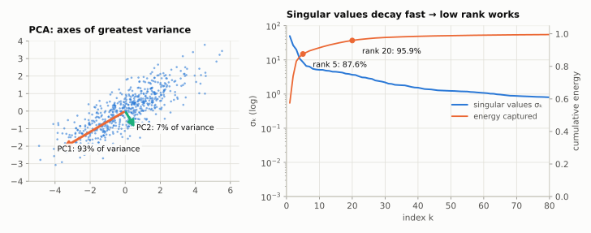
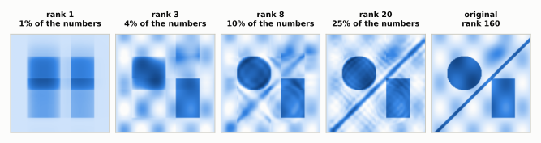
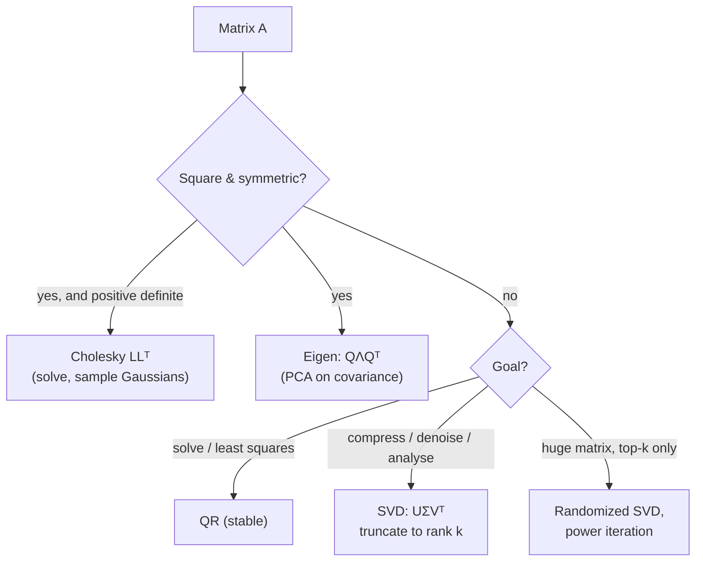

# 30 · Low-Rank Methods: SVD, PCA, Embeddings & LoRA

> *Every matrix is a rotation, then a stretch, then another rotation. Keep only the largest stretches and you have compressed the matrix.*

**Part H · Mathematics for AI** (beyond Kreyszig) · ⏱ ~12 min · Builds on: [Ch. 7](../part-b-linear-algebra-vector-calculus/07-linear-algebra-matrices-systems.md) rank, [Ch. 8](../part-b-linear-algebra-vector-calculus/08-eigenvalue-problems.md) eigenvalues, [Ch. 20](../part-e-numerics/20-numeric-linear-algebra.md) least squares
[← Bayesian Inference](29-bayesian-inference-sampling.md) · [Index](../../README.md) · [Next: Neural Networks & Transformers →](31-neural-networks-transformers.md)

---

## 🧭 The big picture

Kreyszig's eigenvalue chapter covers square matrices. The **singular value decomposition** works for *every* matrix, including rectangular ones:

```math
A_{m\times n} = U\,\Sigma\,V^T = \sum_{i=1}^{r} \sigma_i\,\mathbf{u}_i\mathbf{v}_i^T, \qquad \sigma_1 \ge \sigma_2 \ge \dots \ge \sigma_r > 0
```

$V^T$ rotates, $\Sigma$ stretches along the axes, and $U$ rotates again. In real data the singular values usually **decay quickly**, so a few rank-1 pieces carry most of the information. PCA, latent semantic analysis, recommender systems, LoRA fine-tuning, KV-cache compression and embedding search all build on this.

<p align="center">
  <picture>
    <source media="(prefers-color-scheme: dark)" srcset="../../assets/figures/ch30-pca-svd-dark.svg">
    
  </picture>
</p>

<p align="center">
  <picture>
    <source media="(prefers-color-scheme: dark)" srcset="../../assets/figures/ch30-low-rank-image-dark.svg">
    
  </picture>
</p>

## 🗺️ Which decomposition?



## 🔑 Core ideas

### SVD facts

| Fact | Formula |
|---|---|
| Singular values from eigenvalues | $\sigma_i = \sqrt{\lambda_i(A^TA)}$; $V$ = eigenvectors of $A^TA$, $U$ = eigenvectors of $AA^T$ |
| Rank | number of non-zero $\sigma_i$ |
| Spectral norm, condition number | $\Vert A\Vert_2 = \sigma_1$, $\ \kappa = \sigma_1/\sigma_r$ |
| Frobenius norm | $\Vert A\Vert_F^2 = \sum\sigma_i^2$ ("energy") |
| Pseudo-inverse | $A^+ = V\Sigma^+U^T$: the minimum-norm least-squares solution $\mathbf{x} = A^+\mathbf{b}$ |

### Eckart–Young: the best low-rank approximation

```math
A_k = \sum_{i=1}^{k}\sigma_i\mathbf{u}_i\mathbf{v}_i^T \quad\text{minimises}\quad \Vert A - B\Vert \text{ over all rank-}k\ B, \qquad \Vert A - A_k\Vert_2 = \sigma_{k+1}
```

Storage drops from $mn$ numbers to $k(m + n + 1)$.

### PCA in four steps

1. Centre the data matrix $X$ (rows are samples): subtract column means.
2. Compute the SVD $X = U\Sigma V^T$. The columns of $V$ are the **principal directions**.
3. The variance explained by component $i$ is $\sigma_i^2/\sum_j\sigma_j^2$.
4. Project: $Z = XV_k$ gives $k$-dimensional coordinates (scores).

### LoRA: low-rank fine-tuning

Freeze the pretrained weight $W_0 \in \mathbb{R}^{d\times k}$ and learn a low-rank update:

```math
W = W_0 + \frac{\alpha}{r}\,BA, \qquad B\in\mathbb{R}^{d\times r},\ A\in\mathbb{R}^{r\times k},\ r \ll \min(d,k)
```

| | Full fine-tune of a 4096×4096 matrix | LoRA, $r = 16$ |
|---|---|---|
| Trainable parameters | 16,777,216 | $16\,(4096 + 4096) = 131{,}072$ (**0.8%**) |
| Optimiser state (Adam: 2 moments) | 2× the parameters | 2× a tiny number |
| Deployment | a new copy of the weights | swap small adapters; merge $W_0 + BA$ for zero overhead |

$B$ is initialised to zero, so training starts exactly at the pretrained model. **QLoRA** keeps $W_0$ in 4-bit ([Ch. 32](32-number-formats-quantization.md)) and trains $A, B$ in higher precision. LoRA works because the *updates* needed for adaptation appear to have low intrinsic rank, even when $W_0$ itself does not.

### Embeddings & similarity search

Text, images and code are mapped to vectors $\mathbf{e} \in \mathbb{R}^d$, and similarity is the cosine $\frac{\mathbf{a}\cdot\mathbf{b}}{\Vert\mathbf{a}\Vert\Vert\mathbf{b}\Vert}$ ([Ch. 9](../part-b-linear-algebra-vector-calculus/09-vector-differential-calculus.md)). The **Johnson–Lindenstrauss lemma** says random projections to $k = O(\log n/\varepsilon^2)$ dimensions preserve all pairwise distances among $n$ points within $1 \pm \varepsilon$. That explains why moderately sized embeddings are enough, and why random projections are effective for approximate nearest-neighbour search.

## 💡 Aha! moments

- **The low-rank KV cache.** DeepSeek-V2's *Multi-head Latent Attention* stores a compressed low-rank latent instead of full keys and values, which shrinks the KV cache dramatically ([Ch. 33](33-efficient-inference.md)).
- **The Netflix Prize was won largely with matrix factorisation.** The ratings matrix of users × movies is approximately low-rank because tastes have only a few underlying "directions".
- **Spectral normalisation and conditioning** control $\sigma_1$, the largest stretch a layer can apply.
- **Weight matrices of trained networks** often have heavy-tailed spectra: a few large singular values and a long tail. Pruning, compression and quantization strategies exploit this.

## ⚠️ Pitfalls

- PCA without centring gives a first component that just points at the mean. Without scaling, features with large units dominate.
- PCA finds **linear** structure only. Curved manifolds need kernel PCA, UMAP or autoencoders.
- The full SVD costs $O(mn\min(m,n))$. For huge matrices use truncated or randomized SVD.

## 🧪 Try it

```python
import numpy as np
rng = np.random.default_rng(0)
W = rng.standard_normal((512, 64)) @ rng.standard_normal((64, 512))   # rank ≤ 64
W += 0.01 * rng.standard_normal(W.shape)                               # + noise
U, s, Vt = np.linalg.svd(W)
for k in (16, 64, 128):
    Wk = (U[:, :k] * s[:k]) @ Vt[:k]
    print(k, f"rel. error {np.linalg.norm(W - Wk)/np.linalg.norm(W):.4f}",
          f"params {k*(512+512)/W.size:.1%}")
```

## 🔗 Connections

[Ch. 8](../part-b-linear-algebra-vector-calculus/08-eigenvalue-problems.md) eigen-decomposition · [Ch. 20](../part-e-numerics/20-numeric-linear-algebra.md) least squares, power method · [Ch. 32](32-number-formats-quantization.md) QLoRA · [Ch. 36](36-agentic-workflows.md) retrieval & memory

---
[← Bayesian Inference](29-bayesian-inference-sampling.md) · [Index](../../README.md) · [Next: Neural Networks & Transformers →](31-neural-networks-transformers.md)
