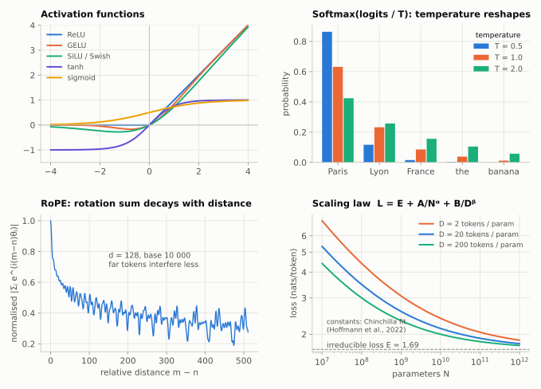
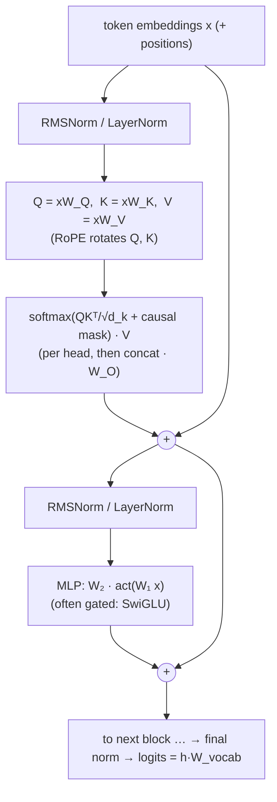

# 31 · The Mathematics of Neural Networks & Transformers

> *A transformer is built from operations covered in earlier chapters: matrix multiplication, a softmax, a few rotations from complex analysis, and the chain rule.*

**Part H · Mathematics for AI** (beyond Kreyszig) · ⏱ ~14 min · Builds on: [Ch. 7](../part-b-linear-algebra-vector-calculus/07-linear-algebra-matrices-systems.md), [Ch. 13](../part-d-complex-analysis/13-complex-numbers-functions.md), [Ch. 26](26-matrix-calculus-autodiff.md), [Ch. 28](28-information-theory.md)
[← Low-Rank Methods](30-low-rank-svd-pca.md) · [Index](../../README.md) · [Next: Number Formats & Quantization →](32-number-formats-quantization.md)

---

## 🧭 The big picture

A neural network is a composition of **linear maps** (matrices) and **simple nonlinearities**:

```math
\mathbf{h}_{l+1} = \sigma\!\left(W_l\,\mathbf{h}_l + \mathbf{b}_l\right)
```

The **universal approximation theorem** says one hidden layer with enough units can approximate any continuous function on a compact set. Depth makes this *efficient*. The **transformer** adds one more ingredient, **attention**: every token computes a weighted average of all other tokens, with weights learned from content.

<p align="center">
  <picture>
    <source media="(prefers-color-scheme: dark)" srcset="../../assets/figures/ch31-activations-softmax-rope-scaling-dark.svg">
    
  </picture>
</p>

## 🗺️ One transformer block (pre-norm, decoder-only)



## 🔑 Core ideas

### Attention

```math
\text{Attention}(Q, K, V) = \text{softmax}\!\left(\frac{QK^T}{\sqrt{d_k}}\right)V
```

- $QK^T$ is a matrix of **dot products**: similarity between what each token looks for (query) and what each token offers (key).
- **Why divide by $\sqrt{d_k}$?** If the entries of $\mathbf{q}$ and $\mathbf{k}$ are independent with variance 1, then $\mathbf{q}\cdot\mathbf{k}$ has variance $d_k$ ([Ch. 24](../part-g-probability-statistics/24-data-analysis-probability.md)). Unscaled scores would push the softmax into saturation, where gradients vanish.
- **Causal mask:** set scores for future positions to $-\infty$ before the softmax, so token $t$ only sees tokens $\le t$.
- **Multi-head:** $h$ attention operations run in parallel on $d/h$-dimensional slices, each free to learn a different relation.
- **Cost:** $O(n^2 d)$ time and $O(n^2)$ memory for the score matrix. FlashAttention avoids storing it ([Ch. 33](33-efficient-inference.md)).

### Positional information: RoPE

Treat each pair of query/key coordinates as a complex number and rotate it by an angle proportional to position $m$: $\tilde q_j = q_j\,e^{im\theta_j}$ with $\theta_j = \text{base}^{-2j/d}$. Then

```math
\operatorname{Re}\Big[\tilde q_j\,\overline{\tilde k_j}\Big] = \operatorname{Re}\Big[q_j\,\bar k_j\,e^{i(m-n)\theta_j}\Big]
```

depends only on the **relative** offset $m - n$ ([Ch. 13](../part-d-complex-analysis/13-complex-numbers-functions.md)). The many frequencies $\theta_j$ form a Fourier basis ([Ch. 11](../part-c-fourier-pdes/11-fourier-analysis.md)). Context-extension tricks (position interpolation, NTK-aware scaling, YaRN) rescale those frequencies.

### Normalisation & residuals

| Component | Formula | Purpose |
|---|---|---|
| LayerNorm | $\gamma\odot\frac{\mathbf{x} - \mu}{\sqrt{\sigma^2 + \epsilon}} + \beta$ | fixes the scale of activations |
| RMSNorm | $\gamma\odot\frac{\mathbf{x}}{\sqrt{\text{mean}(x_i^2) + \epsilon}}$ | cheaper, no centring; common in LLMs |
| Residual | $\mathbf{x} + f(\mathbf{x})$ | identity-like Jacobian → gradients survive depth ([Ch. 26](26-matrix-calculus-autodiff.md)) |

### Counting parameters and FLOPs

For a standard block with width $d$ and MLP width $4d$: attention has $4d^2$ parameters and the MLP $8d^2$, so **about $12d^2$ per layer**, or $N \approx 12Ld^2$ excluding embeddings.

| Quantity | Rule of thumb |
|---|---|
| Forward FLOPs per token | $\approx 2N$ (one multiply and one add per weight) |
| Training FLOPs | $C \approx 6ND$ (forward + backward, $D$ tokens) |
| Weights memory | $N\times$ bytes per parameter (2 for BF16) |

### Scaling laws

Loss falls as a **power law** in parameters $N$ and data $D$ (figure, bottom right):

```math
L(N, D) = E + \frac{A}{N^{\alpha}} + \frac{B}{D^{\beta}}
```

Hoffmann et al. (2022, "Chinchilla") fitted $E \approx 1.69$, $\alpha \approx 0.34$, $\beta \approx 0.28$ and found that for a fixed compute budget $C \approx 6ND$, $N$ and $D$ should grow together, at roughly **20 tokens per parameter**. On log–log axes a power law is a straight line, so this is the linear regression of [Ch. 25](../part-g-probability-statistics/25-mathematical-statistics.md) applied to logarithms.

### Decoding: turning logits into text

| Strategy | Rule |
|---|---|
| Greedy | $\arg\max$ of the logits |
| Temperature $T$ | sample from $\text{softmax}(\mathbf{z}/T)$: $T \to 0$ is greedy, $T > 1$ flattens |
| Top-$k$ | keep the $k$ most likely tokens, renormalise |
| Top-$p$ (nucleus) | keep the smallest set with cumulative probability $\ge p$ |
| Beam search | keep the $B$ best partial sequences (a graph search, [Ch. 23](../part-f-optimization-graphs/23-graphs-combinatorial-optimization.md)) |

**Mixture-of-Experts (MoE):** a router computes $\text{softmax}(W_r\mathbf{x})$ and sends each token to its top-$k$ expert MLPs. Total parameters grow while the **active** parameters per token, and therefore the FLOPs, stay small.

## 💡 Aha! moments

- **A residual stack is Euler's method** for $\mathbf{x}' = f(\mathbf{x})$ ([Ch. 1](../part-a-odes/01-first-order-odes.md)). The residual stream acts like a shared memory bus that every layer reads from and writes to.
- **Attention is kernel smoothing.** Each output is a weighted average of the values with weights $\propto e^{\mathbf{q}\cdot\mathbf{k}/\sqrt{d}}$, a learned, content-dependent version of the Gaussian smoothing seen in the heat equation ([Ch. 12](../part-c-fourier-pdes/12-partial-differential-equations.md)).
- **Embeddings are rows of a matrix,** and the output layer is often the same matrix transposed (tied embeddings). Predicting the next token means finding the vocabulary vector that best aligns with the final hidden state.

## ⚠️ Pitfalls

- Softmax over large logits overflows unless you subtract the maximum first ([Ch. 19](../part-e-numerics/19-numerics-in-general.md)).
- Attention is permutation-equivariant. Without positional information, "dog bites man" and "man bites dog" look the same.
- FLOP counts ignore memory traffic. At inference time, bandwidth usually dominates ([Ch. 33](33-efficient-inference.md)).

## 🧪 Try it: causal self-attention in NumPy

```python
import numpy as np
rng = np.random.default_rng(0)
n, d = 5, 8
X = rng.standard_normal((n, d))
Wq, Wk, Wv = (rng.standard_normal((d, d)) / np.sqrt(d) for _ in range(3))
Q, K, V = X @ Wq, X @ Wk, X @ Wv
S = Q @ K.T / np.sqrt(d) + np.triu(np.full((n, n), -np.inf), 1)   # causal mask
P = np.exp(S - S.max(1, keepdims=True)); P /= P.sum(1, keepdims=True)
print(P.round(2))          # lower-triangular rows that each sum to 1
out = P @ V
```

## 🔗 Connections

[Ch. 26](26-matrix-calculus-autodiff.md) backprop · [Ch. 27](27-optimization-for-ml.md) training · [Ch. 28](28-information-theory.md) cross-entropy loss · [Ch. 32](32-number-formats-quantization.md)–[33](33-efficient-inference.md) making it cheap

---
[← Low-Rank Methods](30-low-rank-svd-pca.md) · [Index](../../README.md) · [Next: Number Formats & Quantization →](32-number-formats-quantization.md)
