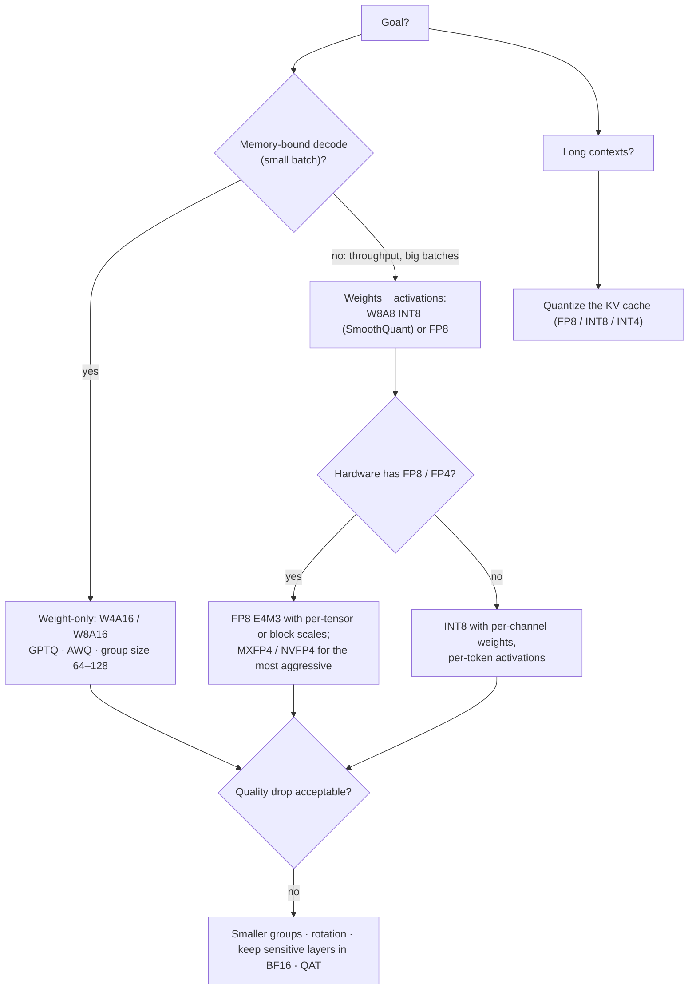

# 32 · Number Formats & Quantization

> *A 70-billion-parameter model is 140 GB in BF16 and 35 GB in 4-bit. Done carefully, the 4-bit version loses surprisingly little quality.*

**Part H · Mathematics for AI** (beyond Kreyszig) · ⏱ ~15 min · Builds on: [Ch. 19](../part-e-numerics/19-numerics-in-general.md) round-off, [Ch. 24](../part-g-probability-statistics/24-data-analysis-probability.md) uniform distribution, [Ch. 15](../part-d-complex-analysis/15-power-series-taylor-series.md) Taylor expansion
[← Neural Networks & Transformers](31-neural-networks-transformers.md) · [Index](../../README.md) · [Next: Efficient Inference →](33-efficient-inference.md)

---

## 🧭 The big picture

**Quantization** maps high-precision numbers to a small set of representable values. Fewer bits per weight means:

- **less memory**: models fit on smaller or fewer GPUs, and longer KV caches fit ([Ch. 33](33-efficient-inference.md));
- **less memory traffic**: decoding is bandwidth-bound, so halving the bytes nearly doubles tokens/s;
- **faster math**: FP8 and INT8 tensor cores have roughly twice the throughput of BF16.

The cost is **rounding error**. The mathematics of quantization is about where that error goes and how to keep it out of the outputs that matter.

<p align="center">
  <picture>
    <source media="(prefers-color-scheme: dark)" srcset="../../assets/figures/ch32-quantization-dark.svg">
    
  </picture>
</p>

## 🔑 Core ideas

### Floating point in one line

```math
x = (-1)^{s}\times 1.m\times 2^{\,e - \text{bias}}
```

Exponent bits buy **range** and mantissa bits buy **precision**. The spacing between neighbouring floats is proportional to their magnitude, so the **relative** error is roughly constant at about $2^{-(\text{mantissa bits}+1)}$.

| Format | Sign / Exp / Mantissa | Max value | Machine ε (spacing at 1) | Typical use |
|---|---|---|---|---|
| FP32 | 1 / 8 / 23 | $3.4\times10^{38}$ | $1.2\times10^{-7}$ | master weights, optimiser state |
| FP16 | 1 / 5 / 10 | 65,504 | $9.8\times10^{-4}$ | inference; training needs loss scaling |
| **BF16** | 1 / 8 / 7 | $3.4\times10^{38}$ | $7.8\times10^{-3}$ | training default: FP32 range, less precision |
| FP8 E4M3 | 1 / 4 / 3 | 448 | 0.125 | weights and activations (forward) |
| FP8 E5M2 | 1 / 5 / 2 | 57,344 | 0.25 | gradients (need range) |
| FP4 E2M1 | 1 / 2 / 1 | 6 | 0.5 | block-scaled formats (MXFP4, NVFP4) |
| INT8 | 8-bit integer | 127 × scale | uniform steps | weights and activations |
| INT4 | 4-bit integer | 7 × scale | uniform steps | weight-only LLM quantization |

### The uniform (integer) quantizer

```math
q = \operatorname{clip}\!\Big(\operatorname{round}\big(\tfrac{x}{s}\big) + z,\ q_{\min},\ q_{\max}\Big), \qquad \hat x = s\,(q - z)
```

- **Symmetric**: $z = 0$, $s = \frac{\max\vert x\vert}{2^{b-1} - 1}$. Simple, and a good fit for zero-centred weights.
- **Asymmetric (affine)**: a zero-point $z$ shifts the grid. Useful for skewed tensors such as post-ReLU activations.

**The error budget.** For values inside the range, the rounding error is roughly uniform on $[-s/2, s/2]$ ([Ch. 24](../part-g-probability-statistics/24-data-analysis-probability.md)), so

```math
\text{MSE}_{\text{round}} \approx \frac{s^2}{12}, \qquad \text{SQNR} \approx 6.02\,b + 1.76\ \text{dB (full-scale sine)}
```

**Each extra bit buys about 6 dB**, i.e. it divides the noise power by 4. Clipping adds a second error term for values outside the range. The optimal range **trades rounding noise against clipping error**, and it sits well below the maximum (figure, bottom right).

### Granularity: who shares a scale?

| Granularity | Scale per… | Overhead | Accuracy |
|---|---|---|---|
| Per-tensor | whole matrix | ~0 | worst: one outlier ruins it |
| Per-channel | output row / column | tiny | standard for INT8 weights |
| Per-group / block | every $g$ values (e.g. 32, 64, 128) | e.g. +0.125 bit/weight for an FP16 scale per 128 | standard for INT4 weights |
| **Microscaling (MX)** | 32-element blocks share a power-of-two scale | +0.25 bit/elt | OCP MXFP8, MXFP6 and MXFP4 formats |
| NVFP4 | 16-element blocks with an FP8 scale, plus a tensor scale | +0.5 bit/elt | Blackwell-generation FP4 |

### The outlier problem (figure, bottom left)

LLM activations contain a few **outlier channels** whose values are 10–100× larger than the rest. With absmax scaling, the outliers set $s$, so ordinary values round to just a few levels. Solutions:

| Method | Key idea |
|---|---|
| **LLM.int8()** | keep the outlier columns in FP16 and everything else in INT8 |
| **SmoothQuant** | move the difficulty from activations to weights: $Y = (X\operatorname{diag}(\mathbf{s})^{-1})(\operatorname{diag}(\mathbf{s})W)$ with $s_j = \max\vert X_j\vert^{\alpha}/\max\vert W_j\vert^{1-\alpha}$ |
| **AWQ** | scale up *salient* weight channels (those that see large activations) before quantizing, protecting the weights that matter most |
| **Rotation (QuaRot, SpinQuant)** | multiply by an orthogonal (Hadamard) matrix $Q$: $WX = (WQ)(Q^TX)$ spreads outliers across all channels |
| **Clipping search** | choose the range that minimises MSE or output error rather than using the max |

### GPTQ: second-order error compensation

For a linear layer, minimise the **output** error on calibration inputs $X$:

```math
\min_{\hat W}\ \Vert WX - \hat WX\Vert_F^2 \qquad\Rightarrow\qquad \text{Hessian } H = 2XX^T
```

Quantize the weights one column at a time. After rounding weight $w_q$, **update the not-yet-quantized weights** to absorb the error, using the Optimal Brain Surgeon formula:

```math
\boldsymbol\delta = -\frac{w_q - \operatorname{quant}(w_q)}{[H^{-1}]_{qq}}\,(H^{-1})_{:,q}, \qquad \Delta L \approx \frac{\left(w_q - \operatorname{quant}(w_q)\right)^2}{2\,[H^{-1}]_{qq}}
```

This is the Taylor expansion of [Ch. 15](../part-d-complex-analysis/15-power-series-taylor-series.md) to second order, combined with a Cholesky factorisation ([Ch. 20](../part-e-numerics/20-numeric-linear-algebra.md)) for speed.

### Quantization-aware training (QAT) & the straight-through estimator

$\operatorname{round}$ has zero gradient almost everywhere. QAT uses fake quantization in the forward pass and treats rounding as the identity in the backward pass (**STE**: $\partial\,\operatorname{round}(x)/\partial x \approx 1$ inside the clipping range, 0 outside), so the weights learn to sit where rounding does little harm.

## 🗺️ Choosing a scheme



## 💡 Aha! moments

- **Memory arithmetic decides deployment.** Weights take $N\times\frac{\text{bits}}{8}$ bytes: a 70B model needs 140 GB in BF16, 70 GB in FP8 and 35 GB in INT4, plus scales. A model that fits on one GPU avoids cross-GPU communication entirely.
- **Floats are logarithmic grids.** That is why FP8 handles the heavy-tailed, wide-range values of activations and gradients better than INT8 at the same bit-width (figure, top left), and why INT works well once per-group scales have removed the range problem.
- **BF16 won training** because range matters more than precision for gradients: FP16's maximum of 65,504 overflows, while BF16 shares FP32's exponent.
- **Quantization noise acts like a small weight perturbation**, $\Delta L \approx \tfrac12\boldsymbol\delta^TH\boldsymbol\delta$. Models trained to flat minima (small Hessian eigenvalues) quantize better.

## ⚠️ Pitfalls

- Evaluate quantized models on **downstream tasks and long generations**, not only perplexity. Errors can compound in reasoning chains ([Ch. 36](36-agentic-workflows.md)).
- Calibration data should match deployment data. A code model calibrated on news text quantizes poorly.
- Summation needs headroom: INT8 products accumulate in INT32 and FP8 matmuls accumulate in FP32 (or at least BF16). Accumulating in low precision silently loses mass.

## 🧪 Try it: per-tensor vs per-channel INT4

```python
import numpy as np
rng = np.random.default_rng(0)
W = rng.standard_normal((256, 256)) * rng.uniform(0.2, 3.0, (256, 1))   # rows with different scales
def quant(x, s, b=4):
    L = 2**(b-1) - 1
    return s * np.clip(np.round(x / s), -L, L)
mse_tensor  = np.mean((W - quant(W, np.abs(W).max() / 7))**2)
mse_channel = np.mean((W - quant(W, np.abs(W).max(1, keepdims=True) / 7))**2)
print(f"per-tensor MSE {mse_tensor:.4f}   per-channel MSE {mse_channel:.4f}")
```

## 🔗 Connections

[Ch. 19](../part-e-numerics/19-numerics-in-general.md) floating point · [Ch. 20](../part-e-numerics/20-numeric-linear-algebra.md) conditioning, Cholesky · [Ch. 30](30-low-rank-svd-pca.md) QLoRA · [Ch. 33](33-efficient-inference.md) bandwidth and the roofline

---
[← Neural Networks & Transformers](31-neural-networks-transformers.md) · [Index](../../README.md) · [Next: Efficient Inference →](33-efficient-inference.md)
