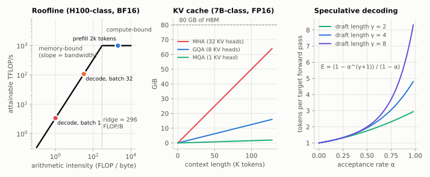
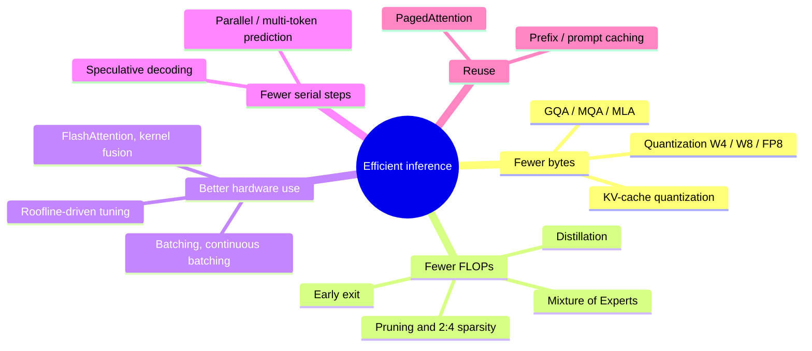

# 33 · Model Compression & Efficient Inference

> *Generating one token at batch size 1 reads every weight from memory once. That fact sets most of the economics of LLM serving.*

**Part H · Mathematics for AI** (beyond Kreyszig) · ⏱ ~15 min · Builds on: [Ch. 7](../part-b-linear-algebra-vector-calculus/07-linear-algebra-matrices-systems.md) matmul cost, [Ch. 28](28-information-theory.md) KL, [Ch. 31](31-neural-networks-transformers.md) transformers, [Ch. 32](32-number-formats-quantization.md) quantization
[← Number Formats & Quantization](32-number-formats-quantization.md) · [Index](../../README.md) · [Next: Stochastic Processes & Diffusion →](34-stochastic-processes-diffusion.md)

---

## 🧭 The big picture

Efficient inference rests on two numbers for every operation, **FLOPs** and **bytes moved**, and on the hardware's two limits, **peak compute** and **memory bandwidth**. Their ratio, the **arithmetic intensity**, tells you which limit you hit and therefore which optimisation will help.

<p align="center">
  <picture>
    <source media="(prefers-color-scheme: dark)" srcset="../../assets/figures/ch33-roofline-kv-speculative-dark.svg">
    
  </picture>
</p>

## 🔑 Core ideas

### 1 · The roofline model

```math
\text{attainable FLOP/s} = \min\!\big(\text{peak FLOP/s},\ \ \text{bandwidth}\times\text{arithmetic intensity}\big), \qquad \text{AI} = \frac{\text{FLOPs}}{\text{bytes moved}}
```

For an H100-class GPU (about 990 dense BF16 TFLOP/s and 3.35 TB/s), the **ridge point** is about 300 FLOP/byte. Below it you are memory-bound, above it compute-bound.

| Operation | Arithmetic intensity | Regime |
|---|---|---|
| Matrix–vector (decode, batch 1, BF16 weights) | ≈ 2 FLOPs / 2 bytes = **1** | heavily memory-bound |
| Decode, batch $B$ | ≈ $B$ (weights reused across the batch) | memory-bound until $B$ ≈ 300 |
| Prefill of $n$ tokens | ≈ $n$ | compute-bound for long prompts |
| Attention over the KV cache in decode | ≈ 1 (each cached byte used once per token) | memory-bound, and grows with context |

**Decode speed limit (batch 1):** $\text{tokens/s} \le \dfrac{\text{bandwidth}}{\text{bytes of weights}}$. A 7B model in BF16 (14 GB) at 3.35 TB/s gives at most about **240 tokens/s**. In INT4 (~3.5 GB) the ceiling is about 960. This is why quantization ([Ch. 32](32-number-formats-quantization.md)) speeds up decoding almost linearly.

### 2 · The KV cache

Each generated token must attend to the keys and values of all previous tokens, so they are cached:

```math
\text{KV bytes} = 2 \times L \times n_{\text{kv heads}} \times d_{\text{head}} \times \text{bytes/elt} \times \text{context} \times \text{batch}
```

| Design | KV heads (7B-class: $L = 32$, $d_{\text{head}} = 128$) | Per token (FP16) | 128k context |
|---|---|---|---|
| MHA (multi-head) | 32 | 512 KiB | 64 GiB |
| GQA (grouped-query) | 8 | 128 KiB | 16 GiB |
| MQA (multi-query) | 1 | 16 KiB | 2 GiB |
| MLA (latent, [Ch. 30](30-low-rank-svd-pca.md)) | low-rank latent | small | small |

Further tools: **PagedAttention** (vLLM) allocates the cache in fixed-size pages, like OS virtual memory, to avoid fragmentation. **Prefix caching** reuses the KV of shared prompts. **KV quantization** (FP8 or INT4) halves or quarters the cache.

### 3 · FlashAttention: IO-aware exact attention

Standard attention writes the $n\times n$ score matrix to slow HBM memory. FlashAttention **tiles** $Q$, $K$ and $V$ into fast on-chip SRAM and combines the tiles with an **online softmax**: it keeps a running maximum $m$ and normaliser $\ell$ and rescales when a new block raises $m$. The result is the exact same output with $O(n)$ memory and far fewer HBM reads. The algorithm is the log-sum-exp stability trick of [Ch. 19](../part-e-numerics/19-numerics-in-general.md), streamed block by block.

### 4 · Making the model smaller

| Technique | Math | Notes |
|---|---|---|
| **Quantization** | fewer bits per number ([Ch. 32](32-number-formats-quantization.md)) | usually the highest-return option |
| **Pruning: unstructured** | zero out weights with small saliency: magnitude $\vert w\vert$, or $\frac{w_q^2}{2[H^{-1}]_{qq}}$ (Optimal Brain Surgeon) | high sparsity possible, but speed-ups need sparse kernels |
| **Pruning: structured / 2:4** | remove heads, channels or layers; or keep 2 of every 4 weights | 2:4 sparsity is hardware-accelerated on NVIDIA Ampere and later GPUs |
| **Distillation** | student minimises $\alpha\,\text{CE}(y, p_s) + (1 - \alpha)\,T^2 D_{KL}(p_t^{(T)}\Vert p_s^{(T)})$ | transfers "dark knowledge" ([Ch. 28](28-information-theory.md)) |
| **Low-rank factorisation** | $W \approx UV^T$ ([Ch. 30](30-low-rank-svd-pca.md)) | also adapters (LoRA) |
| **Mixture of Experts** | only $k$ of $E$ experts run per token | active parameters ≪ total parameters |

### 5 · Speculative decoding

A cheap **draft** model proposes $\gamma$ tokens, and the big **target** model checks all of them in *one* forward pass (cheap, because decode is memory-bound). Draft token $x$ is accepted with probability $\min\left(1, \frac{p(x)}{q(x)}\right)$. On rejection, resample from $\text{norm}\big(\max(0, p - q)\big)$. This rule makes the output distribution **exactly** the target's. With per-token acceptance rate $\alpha$:

```math
E[\text{tokens per target pass}] = \frac{1 - \alpha^{\gamma+1}}{1 - \alpha}
```

At $\alpha = 0.8$ and $\gamma = 4$ that is about 3.4 tokens per pass (figure, right). Variants include Medusa and EAGLE (extra heads instead of a separate draft model) and n-gram or prompt-lookup drafts.

### 6 · Scaling out: parallelism and its laws

| Law | Formula | Lesson |
|---|---|---|
| **Amdahl** | speed-up $= \frac{1}{(1 - p) + p/n}$ | the serial fraction $1 - p$ caps the gain: $p = 0.95$ gives at most 20× |
| **Little** | $L = \lambda W$ (concurrency = throughput × latency) | to serve 100 req/s at 2 s latency you need 200 requests in flight |
| **Ring all-reduce** | each GPU sends ≈ $2\frac{n-1}{n}\times$ the data size | data-parallel gradient sync costs ~2× the model size per step |

Data parallelism replicates the model, **tensor** parallelism splits matrices across GPUs (needs fast links), **pipeline** parallelism splits layers (watch the pipeline bubble), and **expert** parallelism spreads MoE experts.

## 🗺️ The efficiency toolbox



## 💡 Aha! moments

- **Batching is nearly free when you are memory-bound.** Decoding 32 sequences reads the weights once instead of 32 times, so throughput rises almost 32× while per-token latency barely changes, until you approach the ridge point or run out of KV memory.
- **The 6ND rule:** training a 7B model on 2T tokens costs about $6\times 7\times10^9\times 2\times10^{12} \approx 8.4\times10^{22}$ FLOPs. At 40% utilisation of a ~1 PFLOP/s GPU, that is about $2.1\times10^8$ GPU-seconds, roughly 58,000 GPU-hours.
- **Long-context cost is mostly the KV cache,** not the weights. GQA and KV quantization matter more than weight quantization beyond about 32k tokens.

## ⚠️ Pitfalls

- Optimising FLOPs for a memory-bound workload does little. Profile first and locate the workload on the roofline.
- Speculative decoding helps only when the draft model is cheap **and** usually agrees with the target. Low $\alpha$ wastes compute.
- Unstructured sparsity rarely speeds up dense GPU kernels. Use structured or 2:4 patterns.

## 🧪 Try it: a serving back-of-the-envelope

```python
params, bits = 8e9, 4                 # 8B model, 4-bit weights
L, kv_heads, d_head, ctx, batch = 32, 8, 128, 32_768, 16
bw = 3.35e12                          # bytes/s
w_bytes  = params * bits / 8
kv_bytes = 2 * L * kv_heads * d_head * 2 * ctx * batch        # FP16 KV
print(f"weights {w_bytes/1e9:.1f} GB, KV cache {kv_bytes/2**30:.1f} GiB")
print(f"batch-1 decode ceiling ≈ {bw / w_bytes:.0f} tokens/s")
```

## 🔗 Connections

[Ch. 7](../part-b-linear-algebra-vector-calculus/07-linear-algebra-matrices-systems.md) $2mnk$ FLOPs · [Ch. 19](../part-e-numerics/19-numerics-in-general.md) stable softmax · [Ch. 30](30-low-rank-svd-pca.md) low rank · [Ch. 32](32-number-formats-quantization.md) quantization · [Ch. 36](36-agentic-workflows.md) cost and latency of agents

---
[← Number Formats & Quantization](32-number-formats-quantization.md) · [Index](../../README.md) · [Next: Stochastic Processes & Diffusion →](34-stochastic-processes-diffusion.md)
