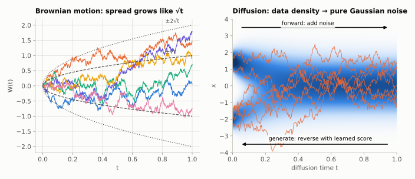
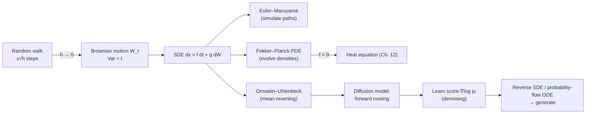

# 34 · Stochastic Processes, SDEs & Diffusion Models

> *A diffusion model learns to run the heat equation backwards, turning noise into images, audio and molecules.*

**Part H · Mathematics for AI** (beyond Kreyszig) · ⏱ ~13 min · Builds on: [Ch. 12](../part-c-fourier-pdes/12-partial-differential-equations.md) heat equation, [Ch. 21](../part-e-numerics/21-numerics-odes-pdes.md) ODE solvers, [Ch. 24](../part-g-probability-statistics/24-data-analysis-probability.md) normal distribution, [Ch. 29](29-bayesian-inference-sampling.md) Langevin dynamics
[← Efficient Inference](33-efficient-inference.md) · [Index](../../README.md) · [Next: Reinforcement Learning →](35-reinforcement-learning.md)

---

## 🧭 The big picture

Kreyszig's ODEs are deterministic. A **stochastic differential equation (SDE)** adds continuous random kicks:

```math
d\mathbf{x} = \underbrace{\mathbf{f}(\mathbf{x}, t)\,dt}_{\text{drift}} + \underbrace{g(t)\,d\mathbf{W}_t}_{\text{diffusion}}
```

where $\mathbf{W}_t$ is **Brownian motion**. Individual paths are random, but the **probability density** of $\mathbf{x}$ evolves deterministically, by a PDE closely related to the heat equation. Diffusion models exploit this: a fixed SDE turns data into noise, and a neural network learns the reverse.

<p align="center">
  <picture>
    <source media="(prefers-color-scheme: dark)" srcset="../../assets/figures/ch34-brownian-diffusion-dark.svg">
    
  </picture>
</p>

## 🗺️ Concept map



## 🔑 Core ideas

### Brownian motion

- $W_0 = 0$, with **independent Gaussian increments** $W_{t+h} - W_t \sim N(0, h)$.
- Paths are continuous but **nowhere differentiable**, and the typical displacement grows like $\sqrt t$, not $t$ (figure, left).
- Rule of thumb for calculus: $(dW)^2 = dt$. This is where SDE calculus departs from ordinary calculus.

### Itô's lemma: the chain rule with noise

For $dX = f\,dt + g\,dW$ and smooth $\phi(X)$:

```math
d\phi(X) = \phi'(X)\,dX + \tfrac12\,\phi''(X)\,g^2\,dt
```

The extra $\tfrac12\phi'' g^2$ term comes from $(dW)^2 = dt$. It underlies the Black–Scholes formula, the analysis of stochastic gradient descent, and diffusion-model derivations.

### Simulating: Euler–Maruyama

```math
\mathbf{x}_{n+1} = \mathbf{x}_n + \mathbf{f}(\mathbf{x}_n, t_n)\,h + g(t_n)\sqrt{h}\;\boldsymbol\xi_n, \qquad \boldsymbol\xi_n \sim N(0, I)
```

This is Euler's method ([Ch. 1](../part-a-odes/01-first-order-odes.md)) plus a noise term that scales as $\sqrt h$.

### From paths to densities: Fokker–Planck

The density $p(\mathbf{x}, t)$ of an SDE satisfies

```math
\frac{\partial p}{\partial t} = -\nabla\cdot(\mathbf{f}\,p) + \frac{g^2}{2}\,\nabla^2 p
```

With no drift, this **is the heat equation** ([Ch. 12](../part-c-fourier-pdes/12-partial-differential-equations.md)): adding Gaussian noise to data blurs its density exactly the way heat spreads in a bar. The first term is the continuity equation of [Ch. 10](../part-b-linear-algebra-vector-calculus/10-vector-integral-calculus.md).

### Diffusion models in four equations

| Step | Equation |
|---|---|
| **Forward (fixed)** | $\mathbf{x}_t = \sqrt{\bar\alpha_t}\,\mathbf{x}_0 + \sqrt{1 - \bar\alpha_t}\,\boldsymbol\varepsilon$, $\ \boldsymbol\varepsilon \sim N(0, I)$, with $\bar\alpha_t$ falling from 1 to ≈ 0 |
| **Training** | $\min_\theta\ \mathbb{E}\,\Vert\boldsymbol\varepsilon - \boldsymbol\varepsilon_\theta(\mathbf{x}_t, t)\Vert^2$ (predict the noise) |
| **Score** | $\nabla_{\mathbf{x}}\log p_t(\mathbf{x}) \approx -\boldsymbol\varepsilon_\theta(\mathbf{x}, t)/\sqrt{1 - \bar\alpha_t}$ |
| **Generate** | reverse SDE $d\mathbf{x} = [\mathbf{f} - g^2\nabla\log p_t]\,dt + g\,d\bar{\mathbf{W}}$, or the **probability-flow ODE** $d\mathbf{x} = [\mathbf{f} - \tfrac12 g^2\nabla\log p_t]\,dt$ |

The probability-flow ODE is deterministic, with the same marginals as the SDE. That makes sampling an **ODE-solving problem**, and better solvers mean fewer steps: DDIM, Heun (EDM) and DPM-Solver ([Ch. 21](../part-e-numerics/21-numerics-odes-pdes.md)).

**Flow matching / rectified flow:** skip the SDE and regress a velocity field $\mathbf{v}_\theta(\mathbf{x}, t)$ onto straight-line paths $\mathbf{x}_t = (1-t)\mathbf{x}_0 + t\,\mathbf{x}_1$ between noise and data. Straighter paths need fewer integration steps.

### Other processes worth knowing

| Process | Definition | Where it appears |
|---|---|---|
| Ornstein–Uhlenbeck | $dx = -\theta x\,dt + \sigma\,dW$ | mean reversion; the VP diffusion forward process; SGD near a minimum |
| Langevin dynamics | $d\mathbf{x} = \nabla\log p\,dt + \sqrt2\,d\mathbf{W}$ | samples from $p$; SGLD; score-based sampling |
| Poisson process | events at rate $\lambda$, exponential gaps | request arrivals at inference servers ([Ch. 24](../part-g-probability-statistics/24-data-analysis-probability.md)) |
| Markov chain | memoryless transitions $P$ | MCMC, PageRank, LLM token generation |

## 💡 Aha! moments

- **Einstein (1905) used Brownian motion to argue that atoms exist:** the $\sqrt t$ spreading of pollen grains let him estimate molecular sizes. The same $\sqrt t$ appears in every noise schedule.
- **Denoising is score estimation.** Tweedie's formula says the best denoiser $E[\mathbf{x}_0\mid\mathbf{x}_t]$ is the noisy input plus (noise variance) × (score). Learning to denoise is therefore the same as learning $\nabla\log p$.
- **SGD behaves like a Langevin process.** Mini-batch noise makes SGD resemble an SDE whose "temperature" scales with $\eta/B$. That is one explanation of why small batches find flatter minima.

## ⚠️ Pitfalls

- Noise enters with $\sqrt h$, not $h$. Writing $g\,h\,\xi$ in Euler–Maruyama is a classic bug.
- Ordinary calculus rules fail for Itô integrals. Remember the $\tfrac12\phi'' g^2$ term.
- Too few sampling steps with a first-order solver gives blurry or off-distribution samples. Switch to a higher-order solver before adding steps.

## 🧪 Try it: Euler–Maruyama for an OU process

```python
import numpy as np
rng = np.random.default_rng(0)
theta, sigma, h, n = 2.0, 1.0, 0.01, 2000
x = np.full(5000, 3.0)                                   # 5000 paths starting at 3
for _ in range(n):
    x += -theta * x * h + sigma * np.sqrt(h) * rng.standard_normal(x.size)
print(x.mean().round(3), x.var().round(3), sigma**2 / (2*theta))   # ≈ 0, ≈ 0.25 = stationary variance
```

## 🔗 Connections

[Ch. 12](../part-c-fourier-pdes/12-partial-differential-equations.md) heat equation · [Ch. 21](../part-e-numerics/21-numerics-odes-pdes.md) solvers · [Ch. 29](29-bayesian-inference-sampling.md) MCMC and Langevin · [Ch. 9](../part-b-linear-algebra-vector-calculus/09-vector-differential-calculus.md) gradient fields

---
[← Efficient Inference](33-efficient-inference.md) · [Index](../../README.md) · [Next: Reinforcement Learning →](35-reinforcement-learning.md)
