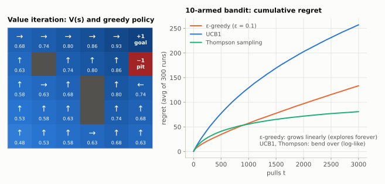
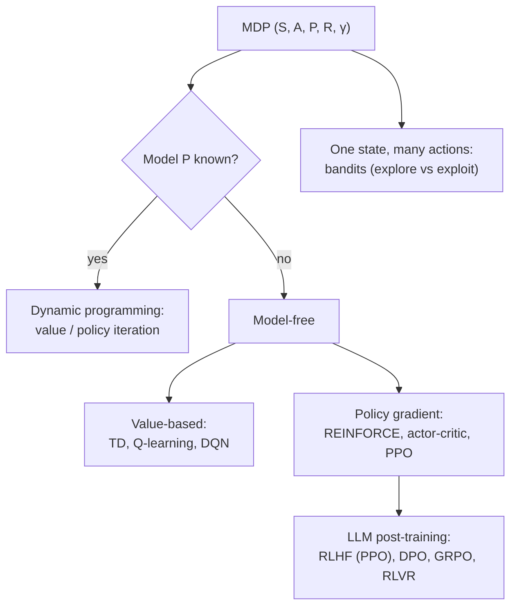

# 35 · Reinforcement Learning & Sequential Decisions

> *Bellman's principle from graph theory, combined with probability, gives the mathematics used to train models from rewards.*

**Part H · Mathematics for AI** (beyond Kreyszig) · ⏱ ~13 min · Builds on: [Ch. 23](../part-f-optimization-graphs/23-graphs-combinatorial-optimization.md) Bellman's principle, [Ch. 24](../part-g-probability-statistics/24-data-analysis-probability.md) expectation, [Ch. 27](27-optimization-for-ml.md) gradient methods, [Ch. 28](28-information-theory.md) KL
[← Stochastic Processes & Diffusion](34-stochastic-processes-diffusion.md) · [Index](../../README.md) · [Next: Agentic Workflows →](36-agentic-workflows.md)

---

## 🧭 The big picture

An **agent** acts, the **environment** responds with a new state and a reward, and the agent tries to maximise the total discounted reward:

```math
G_t = r_{t+1} + \gamma\,r_{t+2} + \gamma^2 r_{t+3} + \cdots = \sum_{k=0}^{\infty}\gamma^k r_{t+k+1}, \qquad 0 \le \gamma < 1
```

There is no teacher giving the right answer, only a scalar score, often delayed. The mathematics answers three questions: **how good is a state** (value functions), **how to improve** (Bellman equations, policy gradients), and **how to explore** (bandits).

<p align="center">
  <picture>
    <source media="(prefers-color-scheme: dark)" srcset="../../assets/figures/ch35-gridworld-bandits-dark.svg">
    
  </picture>
</p>

## 🗺️ The landscape



## 🔑 Core ideas

### Markov decision processes & value functions

A Markov decision process consists of states $S$, actions $A$, transitions $P(s'\mid s, a)$, rewards $R(s, a)$ and a discount $\gamma$. A **policy** $\pi(a\mid s)$ picks actions.

| Function | Definition | Meaning |
|---|---|---|
| $V^\pi(s)$ | $\mathbb{E}_\pi[G_t\mid s_t = s]$ | how good it is to be in $s$ |
| $Q^\pi(s, a)$ | $\mathbb{E}_\pi[G_t\mid s_t = s, a_t = a]$ | how good it is to take $a$ in $s$ |
| $A^\pi(s, a)$ | $Q^\pi(s, a) - V^\pi(s)$ | **advantage**: how much better than average |

### The Bellman equations

```math
V^{*}(s) = \max_{a}\Big[R(s, a) + \gamma\sum_{s'}P(s'\mid s, a)\,V^{*}(s')\Big]
```

This is [Ch. 23](../part-f-optimization-graphs/23-graphs-combinatorial-optimization.md)'s shortest-path recursion with probabilities and discounting. **Value iteration** applies the right-hand side repeatedly. Because the Bellman operator is a $\gamma$-**contraction**, it converges to the unique fixed point by Banach's fixed-point theorem, the same fixed-point iteration as in [Ch. 19](../part-e-numerics/19-numerics-in-general.md) (figure, left).

### Learning from experience

| Method | Update | Idea |
|---|---|---|
| **TD(0)** | $V(s) \leftarrow V(s) + \alpha\big[r + \gamma V(s') - V(s)\big]$ | bootstrap: move toward reward plus discounted guess |
| **Q-learning** | $Q(s,a) \leftarrow Q(s,a) + \alpha\big[r + \gamma\max_{a'}Q(s',a') - Q(s,a)\big]$ | off-policy, learns $Q^*$ directly |
| **DQN** | Q-learning with a neural $Q_\theta$, replay buffer and target network | Atari from pixels |

### Policy gradients

Parametrise the policy $\pi_\theta$ and climb $J(\theta) = \mathbb{E}[G]$. The **log-derivative trick** $\nabla p = p\,\nabla\log p$ gives

```math
\nabla_\theta J = \mathbb{E}_{\pi_\theta}\Big[\nabla_\theta\log\pi_\theta(a\mid s)\;A(s, a)\Big]
```

In words: increase the probability of actions that did better than expected. Subtracting a **baseline** such as $V(s)$ reduces variance without adding bias. **PPO** keeps each update small with a clipped ratio $r = \pi_\theta/\pi_{\text{old}}$: $\ \min\big(rA,\ \operatorname{clip}(r, 1-\epsilon, 1+\epsilon)A\big)$.

### Exploration: multi-armed bandits

| Strategy | Choose arm | Regret growth |
|---|---|---|
| ε-greedy | random with prob. ε, else best estimate | linear (explores forever) |
| **UCB1** | $\arg\max_a\ \hat\mu_a + \sqrt{2\ln t / n_a}$ (optimism under uncertainty) | logarithmic |
| **Thompson sampling** | sample $\theta_a \sim$ posterior, pick the best ([Ch. 29](29-bayesian-inference-sampling.md)) | logarithmic, strong in practice |

No strategy can beat $\Omega(\log T)$ regret (Lai–Robbins). MCTS applies UCB to every node of a search tree (UCT), which is how AlphaGo-style planning chooses moves.

### RL for language models

| Stage | Math |
|---|---|
| **Reward model** (Bradley–Terry) | $P(y_w \succ y_l) = \sigma\big(r(y_w) - r(y_l)\big)$, fitted on human preference pairs |
| **RLHF objective** | $\max_\pi\ \mathbb{E}[r(x, y)] - \beta\,D_{KL}(\pi\Vert\pi_{\text{ref}})$ ([Ch. 28](28-information-theory.md)) |
| **DPO** (no explicit RL) | $-\log\sigma\Big(\beta\log\frac{\pi(y_w)}{\pi_{\text{ref}}(y_w)} - \beta\log\frac{\pi(y_l)}{\pi_{\text{ref}}(y_l)}\Big)$ |
| **GRPO** | sample a group of $G$ answers per prompt; advantage = (reward − group mean) / group std; no value network |
| **RLVR** | rewards from verifiers (unit tests, exact-match math answers), which feed reasoning-model training |

## 💡 Aha! moments

- **DPO is a closed-form shortcut.** The KL-regularised objective has the optimal policy $\pi^* \propto \pi_{\text{ref}}\,e^{r/\beta}$. Solve for $r$, substitute into Bradley–Terry, and the reward model disappears, leaving a classification-style loss on preference pairs.
- **The discount factor sets a horizon:** $\sum\gamma^k = \frac{1}{1-\gamma}$, so $\gamma = 0.99$ means the agent effectively looks about 100 steps ahead.
- **Reward hacking is Goodhart's law in mathematical form.** Optimise a proxy hard enough and it diverges from the true goal. The KL penalty to $\pi_{\text{ref}}$ limits how far the policy can drift.

## ⚠️ Pitfalls

- Policy-gradient estimates have **high variance**. Use baselines, advantage normalisation and large batches.
- With function approximation, off-policy learning and bootstrapping together (the "deadly triad") can diverge. Target networks and replay buffers mitigate this.
- Sparse rewards give no learning signal until the agent succeeds by chance. Use shaped rewards, curricula or demonstrations.

## 🧪 Try it: value iteration in a few lines

```python
import numpy as np
# 1-D corridor: states 0..5, reward +1 at state 5 (terminal), step cost −0.04
n, gamma = 6, 0.9
V = np.zeros(n)
for _ in range(100):
    V_new = V.copy()
    for s in range(n - 1):
        V_new[s] = max(-0.04 + gamma * (1.0 if s2 == n - 1 else V[s2])
                       for s2 in (max(s - 1, 0), s + 1))
    V = V_new
print(V.round(3))      # values rise toward the goal: the policy is "go right"
```

## 🔗 Connections

[Ch. 23](../part-f-optimization-graphs/23-graphs-combinatorial-optimization.md) Bellman's principle · [Ch. 29](29-bayesian-inference-sampling.md) Thompson sampling · [Ch. 28](28-information-theory.md) KL regularisation · [Ch. 36](36-agentic-workflows.md) agents in practice

---
[← Stochastic Processes & Diffusion](34-stochastic-processes-diffusion.md) · [Index](../../README.md) · [Next: Agentic Workflows →](36-agentic-workflows.md)
