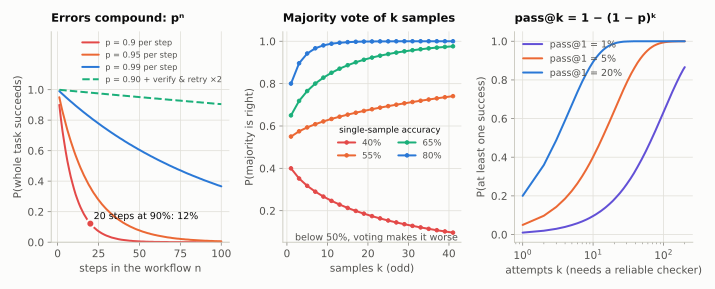
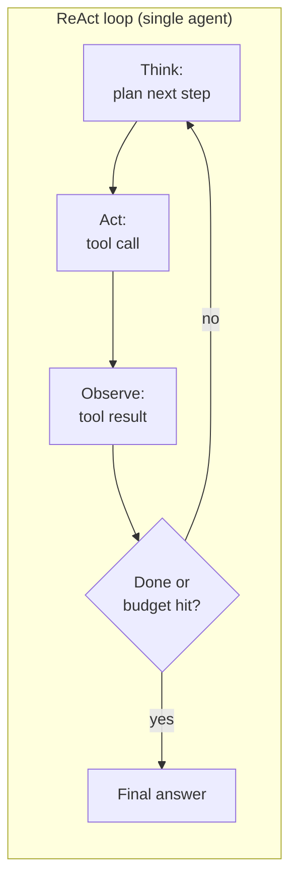
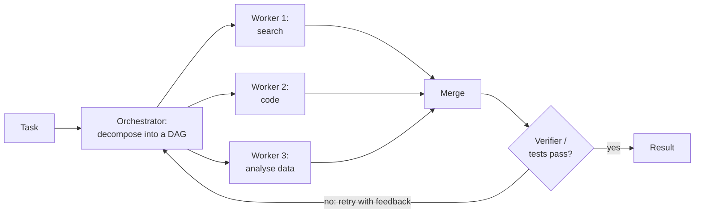

# 36 · The Mathematics of Agentic Workflows

> *An agent that is 90% reliable per step completes a 20-step task only about 12% of the time. Building reliable agents is largely applied probability.*

**Part H · Mathematics for AI** (beyond Kreyszig) · ⏱ ~15 min · Builds on: [Ch. 23](../part-f-optimization-graphs/23-graphs-combinatorial-optimization.md) graphs & search, [Ch. 24](../part-g-probability-statistics/24-data-analysis-probability.md)–[25](../part-g-probability-statistics/25-mathematical-statistics.md) probability & statistics, [Ch. 28](28-information-theory.md) information, [Ch. 35](35-reinforcement-learning.md) RL
[← Reinforcement Learning](35-reinforcement-learning.md) · [Index](../../README.md) · [Appendix: Formula Sheet →](../appendix/A3-auxiliary-formulas.md)

---

## 🧭 The big picture

An **agent** is a policy that maps what it has seen (task, memory, tool outputs) to its next action (think, call a tool, delegate, answer). Formally it acts in a **partially observable MDP** ([Ch. 35](35-reinforcement-learning.md)). In engineering terms it is a *stochastic program* running over a *graph of steps*. Five branches of mathematics describe how it behaves:

| Question | Mathematics | Chapter |
|---|---|---|
| Will the whole chain succeed? | products of probabilities, binomial, geometric | [24](../part-g-probability-statistics/24-data-analysis-probability.md) |
| How should it search and plan? | graphs, A\*, MCTS, dynamic programming | [23](../part-f-optimization-graphs/23-graphs-combinatorial-optimization.md), [35](35-reinforcement-learning.md) |
| How fast and how expensive? | critical paths, order statistics, queueing | [23](../part-f-optimization-graphs/23-graphs-combinatorial-optimization.md), [33](33-efficient-inference.md) |
| What should it ask or look up? | entropy, information gain, embeddings | [28](28-information-theory.md), [30](30-low-rank-svd-pca.md) |
| Is it actually better? | confidence intervals, paired tests, pass@k | [25](../part-g-probability-statistics/25-mathematical-statistics.md) |

<p align="center">
  <picture>
    <source media="(prefers-color-scheme: dark)" srcset="../../assets/figures/ch36-agent-reliability-dark.svg">
    
  </picture>
</p>

## 🗺️ Two shapes every agent system takes





## 🔑 Core ideas

### 1 · Reliability algebra

| Pattern | Success probability | Lesson |
|---|---|---|
| **Series**: $n$ steps, each succeeding with $p$ | $p^n$ | 0.9²⁰ ≈ 12%, 0.99²⁰ ≈ 82%: per-step reliability compounds |
| **Parallel redundancy**: $k$ independent tries, any success counts | $1 - (1-p)^k$ | this is **pass@k** (figure, right); it needs a checker to pick the success |
| **Retry until success** | attempts are geometric: $E = 1/p$ | budget for $1/p$ calls on average, with a long tail |
| **Verify & retry**, perfect verifier, up to $r$ retries | $1 - (1-p)^{r+1}$ per step | turns 0.9 into 0.999 per step with $r = 2$ (figure, dashed) |
| **Verify & retry**, imperfect verifier (accepts correct w.p. $a$, wrong w.p. $b$), retry until accepted | $\dfrac{pa}{pa + (1-p)b}$ | the **verifier's discrimination**, not the generator, sets final precision |

Example: a generator with $p = 0.6$ and a verifier with $a = 0.9$, $b = 0.1$ reach $\frac{0.54}{0.54 + 0.04} \approx 93\%$ precision.

### 2 · Voting and self-consistency (figure, middle)

For a binary right/wrong outcome, the majority of $k$ independent samples is correct with probability

```math
P_{\text{maj}}(k) = \sum_{j > k/2}\binom{k}{j}p^j(1-p)^{k-j}
```

By the **Condorcet jury theorem**, this tends to 1 when $p > \tfrac12$ and to **0** when $p < \tfrac12$. Voting amplifies whatever is already more likely. In practice errors are **correlated** (same model, same blind spots), so real gains are smaller than this independence model predicts. Using diverse prompts, models or tools reduces that correlation.

### 3 · Search & planning

| Method | Rule | Agent use |
|---|---|---|
| Greedy / ReAct | take the best-looking next step | simple tool use |
| Beam search | keep the top $B$ partial plans | constrained generation, plan search |
| **A\*** | expand the node minimising $f = g + h$; optimal if $h$ never overestimates | route and plan search with a heuristic |
| **MCTS (UCT)** | choose a child maximising $\bar Q + c\sqrt{\ln N/n}$ | tree-of-thought search, game-like planning |
| Dynamic programming | Bellman recursion ([Ch. 35](35-reinforcement-learning.md)) | optimal sub-plans reused |

### 4 · Latency & cost

- **A DAG's latency is its critical path.** Parallel branches cost the *maximum* of their latencies, not the sum. By Amdahl's law ([Ch. 33](33-efficient-inference.md)), serial steps cap the speed-up.
- **Fan-out exposes the tail.** If each call is slow with probability $q$, a step waiting on $k$ parallel calls is slow with probability $1 - (1-q)^k$: 1% per call with 100 calls gives 63% (Dean & Barroso, "The Tail at Scale"). With exponential latencies of mean $\mu$, $E[\max] = \mu\left(1 + \tfrac12 + \dots + \tfrac1k\right) \approx \mu(\ln k + 0.577)$.
- **Resending the whole history is quadratic.** If each turn adds $\Delta$ tokens and the full history is resent each turn, $n$ turns cost $\sum_{i=1}^{n}(c_0 + i\Delta) = nc_0 + \Delta\frac{n(n+1)}{2}$ input tokens, i.e. $O(n^2)$. Prompt caching, summarisation and sub-agents with fresh contexts bring this back toward linear.
- **Throughput:** Little's law $L = \lambda W$ sizes concurrency. A **token bucket** (capacity $b$, refill rate $r$) allows bursts of $b$ requests and a long-run rate of $r$.

### 5 · Information: what to ask, what to retrieve

- **Expected information gain** of an action (a question, a tool call, a test) is $\text{IG} = H(\text{belief}) - \mathbb{E}[H(\text{belief after observing})]$ ([Ch. 28](28-information-theory.md)). Good agents choose the probe that is most informative per unit of cost. Twenty yes/no questions carry 20 bits, enough to identify one item in a million.
- **Retrieval (RAG) is nearest-neighbour search** in embedding space ([Ch. 30](30-low-rank-svd-pca.md)). Quality is measured by recall@k: did the right document make the top $k$?

### 6 · Evaluating agents honestly

| Need | Tool |
|---|---|
| Success rate with uncertainty | $\hat p \pm 1.96\sqrt{\hat p(1-\hat p)/n}$ ([Ch. 25](../part-g-probability-statistics/25-mathematical-statistics.md)); with $n = 50$ tasks, ±14 points at $\hat p = 0.5$ |
| Comparing two agents | **paired** tests on the same tasks; repeat runs, because agents are stochastic |
| pass@k from $n$ samples with $c$ correct | unbiased estimator $1 - \binom{n-c}{k}\Big/\binom{n}{k}$ (Chen et al., 2021) |
| LLM-as-judge vs humans | Cohen's $\kappa = \frac{p_o - p_e}{1 - p_e}$ (agreement beyond chance) |
| Many prompt or agent variants | correct for multiple comparisons, confirm on held-out tasks |

## 💡 Aha! moments

- **Shorter chains beat smarter steps.** Raising per-step reliability from 0.95 to 0.99 makes a 50-step task go from 8% to 61%. Halving the number of steps is often easier: better tools, larger atomic actions, or cached sub-results.
- **Verification is the multiplier.** Whenever outputs can be checked (tests, compilers, schemas, proofs, recomputation), sampling, retries and voting become very effective. Agents for code and math advance fastest for this reason, and RL with verifiable rewards ([Ch. 35](35-reinforcement-learning.md)) builds on the same property.
- **Budgets are optimal stopping problems.** Each additional attempt costs $c$ and raises success along $1 - (1-p)^k$. Stop when the marginal gain $p(1-p)^{k}$ times the value of success drops below $c$.

## ⚠️ Pitfalls

- **Independence assumptions overstate the gains** from voting, redundancy and pass@k. Measure the correlation between attempts.
- Small evaluation sets give wide confidence intervals. Report them.
- A verifier that is *gamed* (tests too weak, judge too lenient) turns retries into **reward hacking**: precision collapses to $\frac{pa}{pa + (1-p)b}$ with a large $b$.

## 🧪 Try it

```python
from math import comb
def pass_at_k(n, c, k):                     # unbiased estimator (n samples, c correct)
    return 1.0 if n - c < k else 1 - comb(n - c, k) / comb(n, k)
print(pass_at_k(n=20, c=3, k=1), pass_at_k(20, 3, 5))      # 0.15, ≈ 0.60

p, steps = 0.95, 30
print(f"{steps}-step chain: {p**steps:.1%};  with verify+2 retries: {(1-(1-p)**3)**steps:.1%}")

c0, delta, turns = 2_000, 800, 40          # context growth in an agent loop
print("input tokens resent:", turns*c0 + delta*turns*(turns+1)//2)
```

## 🔗 Connections

[Ch. 23](../part-f-optimization-graphs/23-graphs-combinatorial-optimization.md) DAGs & search · [Ch. 25](../part-g-probability-statistics/25-mathematical-statistics.md) evaluation statistics · [Ch. 28](28-information-theory.md) information gain · [Ch. 33](33-efficient-inference.md) cost & latency · [Ch. 35](35-reinforcement-learning.md) policies & rewards

---
[← Reinforcement Learning](35-reinforcement-learning.md) · [Index](../../README.md) · [Appendix: Formula Sheet →](../appendix/A3-auxiliary-formulas.md)
